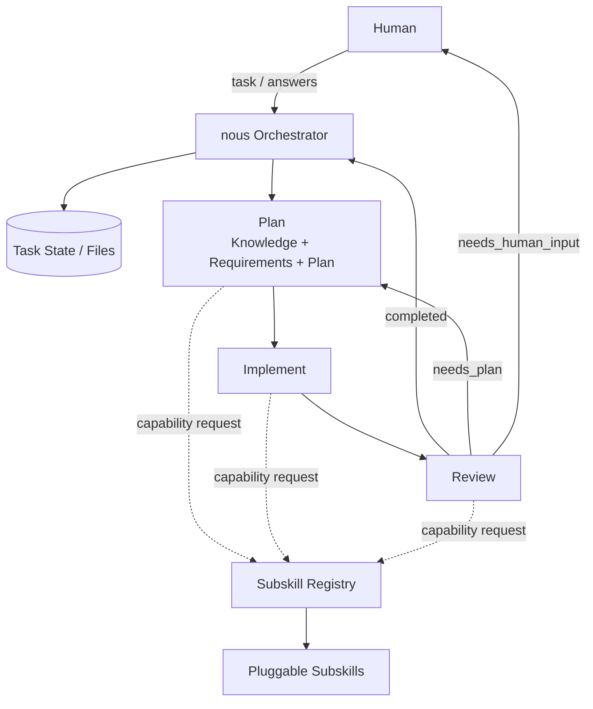

# nous

`nous` は、人間から与えられたタスクを `plan → implement → review` の3段階で進める支援エージェント構想です。

実装baselineを公開しています。現行のv1.0 required Evalは17/17 passしていますが、実運用への導入前には対象環境の権限、provider、ネットワーク、秘密情報の扱いを利用者自身の基準で確認してください。

## いま読むもの

まずは以下の順に読めば、現状が分かります。

1. [このREADME](./README.md)
2. [Design Index](./design/README.md)
3. [Distribution and Repository Hygiene](./design/distribution.md)

## 目的

nous が目指すこと:

- タスクごとに作業記録・判断・成果物を残す
- 最初は人間の指示からPlanを作る
- Planの初期段階で、インターネット、文献、論文、リポジトリ、既存コードなどから必要なKnowledgeを集める
- 不明点や高リスクな判断は人間に聞く
- 確認不要な修正は自動で `plan → implement → review` を回す
- Review後、未完了なら自律的にPlanへ戻れるようにする
- 各フェーズのコンテキストを分離し、誤った前提や古い情報の引き継ぎを減らす
- Plan / Implement / Review とサブスキルを疎結合にする
- サブスキルは一般論の羅列ではなく、特定の人名・概念・原則に根ざした「芯」を持つ

## 位置づけ

nous は「ただのCodex Skill」ではなく、**タスク実行システム**として設計します。

以下の組み合わせで実装します。

```txt
SKILL.md       = nousを呼び出す入口・実行プロトコル
tasks/         = nousの記憶・進捗・成果物
templates/     = タスク管理ファイルの型
subskills/     = Plan / Implement / Review の専門能力
scripts or CLI = deterministicな永続化・安全な実行境界
```

## 全体像



## 実装baselineの実行入口

```sh
agent-nous/bin/nous --config ~/.config/nous/config.json taskctl doctor
agent-nous/bin/nous --config ~/.config/nous/config.json --input request.json taskctl create
agent-nous/bin/nous --config ~/.config/nous/config.json taskctl list
```

Taskのcanonical JSON・journal・checkpointは手編集せず、`taskctl`経由で扱います。現行のlocal Evalは以下で実行できます（外部独立レビューを含むrelease gate全体のGOを意味しません）。

状態を変更するtaskctl commandは、`contract_version: 1`、`request_id`、`loop_id`（省略時は`root`）、`actor.type` / `actor.run_id` / `actor.actor_id`を含むJSON request envelopeを要求します。同じrequestの再送は保存済みresponseを返し、同じ`request_id`への異なるpayloadは拒否します。

適用前の確認には`--dry-run`を付けます。実行予定は一時コピー上で検証され、実際のNOUS_HOMEとrequest ledgerは変更されません。

```sh
agent-nous/.venv/bin/python -m agent_nous.eval.runner --release v1.0
```

自律実装エンジンは `taskctl engine-run` で起動します。通常は毎回長いrequest JSONを書く必要はありません。プロジェクトの`.nous/config.json`にPlan / Implement / Review Agentと検証コマンドを一度だけ設定し、Task IDだけを指定します。

### 人間向けの最小設定

1. `agent-nous/examples/nous.config.example.json`をプロジェクトの`.nous/config.json`へコピーします。
2. `engine.agents.plan` / `implement` / `review`を、自分のAgent commandへ変更します。文字列形式はshell経由ではなく安全なargvへ分解されます。
3. AgentがReviewで使う検証コマンドだけを`engine.validation.allowed_processes`へ追加します。これはshell commandではなく、`["/usr/bin/python3", "-m", "pytest"]`のようなargv prefixです。network、credential、paid、remote Gitをここで有効化する設定はありません。
4. 次の1コマンドで実行します。

```sh
agent-nous/bin/nous --config .nous/config.json \
  taskctl engine-run <task-id>
```

`--input`を省略した場合、CLIがrequest IDとlocal actorを自動生成します。`max_cycles`、`max_steps`、`lease_seconds`、`agent_timeout_seconds`も同じファイルで設定できます。 `resources`でphase concurrency/output/tool-call/wall-timeのportable budget、`durability.mode`でlocal/shared_fsの前提、`observability.trace_export_path`でsecret-free JSONL traceの出力先も同じ設定ファイルに指定できます。OS CPU/memory/network隔離、OTLP配送、実MCP HTTP接続、分散DBは別host/provider adapterの責務です。`subskills`で明示root、選択数、phaseごとのcapabilityを指定できます。デフォルトでは各Plan / Implement / Review phaseでSubskillを1つ選び、selection recordへpinします。同じcycle中は再利用し、Reviewが`needs_plan`を返した次cycleで再選定します。既存の明示的なrequest JSONを使う`engine-run`も引き続き利用できます。設定ファイルが見つからない、Agentが3つ揃っていない、allowlistが空または不正、といった場合は実行前に分かりやすく停止します。

設定ファイルの探索順は`--engine-config` → `.nous/config.json` → `nous.config.json` → `~/.config/nous/config.json`です。同じ設定ファイルの`nous_home`をTask stateの保存先にも使います。`--nous-home`または`NOUS_HOME`を指定した場合だけ、それが明示的な保存先overrideになります。

複数の独立視点でReviewしたい場合は、設定の`engine.review.mode`を`cross`にし、`reviewers`へ最大2件の`id`・`perspective`・`command`を追加します。各Reviewerは同じ成果物を見ますが、他Reviewerの結果は見ません。Engineが結果を1回だけ集約し、ReviewのReviewや追加承認段階は作りません。Secondaryが一時的に失敗した場合は、`fallback: "single"`なら成功したReviewerへ1回だけ縮退します。通常設定は単一Reviewerのままで、cross-reviewの設定例は[`examples/nous.cross-review.config.example.json`](./examples/nous.cross-review.config.example.json)にあります。

`.nous/config.json`は利用者ごとのローカル設定です。配布・Git管理する場合は`examples/nous.config.example.json`だけをテンプレートとして共有し、`.nous/`、`tasks/`、`requests/`などの実行時データはコミットしないでください。リポジトリ同梱の`.gitignore`でこれらを除外しています。公開文書の運用方針は[DOCS_POLICY](./DOCS_POLICY.md)を参照してください。

詳細は [Autonomous Loop Design](./design/autonomous-loop.md) を参照してください。

Plan Agentが独立作業を検出して`parallelization_plan`と`child_contracts`を返した場合は、同じ`engine-run`から物理Child workerの並列実行へ切り替わります。workerのPlan / Implement / Reviewは最大3つまで同時に起動し、最後にRoot Integration Reviewを実行します。`sequential` modeは保存済みPlanを優先して実効並列数1になります。fresh processでも保存済みparallel graphから再開し、lease heartbeat・failure retry・Integration Review failureをcanonicalに記録します。通常Planは従来どおり直列です。write Childはv1では自動worktreeを作らず、canonical worktree・reservation・managed commitが事前に揃わない限り親repositoryへ直接書き込まず、安全に停止します。

保証対象はmanaged executor / taskctlを通る操作だけです。network、credential、paid、remote Git pushは、現行baselineでは承認があっても`unsupported`として拒否します。

Recoveryでは`taskctl diagnose`でcanonical state / checkpoint / event / lease / reservationの要約を取得し、`taskctl repair-plan`で非破壊のreconciliation proposalを生成できます。推測による汎用修復は安全境界を越えるため、`taskctl repair-apply`は明示的に`unsupported_action`を返します。

## 標準タスク置き場の方針

タスク履歴は作業対象リポジトリを汚さないため、nous自身の管理領域に集約します。

```txt
${NOUS_HOME}/tasks/
```

実タスクの作成時にruntimeが`NOUS_HOME`を解決し、canonical fileを`taskctl`経由で作成します。

## 設計書

詳細設計は `design/` に分けています。

- [Design Index](./design/README.md)
- [Architecture Design](./design/architecture.md)
- [Autonomous Loop Design](./design/autonomous-loop.md)
- [Phase Handoff Design](./design/phase-handoff.md)
- [Subskill Registry Design](./design/subskill-architecture.md)
- [Subskill Catalog and Intake Policy](./design/subskill-catalog.md)
- [Parallel Loop Design](./design/parallel-loop.md)
- [Task State and Recovery Design](./design/task-state.md)
- [Knowledge Design](./design/knowledge.md)
- [Task Files Design](./design/task-files.md)
- [Human Input Policy](./design/human-input-policy.md)
- [Installable Skill Design](./design/installable-skill.md)
- [Task Template Design](./design/task-templates.md)
- [Task Operations Design](./design/task-operations.md)
- [Distribution and Repository Hygiene](./design/distribution.md)
- [taskctl Internal Utility Design](./design/taskctl.md)
- [Cross-design Contract Map](./design/contract-map.md)
- [Implementation Sequence Design](./design/implementation-sequence.md)
- [Phase Artifact Contract](./design/phase-artifacts.md)
- [Action Policy Design](./design/action-policy.md)
- [Policy Gateway Design](./design/policy-gateway.md)
- [Evaluation Design](./design/evaluation.md)
- [Capability Evaluation and NCS](./design/capability-evaluation.md)

公開版では、個別の作業メモ、レビュー記録、引き継ぎ状態は配布しません。
現在有効な仕様と配布上の境界は `design/` に置いています。
## Nous Loop

Nousの反復単位を **Nous Loop** と呼ぶ。1サイクルは次の順序で進む。

```text
Plan -> Implement -> Review -> Plan -> Implement -> Review -> ...
```

通常の `engine-run` は3フェーズすべてを外部サブエージェントで実行し、managed executorと検証証拠を親エンジンが管理する。設定例は `examples/nous.config.example.json` にある。

最低サイクル数を指定する場合は、設定ファイルまたは`engine-run`入力に`min_cycles`を指定する。たとえば`min_cycles: 3`なら、Reviewが早期に完了してもRootのPlan→Implement→Reviewを最低3サイクル実行する。既定値は1で、`min_cycles`は`max_cycles`以下でなければならない。`min_cycles > 1`では`max_steps`も最低`min_cycles * 3`が必要で、省略時は自動補完される。サイクルを増やすほどAgent呼び出し・検証時間・AI利用量も増えるため、必要な確認強度に合わせて設定する。

完了判定だけでなく、結果の `diagnostics` でフェーズ順序、外部サブエージェント呼び出し数、typed no-op、validation evidence不足を確認できる。

Capability evaluation smoke/full/holdout commands are documented in [Capability Evaluation and NCS](./design/capability-evaluation.md).

Capability evaluation smoke/full/holdout commands are documented in [Capability Evaluation and NCS](./design/capability-evaluation.md).

Capability evaluation smoke/full/holdout commands are documented in [Capability Evaluation and NCS](./design/capability-evaluation.md).

Capability evaluation smoke/full/holdout commands are documented in [Capability Evaluation and NCS](./design/capability-evaluation.md).

Capability evaluation smoke/full/holdout commands are documented in [Capability Evaluation and NCS](./design/capability-evaluation.md).

Capability evaluation smoke/full/holdout commands are documented in [Capability Evaluation and NCS](./design/capability-evaluation.md).

Capability evaluation smoke/full/holdout commands are documented in [Capability Evaluation and NCS](./design/capability-evaluation.md).

Capability evaluation smoke/full/holdout commands are documented in [Capability Evaluation and NCS](./design/capability-evaluation.md).

Capability release thresholds use `scripts/nous_capability_gate.py`; real EvalRunner captures enter through `eval capability-from-eval`, while holdout bundles remain external to the public repository.

## Open Web Research

公開Webの技術サイト、個人サイト、競合サイト、ニュース、GitHub、論文などをドメインで絞らず調査できます。`nous research`は専用の読み取り専用Adapterを使い、GET/HEAD、公開HTTPS、秘密情報なし、外部変更なし、ダウンロード実行なしで動きます。Web本文はuntrusted dataとして扱われ、取得元・時刻・status・redirect・hashをprovenanceとして返します。設定は`.nous/config.json`の`engine.research`です。詳細は[`design/web-research.md`](./design/web-research.md)を参照してください。

```sh
nous research search "競合サービス 技術ブログ"
nous research fetch --url https://example.com/article
```

### Provider-backed NCS evaluation

The deterministic NCS suite can ingest live provider results without trusting worker self-reports. A protected host adapter writes digest-bound EvalRunner captures and is invoked explicitly with `--allow-host-provider`; the public repository does not contain hidden prompts or answers.

```bash
nous eval capability-provider-validate --provider-config ./provider-eval.json
nous eval capability-provider-run --provider-config ./provider-eval.json --profile smoke --allow-host-provider
```
