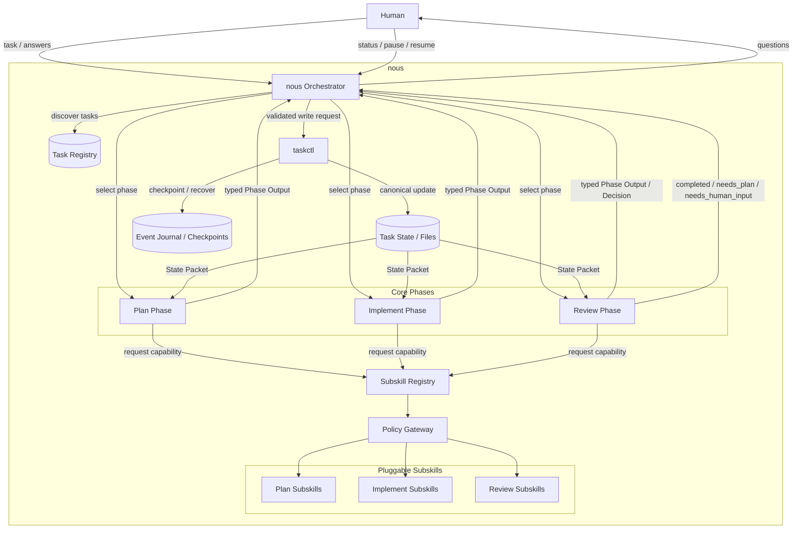
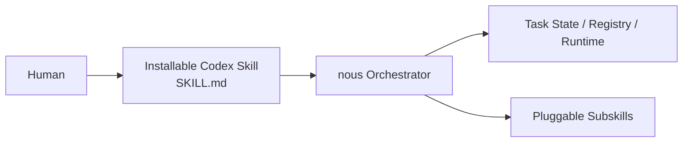
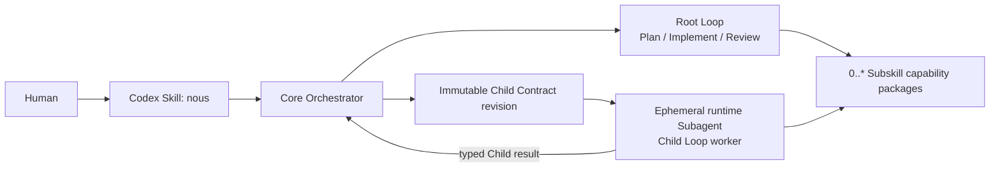
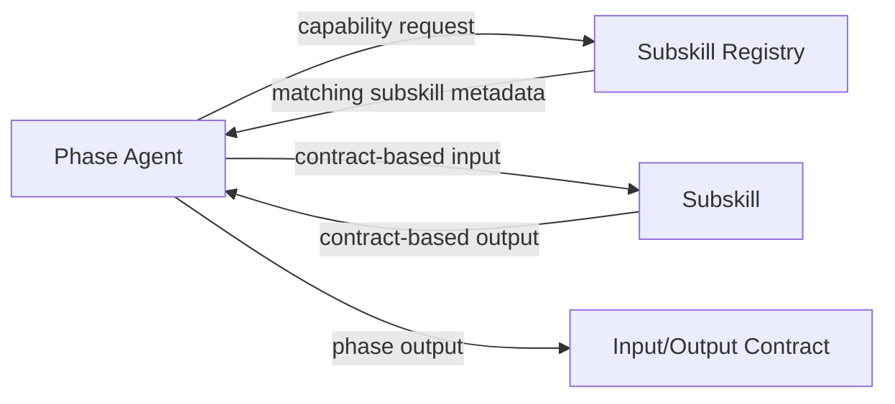

# nous Architecture Design

## 目的

nousの中身を、1つのユーザー向けCodex Skill、オーケストレーター、3つのCore Phase、Subskill capability package、タスク状態管理、runtime workerに分けて整理する。

重要な方針:

- Orchestratorと各工程を疎結合にする
- Plan / Implement / Review とサブスキルを疎結合にする
- サブスキルは容易に追加・修正・削除できるようにする
- 各工程は、サブスキルの具体実装を直接知らない
- 共有するのはファイルと契約だけにする
- Codex Skill、Subskill、runtime Subagentを別のidentityとして扱う

## 全体アーキテクチャ



## nous本体とCodex Skillの境界

初期のユーザー向けCodex Skillは`nous`の1つだけとする。Skill packageへ全実装を埋め込むのではなく、Humanの要求をnous Orchestratorへ接続する入口と実行プロトコルを担わせる。Plan / Implement / Reviewは`nous`内のCore Phaseであり、`nous-plan`、`nous-implement`、`nous-review`という別Codex Skillにはしない。



役割を次のように分ける。

| 領域 | 役割 |
| --- | --- |
| nousプロジェクト | 設計、Task Registry、タスク履歴、実行基盤、開発管理 |
| installable Codex Skill | trigger、入口、Orchestratorの基本実行手順 |
| Subskill | PhaseがCapabilityとして要求する交換可能な専門能力package |
| runtime Subagent | 1つのChild Loopを実行する一時的なworker backend |

installable Codex SkillはCodexの`skill-creator`に従って作成・検証する。Skill本体は簡潔に保ち、詳細な契約や必要時だけ読む知識は`references/`、決定的な処理は`scripts/`へ分離する。nousプロジェクト用のREADME、TODO、CHANGELOGをinstallable Skillへそのまま同梱しない。

installable Skillは明示呼び出しに加え、Humanが次を明確に要求した場合にimplicit invocationを許可する。

- 調査・Plan・Implement・Reviewを一連で管理する
- 自律loop、進捗永続化、pause / resumeを行う
- 並列Child LoopをOrchestratorに管理させる

単発の質問、局所的なfile修正、Planだけ、Reviewだけの依頼では、nousによるTask管理を暗黙に開始しない。

Skill identity、package構造、trigger metadata、runtime reference、validationの詳細は [Installable Skill Design](./installable-skill.md) で定義する。

## Skill / Subskill / Subagent runtime topology



不変のcardinalityは次のとおり。

- Codex Skillはユーザーが呼ぶworkflow identityであり、runtime worker identityではない
- runtime Subagentは永続的なSkillやTask Stateではなく、Child Loop Contractから必要時に起動する一時的backendである
- 1つのruntime Subagentは0個以上のSubskillを利用できる。Subskillを呼ぶたびに新しいSubagentを作らない
- 1つのSubskillは複数のRoot / Child workerから再利用でき、1つのprovider packageは複数CapabilityまたはSubskillを提供できる
- Subagentを利用できない場合もChild Loop Contractは維持し、同じOrchestratorがlogical sequential backendとして実行する
- persona、Phase名、今回のworker名だけを理由にCodex Skillを分割しない

Subskillの物理配置、provider discovery、version解決は [Subskill Registry Design](./subskill-architecture.md) を正とする。別Codex Skillへの昇格は、nous外からの直接利用、独立trigger、独立end-to-end workflow、固有permission / version / forward testが必要な場合に限る。

## 中核コンポーネント

### nous Orchestrator

責務:

- タスクの開始
- Human向けの単一操作窓口
- タスクの停止・再開・復旧
- フェーズ遷移
- 現在状態の確認
- 必要ファイルの読み書き指示
- Humanに質問するかの判断
- 並列化できるかの判断
- 子ループの起動・集約

Orchestratorは会話セッションを状態保存先として扱わない。Task Registry、Task State、Event Journal、CheckpointからRoot TaskとChild Loopを復元する。詳細は [Task State and Recovery Design](./task-state.md) で定義する。

Orchestratorはcanonical Task Filesを直接編集しない。Phase Agentからtyped Phase Outputを受け取り、Action PolicyとPolicy Gatewayの判定を経て、taskctlへ検証済みの更新要求を渡す。書き込み境界の詳細は [Phase Artifact Contract](./phase-artifacts.md) と [taskctl Internal Utility Design](./taskctl.md) で定義する。

Orchestratorが持つべきでない責務:

- 個別サブスキルの詳細ロジック
- コードレビューの具体観点
- 実装方式の細部
- Knowledge調査の専門手順

### Core Phases

Plan / Implement / Review は固定の工程として扱う。

ただし、各工程の内部能力はサブスキルで拡張する。

```txt
Plan Phase
  - タスク理解
  - Knowledge収集
  - 要件定義
  - 実行計画

Implement Phase
  - 実装
  - 変更記録
  - 検証

Review Phase
  - 受け入れ条件確認
  - 差分確認
  - 次状態判定
```

### Subskill Registry

サブスキルを直接import・固定参照せず、Registry経由で選ぶ。

Registryが管理する情報:

```txt
subskill_id:
name:
phase:
capabilities:
core_concepts:
inputs:
outputs:
activation_hints:
```

RegistryはPhase、Capability、Input / Output Contract、permission、side effect boundaryで候補を機械的に絞り、Phase AgentがTask contextに応じて最終選択する。詳細は [Subskill Registry Design](./subskill-architecture.md) で定義する。

Manifestは権限の宣言であり、実行時の強制手段ではない。Subskillやtoolの起動は [Policy Gateway Design](./policy-gateway.md) を通し、filesystem、tool、network、write scopeを実行時に検証する。

例:

```txt
subskill_id: review.code.connascence
name: Connascence Review
phase: review
capabilities:
  - coupling_review
  - change_impact_review
core_concepts:
  - Connascence
  - Coupling
  - Cohesion
activation_hints:
  - 複数モジュール変更
  - 変更影響範囲が広い
  - 暗黙的な依存がありそう
```

## 疎結合の境界



Phase Agentは、サブスキルの中身を知らない。

Phase Agentが知るのは以下だけ:

- どのcapabilityが必要か
- そのサブスキルに渡す入力契約
- そのサブスキルから返る出力契約

## Canonical Write Boundary

```txt
Phase Agent
  -> typed draft / Phase Output Envelope
  -> Orchestrator
  -> Action Policy / Policy Gateway
  -> taskctl
  -> canonical Task Files
  -> generated Markdown views
```

- Phase Agentは`state.json`、Event Journal、Checkpoint、Registry、canonical Phase Artifact、generated viewを直接更新しない
- Phase Agentが直接変更できるのは、明示されたdraft workspaceと許可済みtarget repository scopeだけとする
- OrchestratorはHuman intentとPhase結果を解釈するが、canonical fileのrecoverable multi-file transactionはtaskctlへ委譲する
- taskctlはSchema、revision、lock、idempotency、`transaction_id`、prepared → canonical replace → committedを検証し、意味上の判断を行わない
- generated Markdown、Registry、STATUSはcommit後に再生成できるview / cacheであり、canonical commitの成功条件に含めない
- Human向けMarkdownはtyped artifactから生成し、State遷移の入力として逆parseしない

## サブスキル追加・修正・削除の方針

### 追加

新しいSubskillは、Capability Catalog、versioned Manifest、解決可能なProvider identity / packageをRegistryへ追加し、validationに通ると候補に入る。Core PhaseやOrchestratorへSubskill固有分岐を追加しない。

Plan / Implement / Review の本体を変更しなくてもよい状態を目指す。

### 修正

サブスキルの内部ルールやcore conceptsは変更可能。

ただし、入力・出力契約を破壊する変更は避ける。

### 削除

サブスキルを削除しても、Core Phaseが壊れないようにする。

削除時の挙動:

- Registryから候補が消える
- 該当capabilityが不足する場合、Phase Agentは代替サブスキルを探す
- 代替がなければCapabilityのrequired / optional分類に従い、optionalだけをCore Phase標準処理へfallbackし、requiredはreplan / Human / blockedへ分類する

## OrchestratorとSubskillを強く結合しないためのルール

- Orchestratorは具体的なサブスキル名に依存しない
- Phase Agentは具体IDではなくcapabilityを要求する
- Phase Agentが必要に応じてサブスキルを選ぶ
- サブスキルはファイルシステム全体を勝手に読むのではなく、渡された入力を中心に動く
- サブスキルの出力は、次工程が読める構造にする
- file pathだけでなくschema、API contract、config、lockfile、external service、Git refをsemantic resource contractとして受け渡し、provider固有の表現へCoreを結合しない

## Provider・Validation・診断境界

Providerはtyped envelopeを返すだけで、Task Stateやcanonical artifactを直接編集しない。Provider failureは`ProviderDiagnostic`へ正規化し、phase / cycle / action、JSON path、actual type、redacted stderr、retryabilityをTask-local append-only diagnosticsへ保存する。raw outputやsecretは保存しない。

ValidationはActionごとのdisposable workspaceで実行する。snapshot前後のtree差分を取り、pytest cache・`__pycache__`・`.pyc`・指定ログのような明示的side effectとsource変更を分離する。target repositoryへ検証workspaceをコピーし戻すことは禁止する。詳細なpolicyとpostflight factsは [Validation Sandbox Design](./validation-sandbox.md) を正とする。

Reviewはfailureを`code_gap`、`test_gap`、`validation_environment_gap`、`provider_gap`、`schema_gap`、`documentation_gap`、`safety_gap`、`completed`、`human_required`に分類する。分類は`needs_plan`の理由を失わせないためのcanonical evidenceであり、環境エラーをコード不備へ暗黙変換しない。

Planは固定のファイル数上限ではなく、推定出力サイズ、依存関係、acceptance criteria、関連fileのatomic change setから複雑度を評価する。複雑すぎる場合だけ依存DAG付き分割を提案し、同じfileの反復変更や大規模全体置換を診断する。

## 結論

nousの安定部分は以下に限定する。

- Orchestrator
- Plan / Implement / Review の3工程
- Task State / Files
- typed Phase Artifactとcanonical write boundary
- Action Policy / Policy Gateway
- taskctlによる永続化境界
- Phase Handoff Contract
- Subskill Registry Contract

サブスキル自体は交換可能なプラグインとして扱う。
