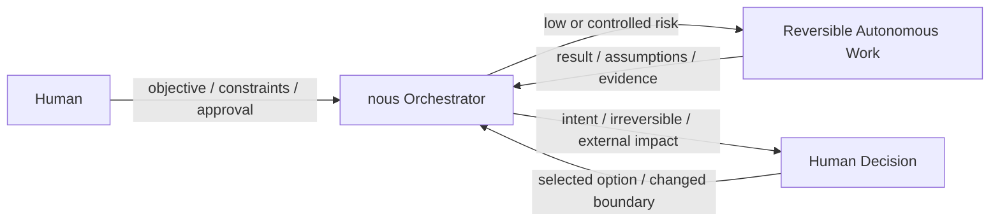
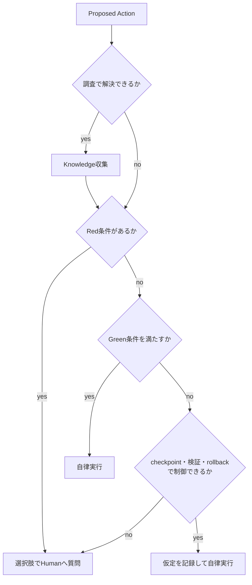
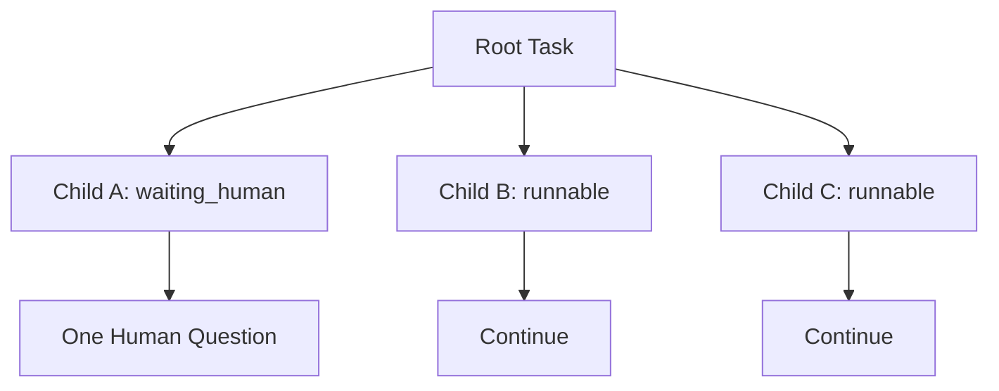

# Human Input Policy

## 目的

nousができるだけ自律的に進みながら、Humanが決めるべき判断を勝手に代行しないための境界を定義する。

- 戻せる低・中riskの作業では止まらない
- 要件、不可逆操作、外部影響、課金、機密情報に関わる判断はHumanへ戻す
- 調査すれば解決できる問題をHumanへ丸投げしない
- Humanへの質問を少なく、短く、選びやすくする
- 並列Child Loopの一部が回答待ちでも、独立した作業は継続する
- Actionごとのrisk、approval、probeを一貫した機械契約へ束縛する

基本姿勢は**バランス型**とする。判断軸には、Two-way Door / One-way Doorとして知られる可逆性の考え方、blast radius、uncertainty、authorization boundaryを用いる。

## Humanとnousの責任境界



Humanが決めるもの:

- 何を達成するか
- どの価値・優先順位を選ぶか
- 許容するrisk、cost、公開範囲
- 破壊的・不可逆・本番相当の操作を許可するか
- 複数の妥当な仕様案からどれを採用するか

nousが決めるもの:

- 承認済みObjectiveを達成するための局所的な実装方法
- repository規約に従うfile配置や命名
- 安全に戻せるrefactoringや修正
- 必要な調査、検証、Review方法
- Human判断を伴わない再PlanとChild Loop分割

## 判断モデル

OrchestratorはHumanへ質問する前に、次の7軸を評価する。

```txt
reversibility     元に戻せるか
blast_radius      影響範囲はどこまでか
data_sensitivity 機密情報・個人情報・credentialを扱うか
external_effect   本番、公開、外部通信、第三者へ影響するか
cost              課金や有料resource消費があるか
uncertainty       要件と結果を十分な根拠で予測できるか
authorization     Humanが明示した権限範囲内か
```

`authorization`は他の軸を無効化しない。権限があっても、予想外の重大riskを検出した場合は停止できる。

具体的な`action_type`、default risk、approval、preflight / postcheck、reconcile、audit要件は[Action Policy](./action-policy.md)を正とする。本書のGreen / Yellow / RedはHumanとの責任境界を説明し、Action Policy Matrixを上書きしない。

## Risk Class

### Green: 自律実行

次をすべて満たす作業。

- 元に戻せる
- task scope内である
- localまたは隔離された開発環境である
- secretや個人情報を新たに扱わない
- 外部公開や第三者への通知を行わない
- paid actionではない
- repository、test、公式情報から妥当な方針を決められる
- 検証方法がある

例:

- lint/type errorの局所修正
- 受け入れ条件を変えないrefactoring
- test追加
- documentationの整合修正
- local branch内のfile編集
- 公式docsやrepositoryの調査

### Yellow: 条件付き自律実行

次のような不確実性があるが、checkpointと検証によってriskを制御できる作業。

- 複数案があるが、repository内に明確な既存patternがある
- 中程度の変更範囲だが、commit単位でrollbackできる
- 仮定を置く必要があるが、受け入れ条件を変えない
- 失敗してもlocal環境と当該Child Loop内に限定できる

Yellowを自律実行する条件:

1. 仮定と根拠をPlanへ記録する
2. 作業前checkpointを保存する
3. 検証方法とrollback方法を持つ
4. 結果をReviewで明示的に確認する
5. 複数のYellow要因が重なり、実質的にRedになる場合はHumanへ戻す

repository由来scriptは名前だけでGreenにしない。`test` / `lint` / `build`は、初回またはscript定義・参照先変更後のinspectionに合格し、そのevidenceと定義hashが現在値に一致する場合だけGreenにできる。その他のscriptはYellowをdefaultとし、未知・検査不能・不審なnetwork、secret access、広いwrite / deleteを含む場合はRedまたはblockへ上げる。

### Red: Human確認必須

いずれかを満たす場合。

- Objective、Non-goals、Acceptance Criteriaを変更する
- UIやAPIの意味など、利用者向け仕様を複数の妥当案から選ぶ
- data削除、履歴改変、強制push、不可逆migrationを行う
- production deploy、公開、release、mergeなど外部状態を変える
- email、chat、issue、PR commentなどをHuman名義で外部送信する
- 新規課金、購入、契約、resource作成、有料API利用を行う
- credential、private key、secretを通常payloadとして永続化または外部送信しようとする。この操作はHuman approvalでも解除せずblockする
- repository / Task固有policyが、個人情報または機密dataの送信をRedに分類している
- 権限昇格、認証・認可policyの弱体化、security controlの無効化を行う
- 法務、契約、規制、雇用、医療、財務上の判断を行う
- Humanの指示が互いに矛盾する
- 副作用が完了したか分からず、再実行が危険である
- 根拠不足のまま高いblast radiusを持つ変更を選ぶ
- 自律ループの停止条件へ到達する

paid actionは承認後もrisk分類をRedのまま維持する。初期契約ではUsage Ledgerや累積cost追跡を持たず、provider、operation、最大請求影響または1回当たりの上限、最大回数へ束縛したapprovalでgateする。

## 判断フロー



## Humanへ質問する前の確認

Orchestratorは次を順に確認する。

1. `task-definition.json`のObjective、Constraints、Human Action Boundaries
2. `stable-context.json`の確定済み要求、Human質問・回答、active decisions
3. Active KnowledgeとSource
4. 対象repositoryのcode、test、config、設計書、履歴
5. 公式docs、標準、原論文、upstream repository
6. 既存のpre-approval
7. checkpoint、rollback、検証でriskをGreenまたはYellowへ下げられるか

これで解決できる場合は質問しない。「念のため」だけの確認を繰り返さない。

## 推論で進めてよい条件

Human未確認の仮定で進める場合は、次をすべて満たす。

- ObjectiveとAcceptance Criteriaを変えない
- Humanにしか分からない価値判断ではない
- repositoryまたはPrimary Sourceに優勢なpatternがある
- 仮定が誤っていても局所的にrollbackできる
- 検証によって誤りを検出できる
- Plan、Event、Implement Reportへ仮定を記録する
- Reviewが仮定の妥当性を確認する

推論結果をHumanの決定として`stable-context.json`へ記録しない。`summary.md`はStable Contextから生成するviewである。

## Humanへの質問契約

質問は会話上で選択肢として提示する。設計書を読まなければ回答できない形式にしない。

`HumanQuestion`の唯一のmachine shapeは`common.schema.json#/$defs/HumanQuestion`である。Phase Artifact、Stable Context、taskctl requestは別shapeを定義せず、次のfield名をそのまま使う。

```txt
question_id
question
why_now
blocking_scope          action | loop | phase | root_task
blocked_refs[]
options[]               option_id, label, impact
recommended_option_id
free_text_allowed
affected_loop_ids[]
resume_target
approval_request_ref    Approval requestの場合だけ。Action Policyのrecordへのref
```

`recommended_option_id`は`options[].option_id`に解決する。`options[]`が空なら`free_text_allowed: true`を必須とする。`approval_request_ref`は参照だけであり、Approvalのcanonical fieldを本書で再定義しない。

`resume_target`も`common.schema.json`の共通型とし、質問が停止させた対象へだけ戻す。

```txt
blocked_action_ref      action scopeの場合に必須
blocked_artifact_ref    artifact確定待ちの場合に必須
resume_phase
resume_transition
```

`resume_phase`は回答前のphaseまたは明示されたPlanを指す。`resume_transition`はState Machineに存在する遷移IDでなければならず、自由なphase jumpを許可しない。

表示規則:

- 独立して回答できる質問は1回にまとめる
- 前の回答で後続の選択肢が変わる場合は、質問を順序立てて分ける
- 固定の最大質問数を設けず、各質問を短く保つ
- 相互に重ならない2〜3案を提示する
- 推奨案を先頭に置き、`推奨`と表示する
- 各案の影響またはtrade-offを1文で説明する
- 自由入力を許可する
- 判断に必要な背景だけを短く説明する
- 詳細Markdownは任意の参照先にする
- 何も選ばなかった場合の暗黙defaultを設定しない

例:

```txt
質問: production migrationを実行しますか？

A. migration作成とlocal検証まで（推奨）
   外部状態を変えずに準備と検証を完了します。

B. productionへ適用
   production DBを変更するため、backupと実行時刻の確認が必要です。

C. 今回は中止
   migration作業を停止します。
```

自由記述しか成立しない質問でも、可能なら「現状維持」「作業停止」など安全な選択肢を添える。

## 質問のBlocking Scope

質問はRoot Task全体を無条件に停止しない。

```txt
action     特定Actionだけ停止
loop       当該Child Loopを停止
phase      当該Phaseを停止
root_task  Root Task全体を停止
```



依存しないChild Loopは継続する。複数Child Loopが同じ判断を必要とする場合は、Parent Orchestratorが質問を1つに統合する。

Root Taskを`waiting_human`にするのは、実行可能な独立作業が残っていない場合だけとする。

## Human回答の保存

`HumanAnswer`の唯一のmachine shapeは`common.schema.json#/$defs/HumanAnswer`である。

```txt
answer_id
question_id
answer_type             selected_option | free_text
selected_option_id      selected_option時に必須
answer_text             free_text時に必須
answered_by
answered_at
applied_scope
answer_effect           resume | replan | cancel | remain_blocked
resume_target
```

Answerの`resume_target`は対応Questionの値と完全一致しなければならない。別phase、別Action、別Loopへ回答を流用する場合は新しいQuestionを作る。`selected_option_id`はQuestionのoptionへ解決し、`free_text_allowed: false`のQuestionへ自由入力回答を適用しない。

回答は会話履歴だけに残さない。

- `human_input_requested` eventへQuestion IDと選択肢を記録する
- Question / Answer本体をimmutableな`human-input/questions/{question_id}.json` / `human-input/answers/{answer_id}.json`へcanonicalに保存し、Stable Contextにはrefを保存する
- `state.json.pending_human_questions`にはblocking中Questionへのrefだけを置く
- 回答後に`human_input_received` eventを記録する
- Objective、Requirement、Decisionに影響する回答はimmutableな`task-definition.json`を上書きせず、`stable-context.json`のtyped amendment / decisionへprovenance付きで適用し、`task.md`と`summary.md`を再生成する
- 対応するQuestion ID、回答者、回答時点、適用scopeを残す
- Human原文を含む全保存候補を永続化前のSecret Gateへ通す
- secretを含む回答は本文、値のhash、可逆表現を保存せず、安全なprovider参照またはredaction summaryだけを使う

回答が選択肢と異なる自由入力の場合、Orchestratorは意図を解釈して適用scopeを示す。重大な解釈差があり得る場合だけ再質問する。

`record-human-answer`はQuestion、Answer、pending ref、State、Event、Checkpointを同じ`transaction_id`のrecoverable multi-file transactionで確定する。`answer_effect = resume`でもblocking reasonまたはpolicy gateが残る場合は遷移を拒否する。`replan`はReview Decision `needs_plan`の経路、`cancel`は対象Actionの中止経路を使い、独自にcycleを増やさない。

## Pre-approval

Humanは将来の個別確認を減らすため、Task単位で事前承認を与えられる。

Approval recordのfield、scope、matching、consume、lifecycleのcanonical authorityは[Action Policy](action-policy.md)とする。Human Input Policyは承認を依頼・回答・撤回するinteractionとHumanへ戻す条件を定め、別のApproval schemaを追加しない。

例:

- 「このTaskではlocal test実行を許可する」
- 「CI成功後のPR作成まで許可するが、mergeは含めない」
- 「このproviderの有料API操作を、1回当たりの最大請求影響を示した上で2回まで許可する」

Human interactionとしてのPre-approval規則:

- scope外へ拡張解釈しない
- 別Taskへ自動継承しない
- `exact_action`と`bounded_standing`の適用条件はAction Policyに従い、Humanへは対象、効果、有効範囲、除外事項を選択肢とともに示す
- 反復許可は明示的なHuman回答を必要とし、広い自然言語を`bounded_standing`へ暗黙変換しない
- Humanはいつでも撤回できる
- 新たに判明したsecurity riskを無視する根拠にはしない
- production、公開、課金などは、具体的に含まれる場合だけ承認済みとする
- Usage Ledgerや累積cost追跡は行わない。paid actionはAction Policyが定める請求影響境界と回数へ束縛した承認をHumanへ求める

Action開始時のmachine-readable照合とconsumeはAction Policyおよびtaskctlが担う。Human Input Policyは会話上の回答をその照合条件より広く解釈しない。

Approval Event名は次に固定する。

```txt
approval_requested
approval_granted
approval_denied
approval_revoked
approval_expired
approval_consumed
```

- 拒否時は`approval_denied`を記録し、active approvalを作らない
- 撤回後は`approval_revoked`を記録し、新しいActionへ使わない
- `expires_at`到達時点で承認は無効とし、次のtaskctl operationで`approval_expired`を一度だけ記録する
- `max_count`到達後は`exhausted`とし、新しいActionへ使わない
- revoke / expire前に開始済みのActionは実状態をreconcileし、新しいretryには新承認を要求する

## SecretとOutbound

Task request、Human回答、Action proposal、Event、probe evidence、generated view、commit、push、outbound requestは、永続化または送信前にSecret Gateを通す。高信頼secretはblockし、不確実なsecret-like値は安全に意味を保てる場合だけredactする。redaction summaryには種類、場所class、件数、detectorだけを残し、元の値や値のhashを残さない。

共通outbound ruleではsecretを通常payloadとして外部送信することを禁止する。repository-specific policyまたはtask-specific policyがprivate context、個人情報、顧客情報、endpointをさらに厳しく制限する場合は、そのpolicyを優先する。stricter policyがない非secret情報はAction Policy Matrixのriskとapprovalに従う。Human approvalはsecret outboundのhard blockを解除しない。

Secret detectorのfalse positiveをHumanが確認した場合だけ、[Task Files Design](task-files.md)が定める`secret-exceptions.json` recordを作成できる。本書はfieldを再定義しない。元の値と値hashは保存せず、private key、既知provider token等のhigh-confidence hard blockはexception不可とする。Approval recordへSecret exception fieldを追加しない。

## Retryと自律ループ停止条件

同じ失敗を繰り返してHuman確認を遅らせない。

### 自律で再試行できるもの

- 原因が一時的と判断できる
- retryがidempotentである
- costと外部影響が承認範囲内である
- retry前に実状態を確認できる

### Humanへ戻す条件

- 同じfailure categoryが2回連続した
- Reviewが3cycle連続で`needs_plan`を返した
- 調査を追加しても重要な根拠が増えない
- Planが繰り返し大きく変わり、Task境界が安定しない
- 副作用の状態を安全にreconcileできない
- retryによりcost、rate limit、data lossのriskが増える

回数に達するまで無条件にretryするのではなく、1回目でもRed条件を満たせば即座にHumanへ戻す。

## Pause・Resume時

通常の中断やLease切れだけを理由に質問しない。Task State、Checkpoint、Event Journal、実環境をreconcileして安全に再開できる場合は自律再開する。

Human確認が必要な例:

- 途中Actionの副作用が完了したか判定できない
- Humanまたは別processによる未記録変更がある
- branch、worktree、外部resourceがcheckpointと異なる
- 再開時点でapprovalが失効している
- 再開時点でapprovalが撤回・消費済みである、または`exact_action`のaction digest / targetが変わっている
- 中断中に高変動Knowledgeがstaleになった

## 回答がない場合

- blocking対象を`waiting_human`にする
- 回答を推測してRed Actionを進めない
- 独立したGreen / Yellow Actionは継続する
- 同じ質問を表現だけ変えて繰り返さない
- 状況が変わった場合だけ、更新点を添えて再提示する
- Humanの回答期限をnousが勝手に設定しない

## Phase blockedの扱い

Plan / Implement / ReviewがHuman回答待ちではない外部blockerで進めない場合、`handoff_status: blocked`、1件以上の`blocking_reasons[]`、lifecycle `blocked`を記録し、現在phaseとcycleを維持する。Review blocked時はReview Decisionを生成しない。

- `blocking_reasons[]`にはreason ID、category、要約、blocked ref、解消条件、ownerを持たせる
- Human判断が解消条件ならHumanQuestionを作り、`resume_target`をblockerへ束縛する
- Policy Gatewayの`interrupt_for_approval`はApproval requestとQuestionを保存し、影響scopeだけを`waiting_human`にする
- `deny`はAction failure / policy evidenceを保存し、続行不能な場合だけphaseを維持したまま`blocked`にする
- `replan_required`はReview Decision `needs_plan`を経由し、独自にcycleを増やさない
- blocker解消時は`task_unblocked`相当のState Machine operationとevidenceを必要とし、回答があるだけで自動解除しない

## Reviewの確認項目

ReviewはHuman Input Policyについて次を確認する。

- Red Actionが承認なしで行われていないか
- Yellow Actionの仮定、checkpoint、検証、rollbackが記録されているか
- Pre-approvalのscopeと期限を超えていないか
- approvalのgrant / deny / revoke / expire / consumeが正しいEventとcanonical recordへ反映されているか
- Human回答が正しいTaskとLoopへ適用されているか
- Action Eventにpolicy decisionとbefore / after evidenceがあるか
- 永続化・outbound前のSecret Gateと、repository / Task固有のstricter policyが適用されたか
- 必要以上にHumanへ質問して自律性を下げていないか
- Humanの選択をAgentの推論で書き換えていないか

## 不変条件

- 調査で解決できることをHumanへ丸投げしない
- Objective、Acceptance Criteria、価値判断を勝手に変更しない
- Red Actionは明示的なHuman承認なしに実行しない
- Green Actionは不要な確認で止めない
- Yellow Actionは仮定、checkpoint、検証、rollbackを持つ
- Humanへの質問は選択肢、推奨案、短い影響説明を持つ
- 質問による停止範囲を最小化する
- Human回答とPre-approvalを永続化する
- 回答がないことを承認として扱わない
- paid actionはUsage Ledgerなしでもapproval-gatedとする
- secretを永続化または通常outbound payloadへ送信しない
