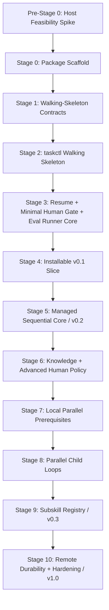

# Implementation Sequence Design

## 目的

nousを一度に全面実装せず、依存物を利用側より先に用意し、各段階で実行可能・検証可能なvertical sliceを閉じる。完成点は単一の最終gateではなく、`v0.1`、`v0.2`、`v0.3`、`v1.0`の段階releaseとする。

本書はruntime file、Skill scaffold、Eval Runner、Host spikeを安全な依存順で構築する実装順を定義する。

## Release Milestones

| Release | 利用可能な完成点 | 対応Stage |
| --- | --- | --- |
| `v0.1` | Root Task create / list / show / status、pause、fresh-process resume、explicit trigger | Stage 0〜4 |
| `v0.2` | managed Executor経由のSequential Plan → Implement → Review completion、Minimal Human Gate、小変更E2E | Stage 5 |
| `v0.3` | Knowledge、Parallel Child Loop、Subskill Registryを含むlocal managed workflow | Stage 6〜9 |
| `v1.0` | remote durability、保証対象surfaceのfull Policy enforcement、full forward eval、hardening | Stage 10 |

後続releaseの機能を早いreleaseのgateへ混ぜない。Manifestへのcase登録と、そのcaseを実際にrunしてreleaseをblockする時点は分離する。

## Dependency Graph



## Pre-Stage 0: Host Feasibility Spike

### Entry Policy

Spikeの開始はHumanの明示承認、対象host、許可surface、禁止する外部effectを束縛したscopeを必要とする。Stage 0はSpikeのExit GateとHuman確認を通過するまで開始しない。

### 目的

[Policy Gateway](policy-gateway.md)の保証を「専用Executor / adapter経由で開始したmanaged action」に限定したうえで、利用予定host上の実強制可能性を確認する。

### Deliverables

- host sandboxをouter trust boundaryとして記述したcapability matrix
- filesystem、process、tool、network、credential、external effectごとの`brokerable / observable / stoppable`判定
- dedicated Executor / adapterの最小prototypeとbefore/after evidence
- built-in toolを含むunbrokerable actionの`unsupported` / `deny`一覧
- sequential fallbackが直接built-in actionへ迂回しないことの確認
- Stage 5までに利用可能なmanaged adapterと、Stage 10まで延期するsurfaceの決定

### Conceptual verification

```txt
host-feasibility validate <capability-matrix>
host-feasibility probe --surface filesystem|process|tool|network|credential
host-feasibility report
```

Spike runnerは上記のartifact / command roleを提供し、結果を再検証可能なevidenceとして保存する。

### Exit Gate

- 少なくともisolated fixture repositoryへの限定read/writeと、fixture test processをbrokerできる
- scope外writeまたは未許可processをruntimeで拒否できる
- brokerできないActionをprompt fallbackせずdenyできる
- Stage 5のsmall-change E2Eで使う全Actionが保証対象adapterへ割り当てられる

満たせない場合はStage 0へ進まず、専用runnerを別deliverableにするか、release scopeを縮小する。

## Stage 0: Package Scaffold

Pre-Stage 0 gate通過後に`skill-creator`を使い、installable Skill sourceを生成する。

```txt
agent-nous/skill/nous/
```

含めるもの:

- required `SKILL.md`
- `agents/openai.yaml`
- 実際に必要な`references/`、`scripts/`、`assets/`
- project venvを解決するlauncherとpackage/runtime path分離

含めないもの:

- project管理用文書
- sample Task history
- secret、credential
- placeholder resource

Gate:

- `quick_validate.py`
- Skill identity `$nous`
- package pathと`${NOUS_HOME}`の分離
- host固有absolute pathがpackageへ入らない

## Stage 1: Walking-Skeleton Contract Assets

最初のruntimeに必要なcontractだけを実装する。Parallel、Subskill、remote operationの将来contractは設計fixtureとして登録してよいが、このStageのruntime実装条件にはしない。

対象:

- common、minimal Root Task、State、Event、Checkpoint、Registry、Response Envelope Schema
- minimal Human Question / Answerと`resume_target` contract
- Eval Manifest / Eval Outcomeのbase contract
- explicit trigger、create / status / pause / resume fixture
- generated view contract fixture
- ActionDescriptorとmanaged Executor request / grant fixture

Gate:

- Schema `$ref`のlocal解決
- minimal valid / invalid fixture
- unresolved placeholder、unknown field、invalid path / revisionの拒否
- Eval Manifest全caseの静的登録検証
- 後続caseに`runnable_from_stage`があり、Stage 4で誤実行されない

## Stage 2: taskctl Walking Skeleton

対象subcommand:

```txt
doctor
init-home
create
list
show
validate
render
rebuild-registry
```

Acceptance Criteria:

- Minimal Root Taskをsingle writer + same-file atomic replaceでcreateできる
- revision CASとlockでconcurrent updateを拒否する
- StateとEventをSchema validationできる
- RegistryとSTATUSをTask directoryから再構築できる
- Human inputをTemplate directiveとして実行しない
- stdoutがResponse Envelopeだけになる
- invalid pathとrevisionを拒否する

Non-goals:

- Plan / Implement / Review
- approval lifecycleとexternal effect
- Parallel、Subskill、remote Git

## Stage 3: Pause / Recovery、Minimal Human Gate、Eval Runner Core

Stage 4と5で利用する依存物を先に実装する。

対象subcommand / capability:

```txt
transition
append-event
checkpoint
lease acquire / renew / release
pause
interrupt
resume-prepare
question record / answer
diagnose
```

Minimal Human Gate:

- question record / answer
- 2〜3選択肢と自由入力
- `resume_target`
- Task全体の単純なwaiting / resume
- approvalなしRed / paid Actionの拒否

Child単位blocking、独立質問batching、複雑なapproval lifecycleはStage 6以降へ残す。

Eval Runner artifact:

```txt
src/agent_nous/eval/
  cli.py
  manifest.py
  environment.py
  codex_adapter.py
  graders/
  trace.py
  cleanup.py
```

Commands:

```txt
bin/nous eval validate-manifest
bin/nous eval list --stage <N> | --release <version>
bin/nous eval run --stage <N> | --release <version> [--eval-id <id>]
bin/nous eval report --run <run-id>
bin/nous eval cleanup --run <run-id>
```

Acceptance Criteria:

- pause後に別processでdurable State / Checkpoint / Journalからresumeできる
- stale Leaseとrevision conflictを安全に拒否する
- generated viewが遅れても再生成できる
- Minimal Human Questionの回答から`resume_target`を機械的に解決できる
- Eval Runnerがisolated `${NOUS_HOME}`とfixture repositoryを割り当て、deterministic grader、evidence retain、cleanupを実行できる
- Manifest登録済みでも`runnable_from_stage`未到達のcaseはskip理由を報告し、pass扱いしない

## Stage 4: Installable v0.1 Vertical Slice

SKILL.mdとruntime referenceを接続し、最初の小さな利用可能releaseを閉じる。

対象:

- explicit trigger
- new / list / show / status / pause / resume intent
- `${NOUS_HOME}` resolution
- taskctl JSON invocation
- one-off requestのnegative trigger判定

`v0.1` Gate:

1. `$nous`でRoot Taskを作成・表示できる
2. safe pause後、conversation終了を挟んだfresh processからresumeできる
3. one-off依頼ではimplicit managed Taskを作らない
4. canonical Task Filesをtaskctl以外から更新しない
5. package内にhost固有absolute pathを持たない
6. Stage 4 runnable evalだけをisolated runnerで実行して通す
7. approval、`needs_plan`、Sequential E2EはManifestへ登録済みでも未実行であり、v0.1 gateに含めない

Stage 4ではPhase completion、Review Decision、external effect、Parallelを要求しない。

## Stage 5: Managed Sequential Core Loop — v0.2

Sequential Phaseが必要とするpersistenceとmanaged action経路を同じStage内で順序付けて実装する。

### 5A. Sequential dependencies

- Plan / Implement / Review typed artifact
- Draft Phase Output Envelope
- `record-phase-output`によるrecoverable multi-file transaction
- Review Decisionと`completed / needs_plan / needs_human_input`
- Action lifecycle: start / complete / fail / reconcile
- Action Policy評価、exact Approval照合、Secret Gate
- Pre-Stage 0で実証済みのfilesystem / process Executor adapters
- Execution Request / Grant / Action Eventで同じ`action_id` / `action_digest`
- unsupported built-in / unbrokerable Actionのdeny

### 5B. Sequential runtime

- Plan Phase
- Implement Phase
- Review Phase
- Phase Handoff
- Review `needs_plan`によるcycle increment
- Review `completed`によるTask完了
- Minimal Human Gateによる`needs_human_input`

### `v0.2` small-change sequential E2E gate

```txt
$nous explicit invocation
→ isolated fixture repositoryで1ファイルの小変更をPlan
→ Plan Resultをrecord-phase-outputでcanonical保存
→ granted write scope内でmanaged filesystem adapterからImplement
→ managed process adapterからfixture testを実行して成功
→ Implement ResultとReview Resultをcanonical保存
→ Review completed
→ process終了
→ fresh processからcompleted statusとartifact / event / diffを確認
```

追加runnable case:

- Review `needs_plan`を1回通ってからcompletionする
- Implement途中のdeclared interruptからfresh-process resumeする
- Red / paid Actionをapprovalなしで開始しない
- scope外write、未許可process、unbrokerable actionをdenyし、結果を採用しない

Acceptance Criteria:

- 各Phaseが別State Packetから開始する
- past Planをcurrent Knowledgeとして読まない
- Reviewが次状態を必ず1つ返す
- 自律loop停止条件が働く
- sequential E2Eの全Actionがdedicated Executor / adapter経由であり、prompt-only safetyへfallbackしない

## Stage 6: Knowledge and Advanced Human Policy

対象:

- Knowledge Question、Source Registry、Claim lifecycle、Knowledge Gate
- Green / Yellow / Redとpre-approval lifecycle
- independent question batching
- Child / DAGを見越したblocking scope
- pending approval、reconcile outcome、Secret exceptionのcanonical store連携

Acceptance Criteria:

- ClaimからSourceへ追跡できる
- stale / superseded Claimをcurrent factとして使わない
- Red / paid Actionをcanonical Approvalなしで実行しない
- independent questionをまとめ、dependent questionを順序分割する
- Human回答からblocked action / artifactとresume targetを機械的に解決する

## Stage 7: Local Parallel Prerequisites

Parallel gateより先に、Stage 8が依存するlocal Git adapterとscheduler persistenceを実装する。このStageではChildを並列実行しない。

対象:

- managed local Git adapter: status / diff / worktree / branch / commit / patch
- shared ActionDescriptor、Gateway、Executor経由のlocal Git operation
- Parallel Plan / Child Contract / Resource / Reservation contract
- Child Contract immutable revision history
- semantic resource conflict判定
- scheduler用taskctl operations

```txt
record-parallel-plan
create-child-loop
reservation-request
reservation-acquire
reservation-release
record-child-result
record-integration-review
```

Gate:

- local Git adapterがscope外path、unexpected ref、unrelated diffを拒否する
- scheduler stateをfresh processから再構築できる
- file、schema、API contract、config、lockfile、external service、Git refをtyped resourceとして扱える
- 曖昧なlocator / semantic scopeを並列可能と判定しない

remote push、cross-machine durabilityはStage 10のnon-goalである。

## Stage 8: Parallel Child Loops

対象:

- Dependency DAG
- independent Child Agent
- 同じExecutor経路を使うlogical sequential fallback
- concurrent write用Git worktree
- resource reservation
- Integration Review

Acceptance Criteria:

- Child contextを分離する
- independent backendがなくても同じcontractを直列実行できるが、built-in actionへ迂回しない
- ChildがRoot共有fileを直接更新しない
- ReservationをExecution Grantの`action_id` / `action_digest`とscopeへ束縛する
- Human waitをDAG下流だけへ伝播する
- Child完了をRoot完了と誤認しない
- integration conflictをmechanical / replan / Humanへ分類する
- parallel isolation / interrupt / resume evalを通す

## Stage 9: Subskill Registry — v0.3

対象:

- Capability Catalog、Manifest Schema、provider identity / resolver
- hard constraint filter、deterministic score
- Phase Agent selectionとSelection Record
- Primary / Advisor / Validator composition
- version / hash pinning、fallback
- Policy Gateway / Executor integration

Acceptance Criteria:

- Core Phaseが具体Subskill IDへ依存しない
- incompatible providerをfilterする
- required safety Capability欠落時はfail closedする
- Manifestを権限として信頼せず、provider actionをmanaged Executor経由にする
- provider削除でCore runtimeがcrashしない

`v0.3` Gate:

- Stage 6 Knowledge gate、Stage 8 Parallel E2E、Stage 9 Subskill selection / fallback evalを通す
- local-onlyのpause / resume / integration evidenceをfresh processから確認できる
- sequential E2Eを継続して通し、Parallel追加による退行がない

## Stage 10: Remote Durability、Full Enforcement、Hardening — v1.0

対象:

- validated commit plan、Task scope staging
- normal push、sync status、archive / retention、cross-machine resume
- Stage 0 capability matrixでv1.0対象とした全managed surfaceのExecutor / broker
- fault injection、concurrency、remote divergence、Schema migration
- long-running pause / resume、missing tool / Subskill fallback
- full forward trigger / policy / isolation eval

`v1.0` Release Gate:

- `quick_validate.py`成功
- taskctl unit / integration / security test成功
- representative fault / concurrency / remote divergence injection成功
- explicit / implicit / negative trigger成功
- resume / approval / needs_plan / isolation / parallel / subskill / remote eval成功
- 保証対象のundeclared tool、filesystem、network、write、external effectがruntimeで拒否される
- unbrokerable actionがunsupported / denyとなり、prompt-only safety claimがない
- no real secret / production external effect fixture
- package、runtime、policy、provider version / hash記録
- cleanupでunintegrated artifactと最初のfailure evidenceを失わない

## Eval Registration versus Runnable Gates

- Stage 1でpositive、negative、resume、approval、needs_plan、isolation、sequential E2E、parallel、subskill、remote caseをManifestへ**登録**する
- `runnable_from_stage`到達前のcaseは登録検証だけ行い、release passの分母に入れない
- 各Stage gateはそのStageまでにrunnableとなったcaseだけを必須実行する
- caseをskipした場合は理由をreportし、runnable caseのskipをpassと扱わない
- 詳細なcase割当とRunner contractは[Evaluation Design](evaluation.md)をauthorityとする

## Implementation Branching

- nous本体の実装はControl Repositoryのfeature branchで行う
- Parallel implementationはcontractを先に固定してworktreeへ分ける
- Shared Schema / Templateは単一ownerが変更する
- Child branchはIntegration Review前にRootへmergeしない
- durable design / implementation milestoneは通常commitし、personal remoteへpushできる

## Contract Test Layers

```txt
L1 Static
  Skill / Schema / Template / Subskill Manifest / Eval Manifest format

L2 Unit
  ID / State / Lock / Transaction / Renderer / ActionDescriptor

L3 Integration
  Task lifecycle / Cycle / Pause / Resume / Registry / Policy Gateway / Executor

L4 Fault
  Crash point / corrupt tail / stale Lease / revision conflict / reconcile

L5 Agent Workflow
  Plan / Implement / Review / Human / Parallel / Subskill / needs_plan

L6 Forward Trigger
  Explicit / implicit / negative / resume / approval / isolation / E2E
```

上位layerの失敗を下位layerのretryで隠さない。

## 不変条件

- Pre-Stage 0 Host Feasibility SpikeはHuman承認付きentry gateであり、Stage 0開始前に合格・確認する
- Host sandboxをouter trust boundaryとし、nousの保証をdedicated Executor / adapter経由のmanaged actionに限定する
- unbrokerable actionをpromptで許可せずunsupported / denyとする
- 最初のruntime contractとwalking skeletonを、将来contractの全面実装より先に完成させる
- Minimal Human GateをSequential Coreより先に実装する
- Eval Runnerを最初のrunnable release gateより先に実装する
- Eval登録とrunnable gateを分離する
- Sequential Coreの`v0.2` gateで実repository small-change E2Eを通す
- local Git adapterとscheduler persistenceをParallel Child Loopより先に実装する
- ParallelとSubskillをSequential Core Loopより先に実装しない
- 各releaseを独立したAcceptance Criteriaとexit evidenceで閉じる
