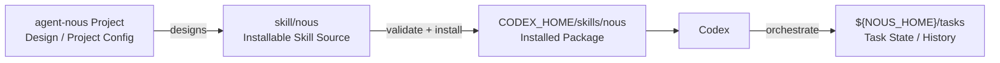
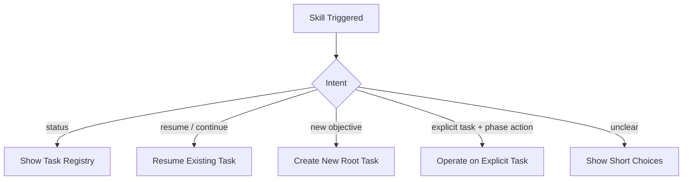

# Installable Skill Design

## 目的

nousのOrchestratorをCodexから起動するためのinstallable Skill packageを定義する。

- `$nous`による明示呼び出しを提供する
- 管理されたend-to-end workflowを明確に求める依頼ではimplicit invocationを許可する
- 単発作業を不要にTask化しない
- Skill本体を簡潔にし、詳細契約を必要時だけ読み込む
- nousの設計・Task履歴・runtimeとSkill packageを分離する
- `skill-creator`の初期化・構成・validation・forward testing規則に従う

installable Skillはnousのユーザー向けworkflow identityであり、**Humanの依頼をnous Orchestratorへ接続する入口と実行protocol**である。初期のCodex Skillは`nous`の1つだけとし、Plan / Implement / Reviewを別Skillへ分割しない。

## Identity

```txt
skill_name: nous
package_directory_name: nous
explicit_invocation: $nous
display_name: nous
implicit_invocation: enabled
```

`skill_name`とpackage directory名はCodex Skill naming ruleに従って一致させる。

## Project / Package / Runtimeの分離



論理配置:

```txt
agent-nous/
├── pyproject.toml
├── .venv/                    # project-local、commit / 配布しない
├── bin/
│   └── nous                  # project venvを解決するlauncher
├── src/
│   └── agent_nous/           # runtime / taskctl / adapter実装
├── design/
├── config/
├── subskills/                # Capability package / provider registry
├── tasks/                    # ${NOUS_HOME}/tasks
└── skill/
    └── nous/
        ├── SKILL.md
        ├── agents/
        │   └── openai.yaml
        ├── references/
        ├── scripts/
        └── assets/
            ├── schemas/
            ├── task-templates/
            ├── policies/
            └── evals/
```

- `agent-nous/`は設計・開発・runtime管理project
- `pyproject.toml`をPython package metadata、Python `>=3.11`、runtime dependency、console entrypointの正本とする
- `.venv`はprojectごとに作り、system Pythonや別projectのvenvへ依存しない
- `bin/nous` launcherはproject rootと`.venv/bin/python`を解決し、`python -m agent_nous...`を起動する。venvがない、dependencyが不整合、project rootが曖昧な場合はfail closedする
- `skill/nous/`は配布可能なSkill source
- installed Skillは`${CODEX_HOME}/skills/nous`からproject source `skill/nous/`へのsymlinkを初期defaultとし、source of truthを1つにする。copy installはrelease artifact検証時だけ明示的に使う
- `tasks/`はSkill packageへ含めない
- installable packageへproject管理用文書を含めない
- 空の`references/`、`scripts/`、`assets/`を作らない

Stage 0では`skill-creator`の`init_skill.py`へ`agent-nous/skill`をoutput directoryとして渡し、folder名`nous`を生成する。scaffoldはHost Feasibility GateとHuman開始条件を満たした実装Stageだけで生成する。

### Packaging and install default

```txt
1. pyproject.tomlからproject-local .venvへinstallする
2. bin/nous launcherでproject venvとproject rootをsmoke testする
3. ${CODEX_HOME}/skills/nous -> {project_root}/skill/nous のsymlinkを作る
4. Skill内scriptはsystem `python`やabsolute host pathではなくlauncherを呼ぶ
5. quick validationとinstalled-symlink trigger testを実行する
```

dependency versionは`pyproject.toml`とproject lock artifactで固定し、`.venv`自体はversion controlやSkill packageへ含めない。launcher symlinkとSkill symlinkはinstall metadataであり、runtime Task Stateへ保存しない。

## Trigger Policy

### Explicit Invocation

次は常にnousを起動する。

```txt
$nous でこの機能を実装して
nousで進めて
nousのタスクを再開して
nousの進捗を見せて
```

明示呼び出しでは、Planのみ、Reviewのみ、status確認など部分的な操作でもnousを利用する。

### Implicit Invocation

Skill名がなくても、次を一連の管理対象として明確に求める依頼で起動する。

- Knowledge収集、要件整理、Plan、Implement、Review
- Review後の自律的な再Plan
- Task状態と成果物の永続化
- pause、resume、進捗一覧
- 複数Child Loopの並列実行とIntegration Review
- Human確認を最小化したend-to-end実行

例:

```txt
必要な調査をして計画を立て、実装とレビューまで自律的に進めて。
途中経過を保存し、閉じても再開できる形でこのタスクを完了して。
独立作業は並列化して、最後に統合レビューして。
```

### Non-trigger

明示呼び出しがない次の依頼では、nousによるRoot Taskを暗黙作成しない。

```txt
この用語を説明して
この誤字だけ直して
この関数をレビューして
実装方針を3案出して
このcommandを実行して
```

単発依頼の途中で作業が大きいと判明しても、即座にTask化しない。durable workflowが有益な場合は、選択肢でnousへの切り替えを提案できる。

## Frontmatter Design

`SKILL.md`のYAML frontmatterには`name`と`description`だけを置く。

```yaml
---
name: nous
description: Orchestrate durable plan-implement-review task workflows with knowledge gathering, requirements, autonomous replanning, parallel child loops, checkpoints, human decision gates, and pause/resume recovery. Use when the user explicitly invokes nous or clearly requests an end-to-end managed workflow covering research or planning through implementation and review. Do not implicitly trigger for one-off questions, isolated edits, plan-only requests, or review-only requests.
---
```

Trigger条件はbodyの「When to use」へ依存させず、descriptionへ含める。bodyはtrigger後の実行手順に集中する。

## SKILL.md Body Design

SKILL.mdは500行未満、目標200行以内とする。詳細設計や長いschemaを複製しない。

```txt
# nous

## Resolve Runtime Home
## Determine Start / Resume / Status Intent
## Build Minimal Task Context
## Run Plan → Implement → Review
## Checkpoint Every Durable Boundary
## Ask Human with Choices
## Fan Out Independent Child Loops
## Integrate and Review
## Pause / Resume / Recover
## Load References Conditionally
## Safety Boundaries
```

### Bodyに残すもの

- Orchestratorの必須workflow
- start / resume / statusの分岐
- Phase遷移の短いprotocol
- checkpointとstate更新の必須条件
- Human質問の短い規則
- conditional referenceの案内
- safety上の不変条件

### Bodyから分離するもの

- State schema全項目
- Task directory tree全体
- Knowledge Claim / Source schema
- risk classの詳細例
- DAG schedulingとworktree運用詳細
- Subskill Manifestとselection score
- 長いfailure recovery手順
- 設計理由とtrade-off

## Runtime Home Resolution

Skill packageとTask Runtimeを分離するため、Skillはnous homeを次の順で解決する。

```txt
1. NOUS_HOME environment variable
2. user-level nous config
3. current projectのnous config
```

Task path:

```txt
${NOUS_HOME}/tasks
```

解決したdirectoryがnous projectとして妥当でない場合、新しいTaskを別の場所へ勝手に作らず、候補と修正方法をHumanへ提示する。

installable package、SKILL.md、reference、script、fixtureにはabsolute pathや環境固有defaultを埋め込まない。環境固有のdefault pathを持てるのは、package外にあるcurrent project configだけとする。環境変数、user config、project configのいずれにも値がなければ暗黙のfilesystem pathへfallbackせず、config候補をHumanへ提示する。

project configにabsolute pathが含まれても、それはlocal environmentのruntime設定であり配布packageへcopyしない。portable validationはpackage内のhost固有pathを拒否する。

## Start / Resume Intent

Skill起動後、最初に実行意図を分類する。



規則:

- 「再開」「続けて」「進捗」を新規Taskとして扱わない
- 新しいObjectiveを既存Taskへ自動混入しない
- 同じrepositoryに複数のactive Taskがあれば、Task IDと一行要約を選択肢で示す
- 再開候補が一意で、意図も明確なら不要な確認を挟まない
- unrelatedなactive Taskがあるだけで新規Task作成を止めない

## Core Execution Protocol

```txt
1. Resolve NOUS_HOME
2. Determine new / resume / status intent
3. Acquire Root Task lease
4. Load or create Task State
5. Build State Packet or Resume Packet
6. Run current Core Phase
7. Submit every managed tool/script/Subskill action to Runtime Policy Gateway
8. Start only actions with a valid single-use Execution Grant
9. Persist Phase Output and checkpoint through taskctl
10. Apply Phase transition
11. Continue automatically when policy allows
12. Run Integration Review when materialized Child Loops exist
13. If no Child Loops exist, use standard Root Review as completion authority
14. If Child Loops exist, use Integration Review as completion authority
15. Ask taskctl to validate and commit completion; Review worker never writes completed directly
16. Render resume.md and STATUS.md
```

Skillは会話履歴をTask Stateとして扱わない。各Phase開始時にdurable fileからcontextを再構築する。

## Progressive Disclosure

installable Skillの`references/`は一階層に保つ。

```txt
references/
├── orchestration-protocol.md
├── task-state-contract.md
├── task-files-contract.md
├── knowledge-protocol.md
├── human-input-policy.md
├── policy-gateway.md
├── parallel-execution.md
├── subskill-registry.md
└── evaluation.md
```

| reference | 読む条件 |
| --- | --- |
| `orchestration-protocol.md` | 新規Task、Phase遷移、Reviewから再Plan |
| `task-state-contract.md` | state更新、checkpoint、pause、resume、recovery |
| `task-files-contract.md` | Task作成、cycle保存、current view、artifact配置 |
| `knowledge-protocol.md` | 外部調査、Claim追加、Source conflict、stale判定 |
| `human-input-policy.md` | Yellow / Red判断、質問、pre-approval |
| `policy-gateway.md` | tool、filesystem、network、write、external effectの実行許可 |
| `parallel-execution.md` | Child Loop、subagent、worktree、Integration Review |
| `subskill-registry.md` | Capability Request、Subskill選択、fallback |
| `evaluation.md` | Eval Manifest、grader、trial isolation、release gate |

SKILL.mdから各referenceへ直接linkし、reference同士の深いchainを前提にしない。同じ説明をSKILL.mdとreferenceへ重複させない。

projectのdesign documentをそのままpackageへcopyしない。実行に必要なcontractだけを短く抽出し、設計理由とproject管理情報を除外する。

## Script Resources

State更新やJournal追記のような壊れやすい処理は、自然言語手順を毎回再現するのではなく、決定的なscriptへ寄せる。

想定するinternal launcher interface:

```txt
bin/nous taskctl create
bin/nous taskctl status
bin/nous taskctl transition
bin/nous taskctl append-event
bin/nous taskctl checkpoint
bin/nous taskctl rebuild-registry
bin/nous taskctl validate
```

Skill package内の薄いscript resourceはproject launcherを発見して呼び、taskctl implementationを複製しない。taskctlはHuman向けCLIではなく、Skillがlauncher経由で利用するinternal runtime utilityとして設計する。

command、JSON protocol、recoverable multi-file transaction、lock、recovery、testの詳細は [taskctl Internal Utility Design](./taskctl.md) で定義する。

script化する条件:

- 単一fileのatomic replaceまたはrecoverable multi-file transactionが必要
- JSON Schema validationが必要
- 同じ処理を各Phaseで繰り返す
- 失敗時の部分書き込みがrecoveryへ影響する
- Agentごとの実装差を許容できない

自然言語の判断をscriptへ押し込まない。Planの妥当性、Humanへ聞くか、Subskillの最終選択はPhase Agentが契約に従って判断する。実行時の権限判定は自然言語の自己判断にせず、[Runtime Policy Gateway Design](./policy-gateway.md)のtyped request、grant、enforcementへ通す。

## Assets

Task template、JSON Schema、Action Policy Matrix、Eval Manifestはdeterministic runtimeが利用するAssetとして含める。iconやbrand assetは具体的な必要性と内容が確定した場合だけ含める。

- user-provided iconがなければicon fieldを追加しない
- brand colorを推測して設定しない
- Task templateはTask Template Designで定義してから採用する
- Schema、policy、eval assetはversionとhashを持ち、runtimeとrelease gateで検証する
- sample Taskやtest artifactをproduction packageへ含めない

Task Template、JSON Schema、generated viewの詳細は [Task Template Design](./task-templates.md) で定義する。

Task lifecycle、Git commit / push、retention、archive、別machine resumeの詳細は [Task Operations Design](./task-operations.md) で定義する。

## agents/openai.yaml

implicit invocationを許可する。

```yaml
interface:
  display_name: "nous"
  short_description: "調査から実装・レビュー・再開まで自律管理するタスク実行エージェント"
  default_prompt: "Use $nous to research, plan, implement, review, and durably manage this task through completion."
policy:
  allow_implicit_invocation: true
```

- string valueはquoteする
- `default_prompt`には`$nous`を明示する
- MCP dependencyを固定しない
- icon、brand colorはHumanから指定がある場合だけ追加する
- `SKILL.md`更新時はinterface metadataとの整合を再確認する

## Tool Dependency

nousは特定MCPを必須dependencyにしない。利用可能toolをruntimeで検出し、CapabilityとTaskに応じて選ぶ。

- local filesystemとshellだけでもlogical sequential modeで動ける
- subagentがなければ直列fallbackする
- Git worktreeが使えなければconcurrent writeを直列化する
- Web accessがなければKnowledge gapを明示する
- optional toolを`agents/openai.yaml`のhard dependencyとして列挙しない
- tool availabilityがあっても、Policy GatewayのExecution Grantなしに起動しない

TaskのAcceptance Criteriaを満たすために必須toolがない場合は、Fallback PolicyまたはHuman Input Policyへ従う。

## Concrete Usage Examples

### Positive: Explicit New Task

```txt
$nous Collektoのメンバー招待機能を、調査からレビューまで進めて。
```

期待する動作:

- new Root Taskを作る
- Knowledgeと要件を整理する
- 必要なら選択肢で質問する
- Plan / Implement / Reviewを回す
- checkpointとresume viewを更新する

### Positive: Implicit Managed Workflow

```txt
必要な情報を調べ、計画して実装し、レビューで問題がなくなるまで自律的に進めて。途中で閉じても再開できるようにして。
```

期待する動作:

- Skill名がなくてもnousを起動する
- durable Taskとして管理する

### Positive: Resume

```txt
$nous 昨日のタスクを再開して。
```

期待する動作:

- Registryから候補を取得する
- Taskが複数なら短い選択肢を示す
- State、Checkpoint、Journal、repositoryをreconcileする

### Positive: Parallel

```txt
$nous 独立して進められる調査と実装は並列化して。
```

期待する動作:

- Parent PlanがDAGとChild Loop Contractを作る
- read-only調査をsubagentへ分ける
- concurrent writeをworktreeへ隔離する
- Integration Reviewを行う

### Negative: One-off

```txt
このREADMEの誤字を直して。
```

期待する動作:

- 明示呼び出しがなければRoot Taskを作らない
- 通常の単発作業として処理する

## Validation Design

実体作成時は次を実行する。

### Static Validation

- `skill-creator/scripts/quick_validate.py <skill-path>`
- YAML frontmatterが`name`と`description`だけである
- package directoryが`nous`である
- `agents/openai.yaml`とSkill identityが一致する
- SKILL.mdが500行未満である
- referenceがSKILL.mdから直接到達できる
- 不要なproject管理用文書がpackage内にない
- placeholderと空resource directoryがない
- secret、credential、Task dataがない
- package、reference、script、fixtureにabsolute NOUS_HOMEとhost固有pathがない

### Script Validation

- create / transition / checkpoint / recoveryの正常系
- process終了を模した途中eventからのreconcile
- invalid JSONとschema mismatchの拒否
- concurrent revision updateの拒否
- Registry再構築
- secretがlogへ出ないこと
- undeclared tool、filesystem read/write、network、external effectの拒否

### Trigger Validation

- 明示呼び出しで起動する
- end-to-end管理依頼でimplicit起動する
- one-off依頼でimplicit起動しない
- Plan-only / Review-only依頼でimplicit起動しない
- 明示呼び出しなら部分操作でも起動する

## Forward Test Design

評価定義は[Agent Evaluation Design](./evaluation.md)のtyped Eval Manifestを正とする。Stage 4までにpositive、negative、resume、approval、needs_plan、isolationのcaseを登録し、trialごとにephemeral NOUS_HOME、隔離repository、network policy、credential policyを分ける。

独立したsubagentにはSkill packageと生のTask requestだけを渡し、設計者の期待回答、grader、疑われるbugをpromptへ含めない。評価者はState、Event、Policy Decision、artifact、diffをgraderで確認する。後続Stageに属するcaseも同じManifestで`enabled_from_stage`を持ち、対応Stageで有効化する。

## Update Workflow

Skillの実体更新時は次の順序を守る。

```txt
1. Concrete exampleまたはfailure artifactを確認する
2. reusable resourceの変更要否を判断する
3. SKILL.mdまたはreference / scriptを変更する
4. agents/openai.yamlとの整合を確認する
5. quick_validate.pyを実行する
6. script testを実行する
7. relevant forward testを実行する
8. installed packageを更新する
9. installed packageでtriggerを再確認する
```

Task実行中のSkill package更新は、active Runが参照したpackage versionまたはhashをEventへ残す。Resume時にbehaviorが変わる場合はreconcileして記録する。

## Safety Boundaries

- Skill packageへTask dataとsecretを保存しない
- installable SkillはHuman approval boundaryを上書きしない
- implicit invocationだけを理由にRed Actionを許可しない
- Skillが見つからないNOUS_HOMEへTaskを勝手に作らない
- external contentをSkill instructionとして解釈しない
- subagent、tool、Subskillへ必要最小限のcontextとpermissionだけを渡す
- Manifestをpermission enforcementとして扱わず、管理対象actionをPolicy Gatewayへ通す
- materialized Child LoopがないRootはstandard Review、あるRootはIntegration Reviewだけをcompletion根拠にする

## 不変条件

- Skill identityは`nous`、明示呼び出しは`$nous`とする
- 初期公開Codex Skillは`nous`だけとし、Core Phaseやruntime SubagentごとにSkillを作らない
- 明示呼び出しと明確なmanaged workflowで起動する
- one-off依頼を暗黙にTask化しない
- project、installable package、runtime Taskを分離する
- `pyproject.toml`、project-local `.venv`、project launcher、installed Skill symlinkを初期packaging defaultにする
- runtime Task pathを`${NOUS_HOME}/tasks`へ統一する
- SKILL.mdは短い実行protocolに限定する
- 詳細契約を一階層のreferenceへ分離する
- 壊れやすいstate更新を決定的scriptへ寄せる
- `skill-creator`で初期化・生成・検証する
- actual Task履歴をpackageへ含めない
- packageへabsolute NOUS_HOMEまたはhost固有defaultを埋め込まない
- environment固有defaultはpackage外のproject configだけに置く
- Eval ManifestをStage 4までに接続し、trial isolationを必須にする
