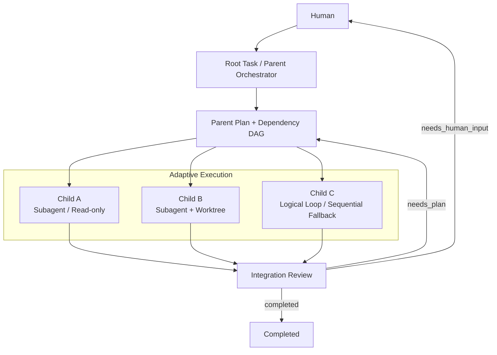
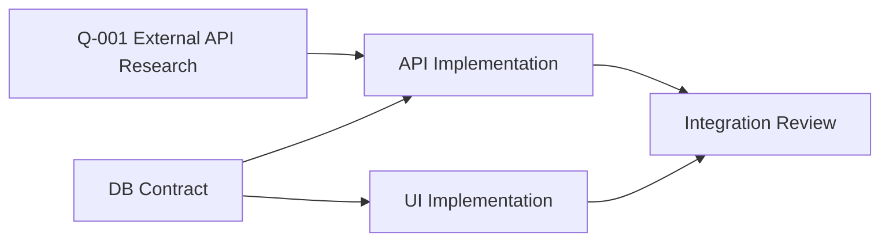
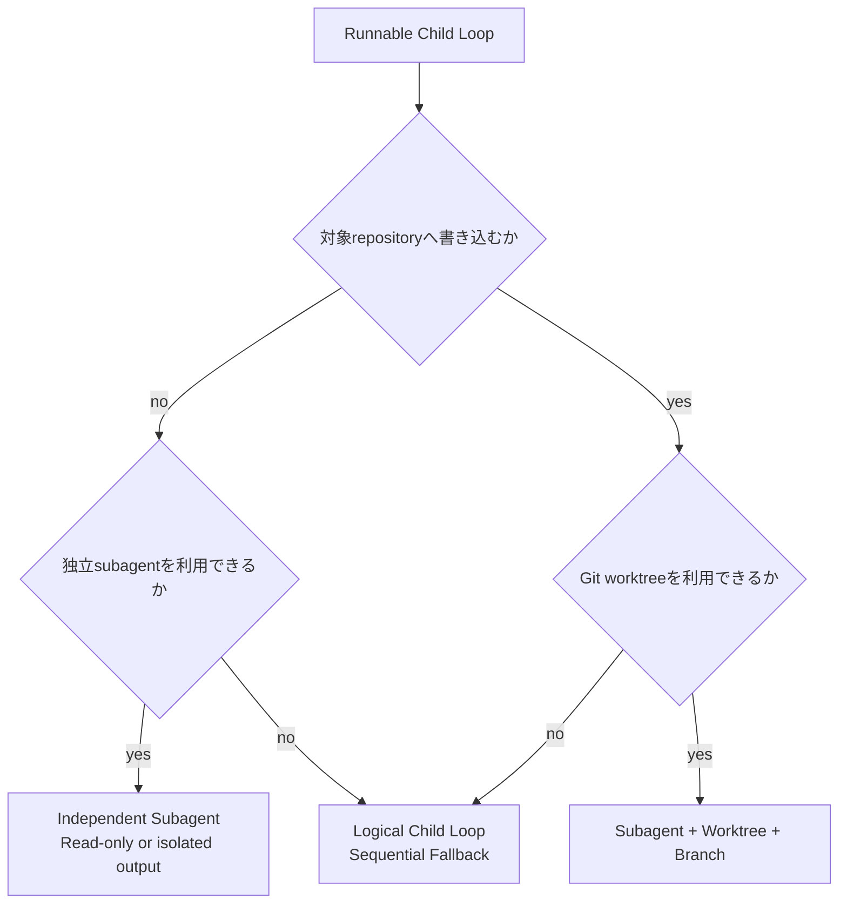
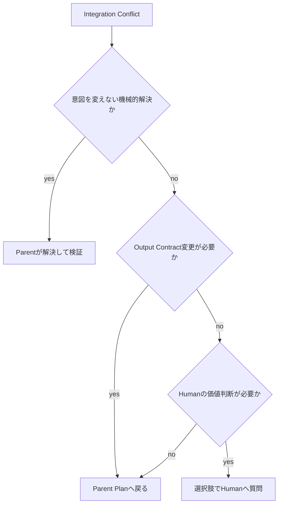

# Parallel Loop Design

## 目的

Parent Planが独立した作業単位を発見した場合に、nousが複数のChild Loopを安全に並行実行し、結果を1つのRoot Taskへ統合できるようにする。

- 論理的なChild Loopと物理的な実行方式を分離する
- 調査は独立subagentへ、同一repositoryへの並列実装はGit worktreeへ分離する
- subagentやworktreeを利用できない環境では直列実行へfallbackする
- Child Loop間のcontext、file、stateの汚染を防ぐ
- Human回答待ちや一部failureで無関係なChild Loopを止めない
- Child ReviewとIntegration Reviewを分ける

中核概念には、**Fork-Join**、**Directed Acyclic Graph（DAG） scheduling**、**Structured Concurrency**、**Git worktree isolation**を用いる。

## 基本モデル

すべての並列作業は、まず永続的な論理Child Loopとして表現する。runtime Subagent、別session、worktree、processはChild Loopを実行するためのbackendであり、Task Stateそのものではない。runtime Subagentは1つのChild Loop Contract revisionを実行する一時的workerであり、0個以上のSubskill capability packageを利用できる。Subagent identityとCodex Skill / Subskill identityを1対1に対応付けない。



Structured Concurrencyの原則として、Child Loopのlifecycleは必ずRoot Taskに属する。Parentが追跡できない孤立workerを作らない。

## Runtime実装（v1）

`src/agent_nous/engine.py` の`ParallelExecutionEngine`が、typed Planを実際のworker起動へ接続する。

1. Root Plan artifactをcanonicalへ記録する。
2. `child_contracts`、Child checkpoint、DAGを`TaskStore.materialize_parallel_plan`の1 transactionでimmutableに確定する。
3. canonical planを読み直し、保存された`mode`（`sequential`なら実効並列数1）と`max_concurrency`に従ってready Childだけを選ぶ。
4. `start_child_loop`でChild leaseを取得し、`ThreadPoolExecutor`で同じwaveのPlan / Implement / Review backendを起動する。
5. 各workerは`record_child_phase` / `record_child_result`を通じてのみcanonical stateへ結果を戻す。
6. 全Childが完了したらIntegration Reviewを起動し、Root acceptance criteriaと統合結果を検証する。失敗やHuman待ちは通常の例外ではなく、integration artifactと次のcanonical phaseとして記録する。

物理並列の範囲はworkerのbackend実行であり、TaskStoreの親revisionやmanaged actionの開始・完了は競合防止のため直列化する。これにより、`max_concurrency=2`でも「同じStateを2 workerが直接上書きする」ことはない。read-only Childの検証processだけはsnapshot上で許可し、write Childはworktree・reservation・commit durabilityが事前に揃っている場合だけ許可する。

既存の通常Planは自動的に並列化されない。Plan Agentが`parallelization_plan`と`child_contracts`を返したときだけ並列runtimeへ分岐する。agent backendが失敗したChildは成功扱いにせず、lease recovery可能な`ready`境界でPlanからbounded retryする。

## Parent Planの並列化出力

Plan Agentは作業手順だけでなく、並列化候補、依存関係、resource contractをtyped Parallelization Planとして返す。MarkdownのPlan記述はこのartifactから生成するviewであり、並列実行の入力には使わない。

```txt
artifact_type: parallelization_plan
mode: parallel | sequential
rationale:
max_concurrency:
child_loop_contract_links[]:
dependencies[]:
integration_order[]:
integration_strategy:
integration_validation[]:
knowledge_references[]:
```

ChildのObjective、scope、Acceptance Criteria、resource setはParallelization Planへ埋め込まず、`child_loop_contract_links[]`がArtifact Set Manifestを介して解決するcanonical Child Loop Contractへ分離する。

Orchestratorはschema validationに成功した提案だけを受け取り、DAG、resource conflict、reservation、Human approval boundary、利用可能backendを確認してからChild Loopを作る。resource locatorまたはsemantic scopeが曖昧なChildをparallel modeで開始しない。

## Dependency DAG

Child Loopの依存関係をDAGとして管理する。



- dependencyを持たない、または完了済みdependencyだけを持つLoopを`runnable`とする
- cycleを含む依存graphは拒否する
- dependencyが`blocked`または`cancelled`なら、下流Loopを自動実行しない
- dependencyのOutput Contractを変更した場合、下流Loopを`needs_plan`として再評価する
- Human質問のblocking scopeは、そのLoopと依存する下流Loopだけに伝播する

## 並列化できる条件

次を満たす作業単位は並列化候補になる。

- ObjectiveとScopeを独立して記述できる
- ChildごとにAcceptance Criteriaを置ける
- Required Inputをsnapshotまたはversionで固定できる
- Output Contractを先に定義できる
- dependencyをDAGで表現できる
- read/write対象を機械検証可能なresourceとして列挙できる
- writeまたはshared resourceの競合を隔離・予約できる
- failureを当該Loopへ封じ込められる
- Integration Reviewで組み合わせを検証できる

例:

- 独立した複数Knowledge Questionの調査
- DB Contract確定後のAPI実装とUI実装
- 複数packageに分かれた局所変更
- code実装と独立したdocumentation更新
- 異なるrepositoryを対象とする作業

## 並列化しない条件

次の場合は同じ実行waveへ入れない。

- RequirementまたはAcceptance Criteriaが安定していない
- ChildのOutput Contractを定義できない
- 同じfileやschemaの意味を同時に変更する
- migration順序など強い実行順序がある
- 同一の非thread-safeな外部resourceを操作する
- rollback境界を分離できない
- Red Actionを含み、必要なHuman approvalがない
- Integrationより先に一方の結果を評価する必要がある
- 分割と統合のcostが直列実行より大きい

同じfileへ触れるだけで常に禁止するのではなく、write setの性質と統合方法を評価する。明確に異なる追加箇所でも、semantic conflictが予想される場合は直列化する。

## Child Loop Contract

各Child Loopは次の契約を持つ。

```txt
loop_id:
parent_loop_id:
objective:
scope:
non_goals:
dependencies:
required_inputs:
input_versions:
acceptance_criteria:
expected_outputs:
read_set:
write_set:
shared_resources:
risk_class:
allowed_actions:
forbidden_actions:
preferred_backend:
integration_strategy:
validation_plan:
knowledge_references:
```

契約に含まれない作業を発見したChild Agentは、scopeを勝手に拡張しない。

- 局所的で契約内に収まる: Child Planを更新する
- Parent Contractへ影響する: Parentへ`needs_plan`を返す
- Humanの価値判断またはRed Action: `needs_human_input`を返す

`read_set`、`write_set`、`shared_resources`は自由記述のpath一覧ではなく、この文書のResource Contractを参照する。required writeまたはexternal effectがresourceとして表現されていないChild Loop Contractは無効とする。fieldの正は [Phase Artifact Contract Design](./phase-artifacts.md) にあり、この文書では別名を追加しない。

### Immutable contract revisions

Child Loop Contractは上書きしない。物理履歴を次へ固定する。

```txt
${NOUS_HOME}/tasks/{task_id}/loops/{loop_id}/contracts/rev-{revision:04d}.json  # canonical / immutable
${NOUS_HOME}/tasks/{task_id}/loops/{loop_id}/contract.json                 # current generated copy/view
```

- `rev-{revision:04d}.json`は作成後に変更せず、artifact ID、content hash、parent revision、確定`transaction_id`を持つ
- `contract.json`はStateの`active_contract_ref`から再生成でき、hash付き参照先には使わない
- scope、Acceptance Criteria、Resource Contract、dependency、approval boundaryの変更は新revisionを作る
- worker、Checkpoint、Child Result、Reservationは開始時にpinしたimmutable revision refを保存する
- active revisionの切替はDAGと下流Output Contractを再検証し、影響ChildをReview経由の`needs_plan`へ送る
- 過去PlanまたはEventが参照するrevisionはretention対象であり、cleanupや更新で削除しない

## Context Isolation

Child AgentへParentの会話履歴や他Childの作業logを丸ごと渡さない。

Child Agentの入力:

```txt
1. Child Loop Contract
2. Child State PacketまたはResume Packet
3. `task-definition.json`から抽出したChild scope内のTask Definition Packet
4. `stable-context.json`から抽出したChild scope内のStable Context Packet
5. Childに関係するKnowledge Packet
6. dependencyの確定Output Contract
7. 対象repositoryの指定されたscope
```

Child Agentへ渡さないもの:

- 他Childの生の会話履歴
- 関係のないResearch Notes
- supersededなPlan
- Parentの未整理な思考過程
- 他Childの未確定な中間成果

Child間で直接状態を共有せず、Parent Orchestratorと永続file契約を介して受け渡す。

## Adaptive Backend Selection

論理Child Loopごとに、作業の性質と利用可能toolから実行backendを選ぶ。並列write backendを候補に入れる前に、次のLocal Git Adapter prerequisiteを満たす必要がある。

### Local Git Adapter prerequisite

Local Parallelより前のruntime milestoneで、managed Executor経由のLocal Git Adapterを利用可能にする。最低限のoperationは`status`、`diff`、`worktree list/create/remove`、`branch create/delete`、`commit`、`patch export/apply`、`integration apply`である。

- adapterはrepository identity、base ref、HEAD、dirty pathsをpre/post probeし、typed evidenceを返す
- worktree / branch / commit / patch operationはsemantic Resource ContractとExecution Grantへ束縛する
- local commit、patch、worktreeはremote push権限を含まない
- adapterがない、probe不能、またはrepositoryがGitでない場合、concurrent writeを開始せずlogical sequentialへfallbackする
- push、remote durability、cross-machine resumeはLocal Parallelの前提にせず、別のremote operationとして扱う

Local Git operationの共通契約は [Task Operations Design](./task-operations.md) の「Local Git Adapter Contract」を正とする。



### Read-only / Research

- 独立subagentまたは別sessionを優先する
- Child固有のKnowledge QuestionとOutput Contractだけを渡す
- 対象repositoryへのwrite権限を与えない、またはwriteを契約で禁止する
- Policy GatewayのExecution Grantでfilesystem writeとnetworkを禁止する
- 調査候補はChildのResearch Notesへ置き、検証後にtaskctlが`knowledge/claims.json`、`knowledge/sources.json`と対応するMarkdown viewへ確定する
- Parentがprovenance、重複、矛盾を確認してRoot Knowledgeへ統合する

### RepositoryへのWrite

同一repositoryで複数Childが並行writeする場合は、ChildごとにbranchとGit worktreeを分ける。

- Childは割り当てられたworktreeだけを変更する
- Policy Gatewayはworktree pathに加えて予約済みsemantic resourceをwrite scopeとして強制する
- Parentのintegration worktreeを直接変更しない
- Child branchを外部へpush、merge、公開しない
- Child Review完了時に統合可能なcommitまたはpatchを作る
- branch、base commit、HEAD、dirty stateをCheckpointへ記録する
- ParentがIntegration Reviewで取り込む

Git repositoryでない場合、同じwrite targetへの物理並列は行わず直列fallbackする。

### Sequential Fallback

subagent、別session、worktreeを利用できない場合でもChild Loopを消さない。

- logical contract、State、Cycle、Reviewを維持する
- 1つのworkerがready queue順に実行する
- 各Childの開始前にcontextを再構築する
- Child間でPhase Agentの会話記憶を引き継がない
- backendが変わってもIntegration Contractを変えない

## Backend選択表

| 作業 | 優先backend | fallback |
| --- | --- | --- |
| 独立したWeb・文献・repository調査 | 独立subagent | logical sequential |
| 対象repositoryを変更しないReview | 独立subagent | logical sequential |
| 異なるrepositoryへの実装 | repositoryごとのsubagent | logical sequential |
| 同一repositoryへの並列実装 | subagent + child worktree | logical sequential |
| 同じfile・schemaへのsemantic変更 | sequential | Parent Planで再分割 |
| Red Action | Human approval後に指定backend | waiting_human |

## Scheduler

Parent OrchestratorはDAGとtyped resource reservationからready queueを構築する。

```txt
1. dependencyが完了したChildを抽出する
2. waiting_human / blocked / cancelledを除外する
3. resource locator、semantic scope、aliasを正規化する
4. reservation conflictを確認して必要なLeaseを取得する
5. risk、approval、Policy Gatewayの実行可能性を確認する
6. max_concurrencyまでworkerを割り当てる
7. completion eventでdependencyとreservationを解放する
8. 新しいready Childをqueueへ追加する
9. 全必須Child完了後にIntegration Reviewへ進む
```

default `max_concurrency`は3とする。Planがresource制約、tool制約、rate limit、cost、integration負荷に応じて1以上へ下げられる。3を超える場合は明示的な実行policyまたはHumanのpre-approvalを必要とする。

同じpriorityでは、dependencyの下流を多く解放するChildを優先し、その後`loop_id`で順序を安定させる。

### Canonical scheduler operation surface

SchedulerはTask Filesを直接編集せず、次のtaskctl operation contractを使う。operationの入力には共通して`task_id`、`expected_state_revision`、`idempotency_key`、`transaction_id`を含め、出力には新しいState revisionとcanonical artifact refsを含める。

| operation | 主入力 | precondition / canonical effect |
| --- | --- | --- |
| `record-parallel-plan` | Draft Parallelization Plan、Child Contract revision refs | DAG / resource / cross-reference検証後、planとactive refをrecoverable multi-file transactionで確定 |
| `create-child-loop` | immutable initial Contract revision、parent loop、backend class | loop ID一意性とparent leaseをCAS検証し、Child State / Event / Checkpointを作成 |
| `revise-child-contract` | prior contract ref、新Draft revision、change reason | prior revisionを保持し、新revisionを確定して`active_contract_ref`だけを切替 |
| `reservation-request` | Resource Request、contract revision ref | immutable requestと`requested` Reservationを保存。実行権限は付与しない |
| `reservation-acquire` | reservation ID、resource version、lease owner / expiry | conflictとrevisionをCAS検証し`held`へ遷移 |
| `reservation-release` | reservation ID、owner lease、release reason | post-probe / reconcile後に`released`または`conflicted`へ遷移 |
| `record-child-result` | Child Phase Output refs、pinned contract ref、durability evidence | Child Review completedならintegration-readyとして記録し、dependencyとreservationを更新 |
| `record-integration-review` | Integration Review Result / Decision、integrated refs | topologyとRoot条件を検証し、parallel Rootの唯一のcompletion requestを確定 |

operation名、typed request / response、CAS、recoverable transactionの共通規則は [Task Operations Design](./task-operations.md) の「Scheduler / taskctl Operation Contract」を参照する。taskctl実装はこのsurfaceを提供し、Scheduler、worker、Subskillがcanonical Stateを直接更新しない。

## Machine Resource Contract

worktreeでfileを分離しても、後のmergeでsemantic conflictは発生する。Parallelization Planはfileだけでなくschema、API contract、config、lockfile、external service、Git refを機械処理できるresourceとして宣言する。

### Resource

```txt
contract_version:
resource_id:
kind: file | directory | schema | api_contract | config | lockfile | external_service | git_ref
locator:
semantic_scope:
  namespace:
  entity:
  facet:
parent_resource_ref:
aliases:
version_ref:
conflict_class: exclusive | mergeable | advisory
merge_strategy:
sensitivity:
```

`locator`はkindごとに正規化可能なidentifierとする。

```txt
file             repo://target/src/api/users.ts
directory        repo://target/src/api/
schema           db-schema://main/public.users
api_contract     api://public/v1/users#create
config           config://target/auth.session-policy
lockfile         repo://target/package-lock.json
external_service service://stripe/test/customer
git_ref          git://target/refs/heads/feature-x
```

`semantic_scope`は同じfileでなくても意味上競合する変更を対応付ける。例えばmigration fileとORM modelは`namespace: db-schema`, `entity: public.users`を共有し、route実装とOpenAPI定義は`namespace: api`, `entity: public/v1/users#create`を共有する。

resource aliasとparent-child関係もcontractとして固定する。directory writeは配下fileを包含し、schema全体のwriteはtable、column、constraint resourceを包含する。包含関係を決定できないlocatorはparallel writeへ使用できない。

### Resource Request

Child LoopはResourceへの意図を宣言する。

```txt
resource_ref:
loop_id:
requested_mode: read | write | reserve | external_effect
input_version_ref:
required_reservation: shared_read | exclusive_write | exclusive_effect | advisory
expected_change:
integration_strategy:
```

`read`はversionを固定できる場合に限りconcurrent writeと共存できる。`write`と`external_effect`は対応するexclusive reservationを必要とする。`reserve`は後続wave用の先行予約であり、実行権限ではない。

### Reservation

```txt
reservation_id:
resource_ref:
owner_loop_id:
mode: shared_read | exclusive_write | exclusive_effect | advisory
status: requested | held | released | expired | conflicted
lease_ref:
acquired_at:
expires_at:
input_version_ref:
plan_revision:
```

Reservationはschedulerの排他契約であり、filesystemまたはtool権限そのものではない。Child開始時にPolicy GatewayがReservationをExecution Grantへ束縛し、実際のwrite、network、external effectを強制する。

### Deterministic Conflict Detection

Orchestratorは次の順でresource conflictを判定する。

```txt
1. kindごとのlocatorをcanonical formへ変換する
2. alias、parent-child、semantic_scopeの一致を展開する
3. input versionとreservation modeを比較する
4. conflict_classとmerge_strategyを適用する
5. conflict resultとreason codeをParallelization Planへ記録する
```

Conflict rules:

- `shared_read`同士は共存できる
- `exclusive_write`または`exclusive_effect`は同一・alias・包含resourceと共存できない
- read/writeはread側の`input_version_ref`がimmutable snapshotへ固定される場合だけ共存できる
- `exclusive` resourceの複数writeはintegration strategyがあっても同一waveへ入れない
- `mergeable` resourceは非重複facetと決定的なmerge strategyを証明できる場合だけ並列化できる
- `advisory` conflictは記録するが、他のhard conflictを緩和しない
- lockfile、shared config、DB schema root、public API contractはdefaultで`exclusive`とする
- external serviceの同じobjectまたはidempotency domainへのeffectは`exclusive_effect`とする
- locator、semantic scope、alias、包含関係が曖昧なら`ambiguous_resource`としてparallel不可にする

reservation取得前のChildは`runnable`でも開始できない。Lease切れだけで別Childへ即時移管せず、Checkpoint、worker、実resourceの状態をreconcileしてから再予約する。

## Child Review

各Child Loopは自身の`plan → implement → review`を完結させる。

Child Reviewが確認すること:

- Child Acceptance Criteria
- Scope外変更がないこと
- Required Input versionとの整合
- Child単体のtest・validation
- Output Contractの充足
- Integration時のriskと順序
- commit、patch、Knowledge Claim、artifactの参照

Child Reviewの`completed`は「統合可能」であり、Root Taskの完了を意味しない。

## Integration

Parent OrchestratorだけがChild OutputをRootへ統合する。

### 統合順序

1. DAGのtopological order
2. shared contractやschemaを定義するChild
3. そのcontractを消費するChild
4. 独立Childは`loop_id`による安定順

### Code Output

- Childのbase commitがParent integration baseと一致するか確認する
- commitまたはpatchを1 Childずつ取り込む
- 各取り込み後にtargeted validationを行う
- conflict解決を別Childへ押し付けない
- Resource Contractの`expected_change`と実diffを照合する
- 全Child統合後にRoot全体のvalidationを行う

### Knowledge / Document Output

- Claim IDとSource IDをRoot namespaceへ変換する
- `derived_from`でChild Claimを追跡可能にする
- 重複Sourceを独立した複数根拠として数えない
- 矛盾するClaimを隠さず`disputed`として扱う
- RootのSummaryへはKnowledge Gateを通過したClaimだけを昇格する

## Conflict Handling



- whitespace、import順、非semanticな位置ずれはParentが解決できる
- API Contract、schema、利用者向け仕様の衝突はParent Planへ戻す
- 未宣言resource、semantic scope不一致、reservation外writeは機械的解決とみなさずPolicy violationとして扱う
- 複数の妥当な仕様から価値判断が必要ならHumanへ戻す
- conflict解消後は影響するChild Acceptance Criteriaを再検証する

## Integration Review

Integration ReviewはReview Phaseの`phase_kind: integration`として実行する。

入力:

```txt
parent_acceptance_criteria:
dependency_dag:
child_review_summaries:
integrated_commits_or_artifacts:
resolved_conflicts:
combined_knowledge:
validation_results:
open_questions:
```

確認項目:

- 全必須Childが完了または明示的に除外されている
- Child Output ContractがParent Planを満たす
- 統合後のcode、schema、docs、Knowledgeが矛盾しない
- Root Acceptance Criteriaを満たす
- Child単体testだけでなく統合testが成功する
- 未承認のRed Actionやscope拡張がない
- orphan branch、worktree、workerが残っていない

出力:

```txt
review_status: completed | needs_plan | needs_human_input
integrated_outputs:
accepted_children:
excluded_children:
resolved_conflicts:
remaining_issues:
next_plan_input:
human_question_refs:
cleanup_actions:
```

このRootにmaterialized Child Loopが1件以上ある場合、Root Taskのcompletion根拠にできるのはcanonical Integration Review Decisionの`completed`だけである。Integration Review Agent自体はStateを書かず、Parent Orchestratorが`record-integration-review`を要求し、taskctlがRoot条件を検証して遷移を確定する。Child Loopが一度もmaterializeされていないsequential Rootはstandard Reviewで完了できる。

## Failure Policy

Child failureで全Siblingを無条件に停止しない。

### Siblingを継続する

- failureが当該Childのscopeに限定される
- shared contractを無効化しない
- security incidentやdata corruptionではない
- Siblingがfailed ChildのOutputに依存しない

### Fail-fastする

- 共通RequirementまたはAcceptance Criteriaが誤っている
- shared schema / API Contractの前提が崩れた
- secret露出、data corruption、権限逸脱を検出した
- Parent Plan全体が無効になるHuman回答を受けた
- external resourceの安全性を保証できない

Fail-fast時は新しいChildを開始せず、実行中Childへsafe checkpointを要求する。

## Dynamic Fan-out

Child Planが追加の独立作業を発見した場合、Parent Orchestratorへfan-out提案を返せる。

- Child Agentが独断でuntracked workerを起動しない
- ParentがDAG、resource、risk、budgetを再評価する
- 追加ChildのResource Contractとreservation conflictを再評価する
- 追加ChildもRoot TaskのTask Stateへ登録する
- default最大nesting depthは2とする
- depthを超える場合はRoot PlanでTask分割を見直す
- max concurrencyはRoot Task全体で共有する

## Pause・Resume・Cancel

- Parent pauseは全Childへsafe checkpointを要求する
- unexpected interruptionはLoopごとのLeaseとCheckpointで復旧する
- ChildだけをpauseしてSiblingを継続できる
- Parent cancelは新規schedulingを止め、実行中Childを安全境界で停止する
- completed Childを再実行しない
- 有効なworkerが存在するChildを重複起動しない
- worktreeとbranchを削除する前に、未統合成果物がないことを確認する

詳細な復旧規則は [Task State and Recovery Design](./task-state.md)、file配置は [Task Files Design](./task-files.md) に従う。

## Human Input

- 質問は影響するChildとDAG下流だけをblockする
- 独立したrunnable Childは継続する
- 複数Childが同じ判断を待つ場合はParentが質問を統合する
- Red Actionはbackendに関係なくHuman approvalを必要とする
- approval後もPolicy Gatewayがresource、write、tool、network scopeを強制する
- 3を超える物理並列や追加costはpre-approvalの対象にできる

質問形式とblocking scopeは [Human Input Policy](./human-input-policy.md) に従う。

## Cleanup

Integration Review後、Parent Orchestratorがcleanupを管理する。

- worker sessionを終了する
- LeaseとLockを解放する
- untracked temporary fileを削除する
- 統合済みChild worktreeを安全に削除する
- branchの保持・削除を実行policyに従って判断する
- Child State、Cycle、Review、Event Journalは履歴として保持する

cleanup failureだけで成果物を失わない。未統合branchやdirty worktreeがある場合は削除せず、Root Taskを`blocked`または`needs_plan`として記録する。

## 不変条件

- 並列作業は必ず永続的な論理Child Loopとして表現する
- subagent、session、worktreeの生存をTask Stateとして扱わない
- Child lifecycleをParentのlifecycleへ結び付け、orphan workerを作らない
- ChildごとにObjective、Scope、Acceptance Criteria、Output Contractを持つ
- dependencyをDAGで管理し、cycleを許さない
- concurrent writeはworktreeとresource reservationで隔離する
- file pathだけでなくschema、API contract、config、lockfile、external service、Git refをsemantic resourceとして管理する
- 曖昧なresourceまたは未予約writeをparallel実行しない
- Reservationを実行権限とみなさず、Policy GatewayのExecution Grantへ束縛する
- ChildはParentの共有fileとintegration worktreeを直接変更しない
- backendが利用できなければlogical sequentialへfallbackする
- Childの`completed`をRoot Taskの完了として扱わない
- materialized Child LoopがないRootはstandard Review、1件以上あるRootはIntegration Reviewだけをcompletion根拠にする
- Review Agentは完了候補を返し、Rootの状態遷移はOrchestrator要求とtaskctl検証でのみ確定する
- Human回答待ちの停止範囲を必要最小限にする
