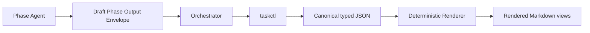
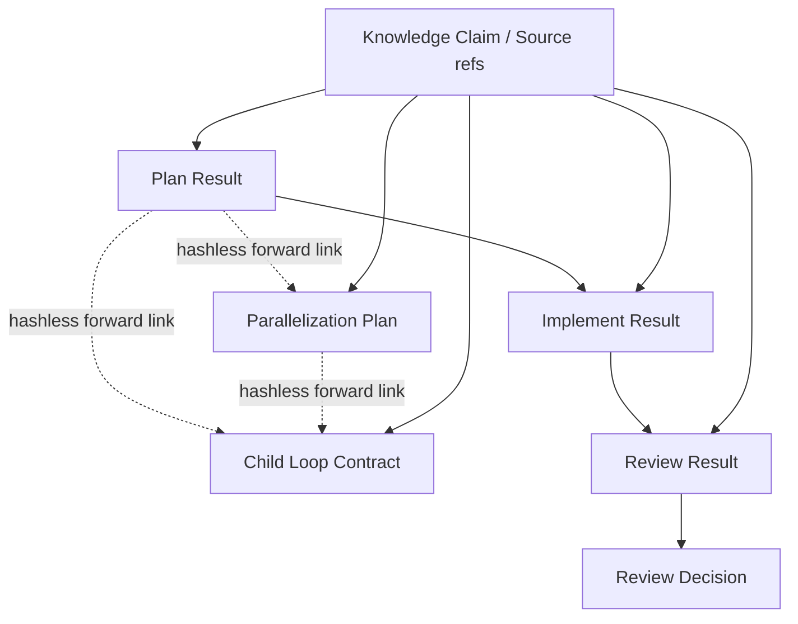

# Phase Artifact Contract Design

## 目的

Plan / Implement / Reviewの成果物と、Review判定、並列化、Child Loop、Knowledge参照を、Markdown解釈に依存しないtyped JSON contractとして定義する。

この文書はPhase Artifactのfield名、型、条件付き必須条件、参照関係のcanonical authorityである。保存pathは [Task Files Design](./task-files.md)、表示規則は [Task Template Design](./task-templates.md)、遷移規則は [Autonomous Loop Design](./autonomous-loop.md) が参照する。

## Canonicality

```txt
typed JSON artifact = canonical machine contract
Markdown            = typed JSONから生成するHuman-readable view
```

- Phase完了、状態遷移、再開、並列scheduleをMarkdown parsingで決めない。
- `01-plan.md`、`02-implement.md`、`03-review.md`、`current-plan.md`、`current-review.md`はすべてrendered viewである。
- JSONとMarkdownが矛盾する場合はJSONを正とし、Markdownを再生成する。
- JSONだけが存在してもPhaseは復元できる。MarkdownだけではPhaseを完了できない。

## Canonical Write Boundary

Phase成果物の確定経路を次へ固定する。



1. Phase Agentは非canonicalなDraft Phase Output Envelopeを返す。
2. OrchestratorはTaskの現在revision、Phase、Cycle、policy、参照先を照合する。
3. Orchestratorは判断済みpayloadを`taskctl`へ渡す。
4. `taskctl record-phase-output`はEnvelope Schema、artifact別Schema、条件付き必須条件、cross-referenceを順に検証する。
5. 検証済みpayloadだけを、`transaction_id`を持つ**recoverable multi-file transaction**の`prepared -> replace -> committed`でcanonical JSON、State、Event、Checkpointへ確定する。
6. rendererはcommit成功後に確定JSONからMarkdown viewを生成する。Markdown、Registry、indexは再構築可能なpost-commit cacheであり、canonical commitの成功条件に含めない。

Phase Agentは`state.json`、`events.jsonl`、Checkpoint、canonical Phase JSON、canonical Child Contract、generated Markdownを直接更新しない。Implement Phaseがtarget repositoryへ行う変更はPhase Artifactではなく作業成果物であり、許可されたwrite scope内で別に扱う。

Draft Envelopeはworker responseまたはruntime draft領域にだけ存在し、Taskの正規記録として参照しない。検証失敗時はcanonical fileを一切変更しない。

## Field Dictionary

同じ意味に別名を使わない。各設計、Schema、renderer、State Packetは次のlogical field名を使う。

| Field | 型 | 意味 |
| --- | --- | --- |
| `schema_version` | positive integer | artifact schemaのmajor version |
| `artifact_type` | enum | artifact種別 |
| `artifact_id` | stable ID | Task内で一意なartifact ID |
| `task_id` | task ID | 所属Root Task |
| `loop_id` | loop ID | `root`またはChild Loop ID |
| `cycle` | positive integer | Loop内のCycle番号。pathでは4桁表記する |
| `phase` | `plan \| implement \| review` | 生成Phase |
| `phase_kind` | `standard \| integration` | 通常またはIntegration Phase |
| `run_id` | run ID | Draftを生成したworker run |
| `produced_at` | offset付きtimestamp | AgentがDraftを返した時点 |
| `transaction_id` | transaction ID | canonical commitを識別するrecoverable multi-file transaction |
| `inputs_read` | `ArtifactReference[]` | 実際に参照した入力。`input_read`は使わない |
| `phase_summary` | non-empty string | Phase結果の短い要約 |
| `work_done` | `WorkItem[]` | Phase内で完了した作業 |
| `decisions` | `Decision[]` | Phase内で確定した判断 |
| `assumptions` | `Assumption[]` | 仮定、影響、検証方法 |
| `open_questions` | `QuestionReference[]` | 未解決の質問 |
| `next_phase_input` | `NextInputItem[]` | 次Phaseが最初に扱う構造化入力 |
| `handoff_status` | `ready_for_next \| needs_human_input \| blocked` | Phaseから次の処理へのhandoff状態 |
| `knowledge_references` | `KnowledgeReference[]` | 採用したClaimと根拠Sourceへのtyped参照 |
| `blocking_reasons` | `BlockingReason[]` | `handoff_status = blocked`の機械判定可能な理由 |
| `human_question_refs` | `ArtifactLink[]` | canonical `HumanQuestion` recordへのhashless link |

Markdown headingの表示言語は変更できるが、logical field IDはこの辞書から変更しない。

### Artifact Header

すべてのcanonical typed artifactは、種別固有fieldに加えて次のheaderを持つ。

```txt
schema_version
artifact_type
artifact_id
task_id
loop_id
cycle
run_id
produced_at
transaction_id
```

Phase Resultはさらに`phase`と`phase_kind`を必須とする。Review DecisionとParallelization Planは生成元Phaseを`phase`で明示し、Child Loop Contractは`created_from_plan_ref`で生成元を固定する。

## 共通参照型

### ArtifactReference

```txt
artifact_id
artifact_type
ref                 Task directoryからのrelative path、または許可されたexternal artifact ref
content_hash        sha256
revision            revisionを持つartifactでは必須
```

relative pathはabsolute path、`..`、空segmentを拒否する。Cycle Artifactへの参照は確定時のhashへ固定する。

`ArtifactReference`は**既に確定済みのartifactへの一方向参照**だけに使う。相手がまだ確定していないforward referenceや、同じartifact set内で相互にhashを要求する参照には使わない。

### ArtifactLink

```txt
artifact_id
artifact_type
intended_ref        taskctlが割り当てたTask directoryからのrelative path
```

`ArtifactLink`は同じDraft Envelope内で後から確定するartifactへのhashless forward linkである。`content_hash`、`revision`、manifest hashを持たせない。commit後のartifact-set-manifestが各Linkをfinalized `ArtifactReference`へ対応付ける。canonical artifactからmanifestへの逆参照は作らない。

### Artifact Set Manifest

同じ`record-phase-output`で確定したartifact集合は、cycleごとのimmutableな`artifact-sets/{transaction_id}.json`（artifact-set-manifest）へ次を保存する。

```txt
schema_version
manifest_id
task_id
loop_id
cycle
transaction_id
members[]             artifact_id, artifact_type, ref, content_hash, revision
committed_at
```

Manifestはmember payloadのfinal hashを一方向に束ねる。member artifactはManifestをhash参照しないため、hash計算に循環がない。Stateのactive refはManifestではなくfinalized memberを指す。

### KnowledgeReference

```txt
claim_id
claim_ref
claim_status        verified | inferred | hypothesis | disputed
lifecycle_status    active | stale | superseded
source_refs[]
as_of
content_hash
use                  requirement | constraint | decision_input | validation_basis | risk
```

- `claim_ref`と各`source_refs`は [Knowledge Design](./knowledge.md) のClaim / Source IDへ解決できなければならない。
- `verified`でないClaimを確定要件として使う場合は、対応する`assumptions`と`validation_plan`を必須にする。
- `stale`または`superseded`なClaimを無条件に採用できない。採用する場合は理由と再検証条件を持つ。
- Phase ArtifactへSource本文を複製せず、stable ID、ref、hash、利用目的だけを保存する。

### HumanQuestion

`HumanQuestion`のfieldは`common.schema.json`の`$defs/HumanQuestion`だけをauthorityとする。本書はfieldを再定義しない。Draft Envelopeは同型の`human_questions[]`候補を運べるが、canonical Phase Resultには`human_question_refs[]`だけを保存する。`taskctl`がQuestion recordとStable Contextを同じrecoverable multi-file transactionで確定する。質問、回答、`resume_target`の意味は [Human Input Policy](./human-input-policy.md) に従う。

### BlockingReason

```txt
reason_id
category              external_dependency | missing_input | policy_block | resource_unavailable | validation_block | other
summary
blocked_refs[]
recoverable_condition
owner                 human | orchestrator | external
```

`handoff_status = blocked`では1件以上を必須とする。Human判断が必要なら`human_question_refs[]`も持ち、単なる外部障害なら質問を捏造しない。

## Draft Phase Output Envelope

EnvelopeはPhase AgentとOrchestratorのtransport contractであり、canonical artifactではない。

```txt
schema_version
task_id
loop_id
cycle
phase
phase_kind
run_id
expected_revision
result                 PlanResult | ImplementResult | ReviewResult
review_decision        Review ResultがblockedでないReview Phaseで必須
parallelization_plan   Planが並列化を提案するときだけ存在
child_loop_contracts[] parallel modeで必須
human_questions[]      common HumanQuestion候補。taskctlがcanonical recordへ分離する
```

Envelope内artifactは最終pathやState active refを自己決定しない。OrchestratorがTask contextと照合し、`taskctl`がcanonical pathを割り当てる。

共通整合条件:

- Envelopeと内包artifactの`task_id`、`loop_id`、`cycle`、`phase`、`run_id`が一致する。
- `expected_revision`が現在State revisionと一致する。
- 現在Phaseと異なるresultを拒否する。
- 同じ`artifact_id`を異なるpayloadへ再利用しない。
- 参照先のartifact ID、path、hashが一致する。

## Plan Result

`artifact_type: plan_result`。Artifact Headerと共通Phase Result fieldを持つ。

共通fieldに加えて次を持つ。

```txt
objective
non_goals[]
requirements[]
acceptance_criteria[]
implementation_steps[]
files_or_areas[]
risks[]
validation_plan[]
parallelization_plan_link
child_loop_contract_links[]
```

各`acceptance_criteria`はstableな`criterion_id`、判定内容、validation methodを持つ。各`validation_plan`は`validation_id`、対象criterion ID、方法、期待結果を持つ。

条件付き検証:

- `handoff_status = ready_for_next`では`objective`、`acceptance_criteria[]`、`implementation_steps[]`、`validation_plan[]`を空にできない。
- すべてのAcceptance Criterionは1つ以上のValidation Planから参照される。
- `handoff_status = needs_human_input`では`human_question_refs[]`を空にできない。
- `handoff_status = blocked`では`blocking_reasons[]`を空にできない。lifecycleを`blocked`へ変更し、phaseとcycleを維持する。
- 並列化しない場合は`parallelization_plan_link`と`child_loop_contract_links`を持たない。
- 並列化する場合は有効なParallelization Planと全Child Loop Contractへのhashless `ArtifactLink`を持つ。final hashはArtifact Set Manifestで解決する。

## Implement Result

`artifact_type: implement_result`。Artifact Headerと共通Phase Result fieldを持つ。

```txt
plan_ref
implemented[]
changed_artifacts[]
not_changed[]
deviations_from_plan[]
validation_results[]
validation_not_done[]
known_issues[]
review_focus[]
target_artifact_durability[]
```

条件付き検証:

- `plan_ref`は同じLoop / Cycleの確定Plan Resultを指す。
- `handoff_status = ready_for_next`では`implemented[]`と`validation_results[]`を空にできない。Plan上の検証を実行していない場合は`validation_not_done[]`へ理由を記録する。
- Planからの差異がある場合は`deviations_from_plan[]`へ、理由、影響するCriterion、Reviewで必要な判定を記録する。
- `handoff_status = needs_human_input`では`human_question_refs[]`を空にできない。
- `handoff_status = blocked`では`blocking_reasons[]`を空にできない。lifecycleを`blocked`へ変更し、phaseとcycleを維持する。
- 変更したtarget artifactごとにlocator、before / after identifier、produced scopeを持つ。Phase確定時点のdurability状態も記録する。

## Review Result

`artifact_type: review_result`。Artifact Headerと共通Phase Result fieldを持つ。Reviewで確認した事実と証拠を保持し、状態遷移の決定自体はReview Decisionへ分離する。

```txt
plan_ref
implement_ref
checked[]
accepted_criteria_ids[]
issues[]
root_causes_or_hypotheses[]
validation_evidence[]
review_decision_link
```

条件付き検証:

- `plan_ref`と`implement_ref`は同じLoop / Cycleの確定artifactを指す。
- `accepted_criteria_ids[]`はPlan Resultに存在するCriterion IDだけを参照する。
- `issues[]`はseverity、影響するCriterion、evidence ref、blockingの有無を構造化する。
- `review_decision_link`は同じ`transaction_id`で後から確定するReview Decisionへのhashless `ArtifactLink`である。
- Review ResultとReview Decisionの判定が矛盾する場合は両方を拒否する。
- `handoff_status = blocked`では`blocking_reasons[]`を必須とし、`review_decision_link`とReview Decisionを禁止する。lifecycleを`blocked`へ変更してReview phaseを維持する。

## Review Decision

`artifact_type: review_decision`。Artifact Headerを持ち、Review loopを閉じる唯一のcanonical decisionである。

```txt
phase                   review
phase_kind
review_result_ref
review_status          completed | needs_plan | needs_human_input
summary
next_plan_input[]
human_question_refs[]
recommended_follow_up[]
confidence             high | medium | low
```

条件付き検証:

| `review_status` | 必須 | 禁止または空 |
| --- | --- | --- |
| `completed` | 全Acceptance Criterionがaccepted、blocking issueなし | `next_plan_input[]`, `human_question_refs[]` |
| `needs_plan` | Review Resultの`issues[]`と`next_plan_input[]`が各1件以上 | `human_question_refs[]` |
| `needs_human_input` | `human_question_refs[]`が1件以上 | なし |

`needs_human_input`で再計画候補もある場合、`next_plan_input[]`を持てる。ただしHuman回答前にPlanへ遷移しない。`completed`で未実施の必須validationがあるDecisionは拒否する。

## Parallelization Plan

`artifact_type: parallelization_plan`。Artifact Headerを持つ。

```txt
phase                   plan
mode                    parallel | sequential
rationale
max_concurrency
child_loop_contract_links[]
dependencies[]          from_loop_id, to_loop_id, required_output_refs
integration_order[]
integration_strategy
integration_validation[]
```

条件付き検証:

- `mode = parallel`では2件以上の`child_loop_contract_links`、DAG、`integration_strategy`、`integration_validation[]`を必須にする。
- Child Loop IDはTask内で一意とし、全dependency endpointがplan内Childを参照する。
- self-edge、cycle、重複edgeを拒否する。
- `max_concurrency`は1以上かつChild数以下にする。
- 各Child Contractのresource setが具体化され、競合が未解決なら`parallel`を拒否する。
- `mode = sequential`ではChild Contractの作成を要求せず、並列化しない理由を`rationale`に持つ。

並列化の判断基準、resource conflict、fallback、integrationは [Parallel Loop Design](./parallel-loop.md) に従う。

## Child Loop Contract

`artifact_type: child_loop_contract`。Artifact Headerを持つ。保存後はChild Agentが直接変更せず、Parent Orchestratorが新revisionとして確定する。

```txt
revision
parent_loop_id
created_from_plan_ref
objective
scope[]
non_goals[]
dependencies[]
required_inputs[]
input_versions[]
acceptance_criteria[]
expected_outputs[]
read_set[]
write_set[]
shared_resources[]
risk_class
allowed_actions[]
forbidden_actions[]
preferred_backend
integration_strategy
validation_plan[]
```

条件付き検証:

- `loop_id != root`、`parent_loop_id`必須、自己参照禁止。
- `objective`、`scope[]`、`acceptance_criteria[]`、`expected_outputs[]`、`validation_plan[]`を空にできない。
- `required_inputs[]`はversionまたはcontent hashへ固定する。
- `read_set[]`、`write_set[]`、`shared_resources[]`はtyped resource referenceとし、曖昧なfree-form pathで書き込み範囲を広げない。
- 同じActionを`allowed_actions[]`と`forbidden_actions[]`の両方に含めない。
- Parent Planのscope、risk、approval boundaryを拡張しない。
- dependency outputを必要とするContractは、そのdependencyを`dependencies[]`に持つ。

## Artifact間の参照graph



- 参照先は同じTaskに属する。
- Loopを跨ぐ参照はChild ContractまたはIntegration Contractで明示する。
- 確定済み入力へのArtifact Referenceはpathだけでなくartifact IDとhashを持つ。
- 同一artifact set内のforward relationはhashless ArtifactLinkだけを使い、final hashはArtifact Set Manifestが一方向に束ねる。
- hashが一致しない参照をactive inputとして使用しない。
- 参照graphにより過去のPlanを暗黙にcurrent inputへ昇格させない。
- Review DecisionだけがReview Resultをhash付き参照し、Review ResultからDecisionへはhashless linkだけを持つ。

## taskctl受け入れ条件

`taskctl`がPhase Artifactを確定できるのは次をすべて満たす場合だけである。

1. Envelopeと全artifactが構造検証に成功する。
2. field dictionary、enum、ID、path namingが一致する。
3. 条件付き必須条件に成功する。
4. `expected_revision`、現在Phase、Cycle、Loop ownershipが一致する。
5. Artifact ReferenceとKnowledge Referenceが解決できる。
6. Review ResultとReview Decision、Plan ResultとParallelization Planのcross-artifact整合性が取れ、hash付き参照graphが非循環である。
7. 全forward Linkへcanonical pathを割り当て、Artifact Set Manifestでfinal hashを一方向に解決できる。
8. `transaction_id`付きcanonical file、State active ref、Event、Checkpointをrecoverable multi-file transactionで`prepared -> replace -> committed`へ進められる。

いずれかに失敗した場合はvalidation errorを返し、Phase遷移を行わない。`prepared`以降のI/O failureは部分成功を隠さずrecovery requiredを返し、transaction markerからroll-forwardまたはrollbackする。generated Markdown、Registry、indexはcommit後に再生成するcacheであり、commit判定へ含めない。

## 不変条件

- Markdownはcanonical Phase Outputではない。
- Phase Agentからcanonical Task Filesへの直接write pathを持たない。
- Plan完了にはAcceptance CriteriaとValidation Planが必要である。
- Review `needs_plan`には`next_plan_input[]`が必要である。
- Review `needs_human_input`には`human_question_refs[]`が必要である。
- Plan / Implement / Reviewの`blocked`は`blocking_reasons[]`、phase維持、lifecycle `blocked`を要求する。
- Parallel modeには検証済みDAG、Child Contract、resource scope、integration contractが必要である。
- Knowledgeはtyped referenceでClaimとSourceへ追跡できる。
- hash付きArtifactReferenceは確定済みartifactへの一方向参照に限定する。
- field名はこの文書のField Dictionaryへ統一する。
