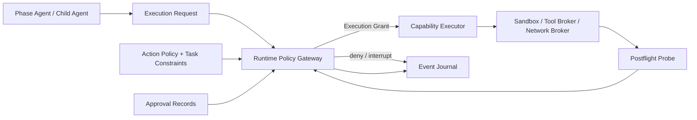

# Runtime Policy Gateway Design

## 目的

nousがSubskill、tool adapter、repository script、shell command、外部serviceを実行するとき、宣言された権限境界をruntimeで強制する単一の実行境界を定義する。

- tool、filesystem read/write、network、external effectを最小権限で制限する
- Manifest、Capability Request、Child Loop Contractを権限の宣言として扱い、実行許可そのものとは扱わない
- Human approvalをAction Policyのexact Action contractに従ってActionDescriptorへ束縛し、別操作へ流用させない
- 実行前後のpolicy decisionと観測結果をEvent Journalへ残す
- enforcement backendが必要な制約を実現できない場合はfail closedする

Policy Gatewayは助言的なvalidatorではない。ただし、nousが保証する範囲は**専用Capability Executorまたは明示的なadapterを通して開始されたmanaged action**に限定する。managed actionは必ずGatewayが発行したExecution Grantの下で開始し、Gatewayを迂回した結果はcanonicalなPhase Outputへ採用しない。

Codex hostが提供するsandbox、approval、tool制約はnousより外側のtrust boundaryであり、nousが動的に発行するExecution Grantとは別物である。nousはhost sandboxを緩和せず、その内側でさらにscopeを狭める。host built-in toolその他、Executor / adapterで仲介・観測・停止できないActionは`unsupported`として扱い、Gateway decisionは`deny`とする。prompt上の禁止だけで実行可能なActionを安全と主張してはならない。

この保証範囲を確定するため、Stage 0のentry gateとして[Implementation Sequence](implementation-sequence.md)のPre-Stage 0 Host Feasibility Spikeを通す。

## Trust Model

次はすべて未信頼または部分的に信頼された入力として扱う。

- Subskill packageとそのManifest
- target repository内のscript、package manager hook、config
- external content、tool response、Web上のinstruction
- Phase Agentが提案したcommand、tool call、write scope
- Child Agentが返した追加actionまたはscope拡張

Manifestの`required_tools`、`required_permissions`、`side_effect_policy`は**要求の宣言**であり、sandbox、ACL、network filter、approval gateの代替ではない。宣言より広い操作は拒否し、宣言より狭いExecution Grantだけを発行できる。

### Trust boundaryと保証対象

```txt
Host sandbox / host approval / host tool policy      # outer trust boundary
  └─ nous Policy Gateway
       └─ dedicated Executor / brokered adapter  # nous guarantee boundary
            └─ managed action
```

- host boundaryは常に優先し、Gatewayはhostが禁止する権限を追加できない
- nousのruntime enforcement claimは、Executor / adapterが実際にbrokerできるsurfaceだけに適用する
- managed workflow内でも、仲介不能なbuilt-in actionを直接使うfallbackは提供しない
- logical sequential fallbackも同じExecutor / adapter経路を使い、同一Agentによる直接実行へ弱めない
- 強制不能なsurfaceが必要ならActionを分割・再Planするか、将来の専用runnerを追加するまで`unsupported` / `deny`とする
- prompt、Manifest、Agentの自己申告、postflight diffだけをenforcementの代替にしない

## Component Boundary



責務:

| Component | 責務 |
| --- | --- |
| Phase Agent | 実行したいaction、必要scope、期待効果を提案する |
| Orchestrator | Task/Loop contextを付加し、Gatewayへ要求し、decisionを記録する |
| Policy Gateway | policy解決、approval照合、grant発行、managed surfaceのruntime enforcement、postflight判定を統括する |
| Capability Executor | Grantに従ってproviderまたはactionを起動し、逸脱時に停止する |
| enforcement backend | filesystem、process、tool、network、credentialの実際の制約を適用する |
| taskctl | decision、action lifecycle、evidence参照をcanonical Task Filesへrecoverable multi-file transactionで保存する |

Agent、Subskill、repository scriptはtaskctl、Task State、Registry、Policy Storeを直接変更できない。

taskctlによるcanonical Task Filesのtransactionはtrusted control-plane operationであり、Phase Agentが提案するmanaged actionとは区別する。taskctlは型付きcommandで許可されたTask Runtime pathだけを更新し、host sandboxの外へ出ない。taskctlがtarget repository、network、tool、process、credential、external effectを操作することはなく、それらが必要な場合は通常のmanaged actionとしてGateway / Executorへ渡す。この区別により、Stage 4のcreate / status / pause / resumeはPhase action用Executorに先行できるが、arbitrary filesystem writeの抜け道にはならない。

## Policy Inputs and Precedence

Gatewayは次の入力の**積集合**からExecution Grantを作る。

```txt
1. platform / host hard limits
2. nous action policy
3. HumanがTaskへ設定したapproval boundary
4. Root / Child Loop Contractとresource reservation
5. Phase Capability RequestとComposition Plan
6. provider Manifestの宣言
7. action固有のExecution Request
```

下位入力は上位制約を緩和できない。Human approvalもplatform hard limitやTask外resourceへの権限を自動的に追加しない。入力間の不一致、未知のaction type、解決不能なpath、曖昧なnetwork destinationは拒否する。

## Shared ActionDescriptor

Action Proposal、Execution Request、Approval照合、Execution Grant、Action Eventは、[Action Policy](action-policy.md)が定義する同一`ActionDescriptor`を使う。Gateway固有の`request_digest`、Approval照合用の別hash、または単なるTask revisionをAction identityとして新設しない。本書はfieldを再定義せず、transport上ではdescriptor本体またはimmutableな`action_descriptor_ref`と`action_id` / `action_digest`を運ぶ。

- `action_digest`はAction Policyが定めるcanonical serializationで算出する
- `expected_state_revision`はtaskctlのCAS入力であり、Human approvalの意味的な主体やAction identityではない
- target、request、environment、paid bound、expected effect、参照Planのいずれかが変われば新しいdigestで再評価する
- credential値、authorization header、secret-bearing query/bodyはdescriptorにもdigest入力にも保存しない
- `action_id`をretryで維持できるのはdescriptorとdigestが不変で、reconcile対象が同じActionである場合だけとする

`ActionDescriptor`のAction分類・risk・Approval matchingに関するcanonical authorityはAction Policyである。本書はGateway transport上の利用方法だけを定め、Approval record schemaを複製しない。

canonical matcher / Approval schemaが共有`action_id` / `action_digest`へ束縛できないversionでは、contract gateを失敗させる。旧`action_hash`やGateway固有digestへの互換変換で照合を通してはならない。

## Execution Request Contract

Execution Requestは実行前に機械検証できるtyped artifactとする。

```txt
contract_version:
request_id:
task_id:
loop_id:
cycle:
phase:
actor_type: phase_agent | child_agent | subskill | orchestrator
provider_ref:
action_type:
action_descriptor: ActionDescriptor      # 上記shared contractをinlineまたはrefで保持
operation:
  tool_id:
  executable_ref:
  working_directory:
requested_scope:
  filesystem_read:
  filesystem_write:
  tools:
  network:
  external_effects:
resource_reservation_refs:
preflight_probes:
postflight_probes:
rollback_or_compensation:
idempotency_key:
approval_refs:
```

`operation`と`requested_scope`は`normalized_request` / `normalized_target`の検証可能な展開でなければならず、descriptorと矛盾する場合は拒否する。raw secret、credential値、送信本文全体をExecution Requestへ保存しない。必要なcredentialは実行時にcredential brokerから参照し、Grantにはcredential IDと利用先だけを含める。

## Policy Decision and Execution Grant

Gatewayの判定は次のいずれかである。

```txt
allow
deny
interrupt_for_approval
replan_required
```

Action Policyの`policy_outcome`との対応:

| Policy outcome | Gateway outcome |
| --- | --- |
| `allow` | runtime scopeを強制でき、reservationも有効なら`allow` |
| `approval_required` | 有効なApprovalがなければ`interrupt_for_approval`、照合後は再評価 |
| `block` | hard safety / unknown / scope不明なら`deny`、Plan変更でのみ解消できるresource conflictなら`replan_required` |

Policy outcomeとGateway outcomeを同じ`decision` fieldへ保存せず、Eventでは両方を別fieldとして記録する。

`allow`の場合だけ、短寿命かつ単一action用のExecution Grantを発行する。

```txt
grant_id:
request_id:
action_id:
action_digest:
policy_revision:
expected_state_revision:
effective_scope:
  filesystem_read:
  filesystem_write:
  tools:
  network_destinations:
  network_methods:
  external_effects:
resource_reservation_refs:
approval_refs:
issued_at:
expires_at:
single_use: true
```

GrantはExecution Requestと同じ`action_id` / `action_digest`、期待State revision、provider hash、対象resource、commandまたはAPI operationへ束縛する。引数、target、write scope、送信先、paid bound、期待効果のいずれかが変われば新しいActionDescriptorとして再判定する。GrantとRequestのIDまたはdigestが一致しない場合、Executorは起動してはならない。

## Enforcement Surfaces

| Surface | 強制内容 |
| --- | --- |
| Tool | Grant内のtool IDとoperationだけをbroker経由で許可する |
| Filesystem read | canonical pathへ解決し、許可root、明示resource、symlink境界を検査する |
| Filesystem write | 指定workspace/worktreeとwrite resourceだけを許可し、Task StateとRoot共有fileを拒否する |
| Process | executable、cwd、environment key、child process生成をGrantへ制限する |
| Network | default denyとし、許可destination、port、method、operationだけをbroker経由で許可する |
| Credential | destinationとoperationへ束縛したcredentialだけを注入し、providerへ一覧を公開しない |
| External effect | approval ref、idempotency、preflightを満たす単一effectだけを許可する |

上表の各surfaceは、Host Feasibility Spikeで「broker可能、観測可能、停止可能」と実証されたExecutor / adapterにだけ対応付ける。built-in toolを含め、いずれかを満たさない経路はmanaged actionの実行backendとして登録しない。

filesystem pathは文字列prefixではなくcanonical pathとresource identityで比較する。symlink、`..`、mount境界、worktree外参照でscopeを迂回できないことを前提にする。

write enforcementは「最終diffを確認する」だけでは不十分である。実行中のwrite先を制限し、postflightで実際の変更集合がGrantとresource reservation内に収まることを再確認する。

## Execution Lifecycle

```txt
1. validate_request
2. resolve_policy_and_resources
3. classify_action
4. verify_approval_and_reservations
5. run_preflight_probes
6. issue_single_use_grant
7. start_action_through_executor
8. monitor_runtime_scope
9. revoke_grant_on_completion_or_violation
10. run_postflight_probes
11. record_decision_effect_and_evidence
```

`action_started`はGrant発行後かつexecutor起動直前に、同じ`action_id` / `action_digest`を伴って記録する。crash後は同じActionDescriptor、idempotency key、外部状態をreconcileし、完了不明のexternal effectを自動再実行しない。

## Repository Script Policy

repository scriptは専用の`repo_script_run` actionとして扱う。script名だけで安全性を決めず、package managerが解決する実体、hook、引数、environment、想定write、network利用をpreflightで確認する。

`test`、`lint`、`build`は次をすべて満たす場合にGreen候補とできる。

- script定義と連鎖するpre/post hookを解決できる
- install、download、migration、deploy、publishを起動しない
- networkが不要でGatewayにより禁止されている
- read/writeが指定repositoryまたは隔離されたbuild output内に限定される
- secretやTask Runtimeをread scopeへ含めない
- command digestとpostflight probeを記録できる

条件を証明できない初回script、動的download、install hook、network利用、database変更、`curl | shell`相当、外部送信はYellowまたはRedへ引き上げる。Greenという分類でもGatewayを迂回しない。

## Approval Binding

Approval recordのcanonical schema、lifecycle、exact-action / bounded-standing matching、consume規則は[Action Policy](action-policy.md)を唯一のauthorityとする。Policy GatewayはApproval field一覧や代替schemaを再定義しない。

GatewayはExecution Requestの共有ActionDescriptorをそのままAction Policyのmatcherへ渡す。`exact_action`では少なくとも同じ`action_id` / `action_digest`と、Action Policyが要求するPlan、target、environment、expected effect、paid bound、期限・回数scopeの完全一致を要求する。`bounded_standing`はAction Policyが許可するGreen / Yellow Actionに限り、同じdescriptorがcanonical constraintへ包含される場合だけ使う。`expected_state_revision`だけの一致、Gateway独自digestへの変換、広い自然言語承認による代替を禁止する。

Redまたはpaid Actionは有効なexact Action approvalがなければ`interrupt_for_approval`とする。広い文言のapprovalを別repository、別environment、別command class、変更後のPlanまたはdigestへ継承しない。

## Violations and Outcomes

| condition | outcome |
| --- | --- |
| 未知のaction、tool、path、destination | `deny` |
| 必須approvalなし | `interrupt_for_approval` |
| resource reservation競合 | `replan_required` |
| runtime scope逸脱 | action停止、Grant revoke、`policy_violation` |
| enforcement backendが制約を適用不能、またはActionをbrokerできない | `unsupported`として分類しGatewayは`deny` |
| postflightで未宣言write/effectを検出 | failure記録、成果物不採用、必要ならfail-fast |

権限逸脱、secret露出、外部effect不明はSibling開始を止め、安全なcheckpointとHuman判断へ移る。

## Audit Evidence

Event Journalには本文やsecretではなく、次を保存する。

- request ID、action ID、action digest、action type
- policy revisionとdecision reason code
- effective scopeとreservation ref
- approval ref
- provider version/hash
- preflight/postflight probe結果
- actual read/write/effectの要約とartifact/diff ref
- violation、revoke、reconcile結果

Gateway監査Eventのcanonical nameは次とする。

```txt
policy_decided
action_denied
execution_grant_issued
execution_grant_revoked
policy_violation
action_reconciled
task_blocked
task_unblocked
```

すべてのAction関連Eventは、対象が存在する場合に同じ`action_id` / `action_digest`を保持する。`policy_decided`、before probe、after probeを別eventとして追跡可能にし、Action開始前の拒否は`action_denied`へ記録して`action_started`へ偽装しない。Event enumのcanonical authorityは[Task State](task-state.md)とし、本書ではfieldを重複定義しない。

Task stateの更新はOrchestratorからtaskctlを経由し、Gatewayやproviderがcanonical fileを直接書かない。

## 不変条件

- ManifestとAgentの宣言をruntime権限として信頼しない
- nousの保証対象は専用Executor / adapter経由で開始したmanaged actionに限定する
- managed actionをPolicy Gateway外で実行せず、仲介不能なbuilt-in / unbrokerable actionはunsupported / denyとする
- Host sandboxを外側のtrust boundaryとして尊重し、nousのGrantと混同しない
- prompt-only enforcementを安全保証として主張しない
- Execution Grantは最小権限、短寿命、単一用途とする
- broker可能と実証されたtool、filesystem、network、write、external effectを実行時に強制する
- 不明または強制不能な制約はfail closedする
- Request、Grant、Action Eventで同じ`action_id` / `action_digest`を使う
- Approvalのcanonical authorityをAction Policyだけに置き、Gateway独自schemaを作らない
- repository scriptも任意code実行としてGatewayへ通す
- undeclared writeとexternal effectをcanonical成果物として受理しない
- policy decisionとbefore/after evidenceをEvent Journalへ残す
