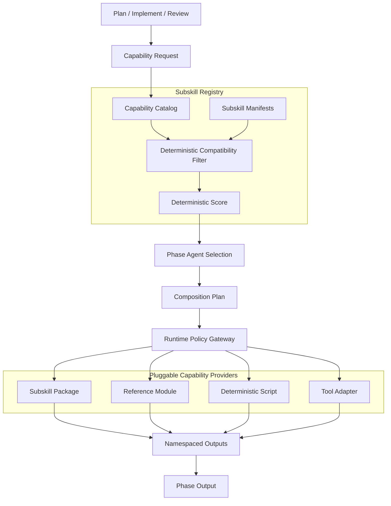
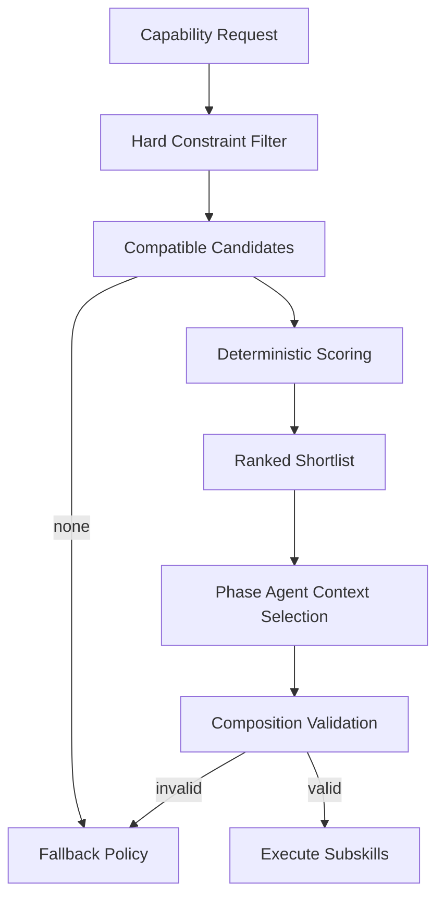
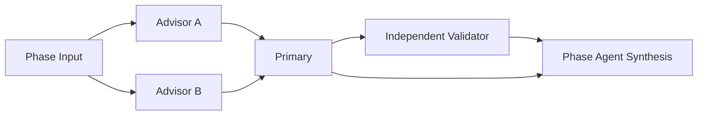

# Subskill Registry Design

## 目的

nousのPlan / Implement / Reviewへ専門能力を追加しながら、Orchestrator、Core Phase、個別Subskillの結合度を低く保つ。

- Subskillを容易に追加・更新・無効化・削除できる
- Core Phaseは具体的なSubskill名へ依存しない
- Registryが互換性のある候補を決定論的に絞る
- Phase Agentが選択済みguidanceを助言として利用する
- Subskillの「芯」を人名、理論、標準、methodologyなどの明確なanchorで表す
- Subskillが存在しなくても、許容可能な範囲でCore Phaseを継続できる
- active Taskの途中でSubskill変更が起きても再現・再開できる

設計上は**Hybrid Selection**を採用する。現在のruntime実装では、認知負荷と再現性を優先し、configで指定されたcapabilityをRegistry/Selectorが決定論的に選ぶ。Phase Agentは選択済みguidanceを助言として受け取り、独自に新しいSubskillや権限を起動しない。将来、候補比較が必要になってもhard constraintとexact pinを維持したまま拡張する。

## Runtime実装（v1）

`SubskillRuntime`は組み込みrootとconfigで明示されたread-only rootだけをdiscoverする。phase/cycleごとに、capability・role・limitで候補を選び、manifest hash、guidance hash、registry revision、入力snapshot digestをSelection Recordへ保存する。同じtask / loop / cycle / phaseにrecordがあればexact id/version/hashを再解決してguidanceを再利用する。provider消失、hash変更、入力変更ではsilent fallback/upgradeせずRecoveryRequiredで停止する。Reviewが`needs_plan`へ遷移してcycleが増えた場合だけ、新しいSelection Recordを作る。

Task agentへ渡すguidanceはuntrusted advisory contextであり、Task State、managed action、承認、policyを変更する命令ではない。外部skill、MCP、CLIの実行はこのregistryへ自動importせず、別adapterとPolicy Gatewayを必要とする。

この文書でのidentityは次のとおり。

| identity | 意味 |
| --- | --- |
| Codex Skill | Humanが呼ぶend-to-end workflow。初期公開Skillは`nous`の1つだけ |
| Subskill | Capability、contract、anchor、selection metadataを束ねる再利用可能package |
| Provider | 1つ以上のSubskillを実行可能にする物理package / entrypoint |
| runtime Subagent | 1つのChild Loop Contract revisionを実行する一時的worker backend |

Plan / Implement / ReviewはCore Phaseであり別Codex Skillではない。runtime Subagentは0個以上のSubskillを利用でき、同じSubskillは複数workerから再利用できる。Subskill invocationごとにSubagentを作成せず、worker名やpersonaをSubskill ID / Codex Skill名へ流用しない。

## 全体構造



具体的なSubskillの要求と選択はPhase Agent、候補のfilter・score・composition validationはRegistry、選択記録の保存とprovider起動はOrchestratorの責務とする。Orchestratorは候補順位を上書きして具体Subskillを選ばない。

## Selection Responsibility

| Component | 責務 |
| --- | --- |
| Phase Agent | Task contextからCapability Requestを作り、Registryが返したcompatible候補から最終選択し、Composition Planを作る |
| Registry | hard constraint filter、deterministic score、contract互換性、compositionの順序と競合を検証する |
| Orchestrator | Phase AgentのRequestと選択結果を受け、Selection Recordをtaskctl経由で保存し、Policy Gatewayの許可後にproviderを開始する |
| Subskill | Input Envelopeを処理し、namespaced Output Envelopeを返す |
| taskctl | Selection Record、action lifecycle、Phase結果をcanonical contractへ保存する |

Registryは候補を決定論的に絞るが、Task contextに対する最終選択を行わない。Orchestratorは実行可能性とpolicy grantを確認するが、具体Subskillを代理選択しない。選択変更が必要な場合はPhase Agentへ候補集合とfailure reasonを返す。

## 安定Coreと交換可能領域

### Stable Core

- nous Orchestrator
- Plan / Implement / Review
- Task State / Files
- Phase Handoff Contract
- Capability Request Contract
- Subskill Input / Output Envelope
- Registry Schema

### Pluggable

- 個別Subskillの手順
- core conceptsとchecks
- activation rules
- 内部prompt、reference、script
- provider type
- 同一Capabilityを満たす代替実装

Core PhaseへSubskill固有の分岐を追加しない。

```txt
避ける:
if subskill_id == "review.code.connascence": ...

採用する:
request capability "code.coupling_review"
```

## Provider Type

SubskillはCodex SkillではなくCapability packageを基本単位とする。Capabilityの性質に応じてproviderを選べる。

| provider | 用途 |
| --- | --- |
| `package` | reference、prompt、script、adapterをまとめた通常のSubskill provider |
| `reference` | 特定の理論・標準・checklistを必要時に読み込む能力 |
| `script` | 構文検証、変換、scanなど決定的な処理 |
| `tool_adapter` | MCP、CLI、APIなど外部toolへの契約付きadapter |
| `composite` | 複数Capabilityを順序付きで束ねる定義 |
| `codex_skill` | nous外から直接呼ぶ独立workflowへ昇格した例外的provider |

初期構成では`codex_skill` providerを作らず、`nous`内のSubskill packageとして提供する。別Codex Skillへ昇格するのは、nous外から直接呼ぶ、独立trigger / end-to-end workflow / permission boundary / version / forward testを持つ、という条件の大部分を満たす場合だけとする。昇格時はsystem `skill-creator`の初期化、構成、validation、forward testingに従う。

## Physical placement and discovery

Subskill sourceはruntime Task historyやCodex Skill metadataから分離し、project sourceでは次へ置く。

```txt
agent-nous/
  subskills/
    registry.json
    capabilities.json
    manifests/
      {subskill-id}/
        {subskill-version}.json
    providers/
      {provider-id}/
        {package-version}/
          provider.json
          references/       # providerが必要とする場合だけ
          scripts/          # providerが必要とする場合だけ
          assets/           # providerが必要とする場合だけ
```

`agent-nous/subskills`はbuilt-in provider rootであり、`${NOUS_HOME}/tasks`配下へcopyしない。追加provider rootはpackage外のnous configに`subskill_roots[]`として明示し、current working directory、`PATH`、任意のCodex Skill directoryを暗黙scanしない。各rootはread-only discovery対象とし、同じ`provider_id` / `package_version`が異なるhashで重複した場合はambiguousとして拒否する。

Discovery順序:

```txt
1. launcherがproject rootと明示subskill_roots[]を解決する
2. 各rootのregistry.json / provider.jsonをschema validationする
3. enabledなSubskill manifestとProvider identityをindex化する
4. path containment、package hash、entrypoint存在、contract互換性を検証する
5. 検証済みRegistry revisionだけをselectionへ公開する
```

directory名だけからproviderを有効化しない。symlinkを許可するrootでもreal pathが宣言root外へescapeするentrypointは拒否する。Taskへは選択時のRegistry revision、Subskill version、Provider identity、package hashをSelection Recordとして保存し、provider source自体をTask directoryへ複製しない。

### Provider identity

Subskill IDとprovider identityを分離する。1つのprovider packageは複数Subskill / Capabilityを提供できる。

```txt
provider_id
provider_type: package | reference | script | tool_adapter | composite | codex_skill
package_name
package_version
entrypoint
locator
package_hash
input_contracts[]
output_contracts[]
provided_subskill_ids[]
```

- `provider_id`はversionを含まないstable IDである
- `package_version`はSemVer、`package_hash`はnormalized package contentへ束縛する
- `entrypoint`はprovider root基準のrelative locatorであり、provider type別adapterが解決する
- `reference`は許可済みcontextへ内容を読み込み、`script` / `package`はJSON Input Envelopeを受けてJSON Output Envelopeを返し、`tool_adapter`は同じEnvelopeをtyped tool request / responseへ変換する
- `codex_skill`は明示的なinstalled Skill identityとversionをlocatorに持ち、通常のSubskill packageへ暗黙fallbackしない

### Version resolution

新しいselectionではSubskill manifestがprovider version constraintを宣言し、Resolverは互換候補の最大SemVerを選び、exact `package_version`と`package_hash`をSelection Recordへpinする。同じversionに異なるhashがある場合は選ばない。

Resumeではpin済みexact version + hashを最優先し、存在しなければ自動で別hashへ置換しない。Phase Agentへ`provider_unavailable`と互換候補を返し、Fallback Policyに従って再選択する。major versionは自動選択せず、Input / Output Contractのmajor compatibilityも独立に検証する。

```txt
new selection:
  enabled manifest -> version constraint -> highest compatible version -> exact hash pin

resume:
  exact version + exact hash -> use
  unavailable / hash mismatch -> fail resolution -> explicit fallback / reselect
```

### registry.json

```json
{
  "schema_version": 1,
  "registry_revision": 12,
  "subskills": [
    {
      "subskill_id": "review.code.connascence",
      "manifest_ref": "manifests/review.code.connascence/1.0.0.json",
      "status": "enabled"
    }
  ]
}
```

### capabilities.json

Capability名の重複や表記揺れを防ぐcatalog。

```json
{
  "schema_version": 1,
  "capabilities": [
    {
      "capability_id": "code.coupling_review",
      "description": "変更による結合と波及範囲を評価する",
      "input_contract": "phase-input@1",
      "output_contract": "review-findings@1",
      "risk_if_missing": "medium"
    }
  ]
}
```

新しいCapabilityを追加する前に、既存Capabilityのaliasやより一般的なCapabilityで表現できないか確認する。

## Subskill ID

内部IDは次のdot notationを使う。

```txt
{primary-phase}.{domain}.{anchor}
```

例:

```txt
plan.requirements.wiegers
implement.architecture.clean-architecture
review.code.connascence
review.security.owasp-asvs
cross.docs.diataxis
```

規則:

- lowercase ASCII、digit、hyphen、dotだけを使う
- IDへversionを含めない
- 作成後に意味を変えない
- display name変更でIDを変更しない
- 異なる思想・契約を持つ場合は別IDにする

provider `package_name`はprovider identityであり、Subskill IDと一致する必要はない。例外的な`codex_skill` providerだけはCodex Skill naming ruleに従うhyphen-case名を使い、Manifestで内部IDへ対応付ける。

```txt
subskill_id: review.code.connascence
provider_id: review-quality-core
package_name: review-quality-core
```

## Capability Naming

CapabilityはSubskill名や特定tool名ではなく、Phaseが必要とする結果で表す。

```txt
{domain}.{action_or_outcome}
```

例:

```txt
requirements.clarification
requirements.acceptance_criteria_design
architecture.boundary_design
code.coupling_review
security.threat_model
security.input_validation_review
docs.information_architecture
testing.test_strategy
knowledge.source_validation
```

避ける例:

```txt
use-connascence
clean-code
good-review
run-tool-x
```

## Subskill Manifest

```txt
schema_version:
subskill_id:
version:
status: draft | enabled | deprecated | disabled
display_name:
description:
provider_type:
provider_ref:
  provider_id:
  package_version_constraint:
  entrypoint_contract:

phases:
provides:
requires_capabilities:

core:
  anchors:
  canonical_sources:
  principles:
  anti_patterns:

activation:
  required_signals:
  positive_hints:
  negative_hints:
  exclusions:

contracts:
  input:
  output:

execution:
  side_effect_policy:
  required_tools:
  required_permissions:
  requested_filesystem_scope:
  requested_network_scope:
  estimated_context_cost:

composition:
  role: primary | advisor | validator
  before:
  after:
  incompatible_with:
  max_instances:

fallback:
  capability_optional:
  alternatives:
  failure_behavior:

quality:
  validation_ref:
  forward_test_ref:
```

ManifestはSubskillの意味とProviderへのversion constraintを持つが、物理`locator`、exact `package_version`、`package_hash`は解決済みProvider identityとSelection Recordが持つ。これによりSubskill IDを維持したままprovider packageを交換できる。

`execution`以下はproviderが必要とする上限の宣言であり、runtime権限ではない。Registryは宣言とRequestの互換性をfilterできるが、実行時のtool、filesystem、network、write、external effectは[Runtime Policy Gateway Design](./policy-gateway.md)がExecution Grantとして強制する。

## 「芯」の契約

`core.anchors`は一般的な美辞麗句の一覧ではなく、Subskillの判断を収束させる具体的なanchorを持つ。

利用できるanchor:

- 人名とそのmethodology
- 名前の付いた理論・原則・model
- 標準・specification・framework
- 原著、原論文、公式guide
- 明確な分析手法

Manifestには次を含める。

```txt
anchors:
  - name: Connascence
    creator_or_body: Meilir Page-Jones
    source_ref: ...
principles:
  - 評価で実際に使う原則
anti_patterns:
  - anchorから導かれる避けるべき状態
```

Registry validationで拒否するもの:

- `best practices`、`高品質`、`保守しやすい`だけで構成される
- anchorとchecksの関係を説明できない
- canonical sourceまたは信頼できる解説へ追跡できない
- 複数の無関係な思想を理由なく混ぜる
- 名前だけ借りて、実際の判断基準へ反映していない

複数anchorを組み合わせる場合は、主anchorと補助anchorを区別し、矛盾時の優先方針を記載する。

## Capability Request

Phase AgentはTask contextから必要なCapabilityを要求する。

```txt
request_id:
phase:
required_capabilities:
optional_capabilities:
objective:
scope:
signals:
available_inputs:
required_output_contract:
risk_class:
side_effect_limit:
tool_availability:
context_budget:
```

`signals`の例:

```txt
- multiple_modules_changed
- public_api_changed
- authentication_boundary_changed
- documentation_restructure
- unclear_acceptance_criteria
```

Phase Agentは具体的なSubskill IDを要求しない。ただし、HumanまたはPlanが特定anchorを明示した場合は`preferred_anchor`としてRequestへ含められる。

## Hybrid Selection



### Stage 1: Hard Constraint Filter

Registryが機械的に除外する。

- `status`が`enabled`ではない
- Phaseが一致しない
- required Capabilityを提供しない
- Input / Output Contract versionが互換でない
- required inputが存在しない
- exclusion ruleに一致する
- required toolまたはpermissionを利用できない
- side effect policyがRequestの上限を超える
- 明示的なincompatibilityがある
- package hashまたはvalidationに問題がある

Hard ConstraintをAgent判断で無視しない。

### Stage 2: Deterministic Score

互換候補を次の観点でscore化する。

```txt
capability_specificity  要求Capabilityへどれだけ直接的か
signal_match            activation signalとの一致
scope_match             対象domain・artifactとの一致
anchor_relevance        Taskの問題とcore anchorの関連性
validated_quality       validationとforward testの状態
execution_cost          context、tool、時間、外部cost
```

Scoreは候補の優先順位付けに使い、単独で最終決定しない。過去の利用回数だけで高scoreにせず、新しいSubskillが永続的に選ばれない状態を避ける。

### Stage 3: Phase Agent Selection

Phase Agentは上位候補のmetadataだけを読み、Task contextに対する最終適合性を判断する。

選択できる結果:

```txt
selected
selected_as_advisor
not_applicable
fallback_required
```

選択理由には、対応Capability、反応したsignal、anchorの関連性、除外した上位候補の理由を短く記録する。

Agentはhard constraintで除外されたSubskillを復活させない。

### Stage 4: Composition Validation

複数Subskillを選ぶ場合、Registryが次を検証する。

- dependencyがcycleを作らない
- `before` / `after`を満たす
- `incompatible_with`が共存しない
- mutating Subskillが同じwrite scopeへ競合しない
- context budgetとtool budgetを超えない
- primary、advisor、validatorの役割が明確である

validation成功後、OrchestratorはSelection Recordをtaskctl経由で保存する。その後、各invocationのExecution RequestをPolicy Gatewayへ渡し、Grantを取得できたproviderだけをcomposition orderに従って開始する。Grant拒否時にOrchestratorが別Subskillを独断で選ばず、Phase Agentへ再選択またはFallback Policyの判定を返す。

## Composition

### Primary

Capabilityの主要成果物を作る。1つのCapability Requestにつき、同じwrite scopeを変更するPrimaryは1つだけにする。

### Advisor

read-onlyで分析やfindingsを返す。複数を組み合わせられるが、出力をSubskill IDでnamespace化する。

### Validator

Primary Outputが特定の契約やstandardを満たすか検証する。Primaryと同じSubskill実体を自己Reviewに使わない。



Subskill同士が直接呼び合わない。Phase AgentがComposition Planを作り、OrchestratorがPolicy Gatewayを通して各providerを開始し、名前付きOutputを次のSubskillへ渡す。

## Input Envelope

Subskillはfile system全体や会話履歴を自由に読むのではなく、Input Envelopeを受け取る。

```txt
contract_version:
invocation_id:
subskill_id:
subskill_version:
provider_id:
provider_package_version:
provider_package_hash:
task_id:
loop_id:
cycle:
phase:
objective:
scope:
acceptance_criteria:
knowledge_packet:
artifact_refs:
previous_outputs:
constraints:
side_effect_limit:
requested_capabilities:
execution_grant_ref:
resource_reservation_refs:
```

必要な情報が不足している場合、Subskillは勝手にscopeを広げず`missing_inputs`を返す。

## Output Envelope

```txt
contract_version:
invocation_id:
subskill_id:
subskill_version:
provider_id:
provider_package_version:
provider_package_hash:
status: succeeded | partial | not_applicable | failed
capabilities_addressed:
summary:
findings:
recommendations:
evidence_refs:
assumptions:
missing_inputs:
conflicts:
artifact_refs:
validation:
suggested_capabilities:
side_effects_performed:
policy_evidence_refs:
```

規則:

- State遷移を直接指定しない
- Humanの意思決定を捏造しない
- findingとrecommendationを分ける
- evidenceへ追跡できるようにする
- 実行したside effectを隠さない
- `suggested_capabilities`はRegistryへのRequest候補であり、Subskill自身が起動しない
- secretや不必要なSource本文をOutputへ複製しない

Phase Agentが複数Outputを統合し、Phase Outputと次状態を決める。

## Side Effect Boundary

```txt
read_only
workspace_write
external_effect
```

- `read_only`: 渡されたinputと許可されたSourceを読むだけ
- `workspace_write`: 指定worktreeとwrite scopeだけを変更できる
- `external_effect`: push、送信、production、課金など外部状態を変える

Subskillは宣言した上限を超えない。`external_effect`はHuman Input Policyに従い、具体的なapprovalをInput Envelopeに含む場合だけ選択候補になる。

この区分も権限宣言であり、自己申告によるenforcementではない。OrchestratorはinvocationごとにExecution Requestを作り、Policy Gatewayがtool allowlist、filesystem read/write scope、network、resource reservation、approvalを検査して単一用途のExecution Grantを発行する。Grantを発行できないproviderは開始しない。

SubskillはTask State、Registry、Root共有fileを直接変更しない。`workspace_write`でもExecution Grantが指定したworktreeとsemantic resourceだけを変更できる。成果物参照、実際のside effect、policy evidenceをPhase Agentへ返す。詳細は[Runtime Policy Gateway Design](./policy-gateway.md)に従う。

## Selection Record

再現とReviewのため、選択結果をEvent Journalへ記録する。

```txt
request_id:
registry_revision:
candidates:
  - subskill_id:
    version:
    score:
    filter_result:
selected:
composition_order:
selection_reason:
rejected_reasons:
resolved_providers:
  - provider_id:
    package_name:
    package_version:
    entrypoint:
    locator:
    package_hash:
composition_validation:
execution_request_refs:
```

OrchestratorがこのRecordをtaskctl経由で保存し、保存成功後にprovider起動へ進む。Resume時は同じcycle内で同じversionとpackage hashをPhase Agentの候補として優先する。利用不能な場合はPhase Agentが再選択し、変更理由とOutput互換性を記録する。

## Fallback Policy

候補がない、実行に失敗した、Output Contractを満たさない場合は次の順に扱う。

```txt
1. 同じCapabilityを持つ互換Subskill
2. Catalogで定義されたbroader CapabilityのSubskill
3. CapabilityがoptionalならCore Phase標準処理
4. required Capabilityなら`missing_required_capability`として原因と解決可能性を分類する
```

`missing_required_capability`は一律に`needs_plan`へ変換しない。

```txt
failure_reason: missing_required_capability
capability_id:
required_by:
missing_because: no_provider | incompatible_contract | unavailable_tool | policy_denied | invalid_provider
resolution: replan | human | blocked
candidate_alternatives:
human_options:
blocking_scope:
```

| resolution | 条件 | Task outcome |
| --- | --- | --- |
| `replan` | Objectiveと安全条件を保った別手順、別Output Contract、依存順序変更で解消可能 | `needs_plan`とし、具体的な`next_plan_input`を返す |
| `human` | tool/providerの提供、scope変更、risk受容、複数案の価値判断が必要 | `needs_human_input`とし、実行可能な選択肢を返す |
| `blocked` | 安全上必須のCapabilityが存在せず、再PlanでもHumanの承認でも代替不能 | `blocked`とし、欠如したCapabilityと解除条件を記録する |

Policy Gatewayのdenyは自動的にHuman承認で上書きしない。承認不足なら`human`、resource競合や手順変更で解消できるなら`replan`、platform hard limitまたは安全上の必須条件を満たせないなら`blocked`へ分類する。

安全上必須のCapabilityを「一般的なAgent判断」で置き換えない。

例:

- security validationがrequiredで代替手順を設計できる: fail closedして`replan`
- 必須validatorを実行するtoolの導入可否をHumanが決める必要がある: `human`
- 必須validatorが存在せず安全条件も緩和できない: `blocked`
- docs表現の補助がoptionalで候補がない: Core Phaseで継続
- 複数の妥当なarchitecture anchorが競合: 選択肢でHumanへ質問

Subskill failureでCore Phase process自体をcrashさせず、failureをnamespaced OutputとEventへ記録する。

## Lifecycle

### 追加

1. Capability Catalogとの重複を確認する
2. Manifestとcore anchorを定義する
3. Input / Output Contractを選ぶ
4. provider実体を作る
5. Schema validationとcontract testを実行する
6. 現実的なtaskでforward testする
7. `draft`から`enabled`へ変更する
8. Registry revisionを増やす

通常は`agent-nous/subskills/providers/{provider-id}/{package-version}`へCapability packageを追加する。例外的に別`codex_skill`へ昇格する場合だけ`skill-creator`を使用する。

### 更新

Subskill versionはSemantic Versioningとして扱う。

- patch: 内部説明、bug fix、互換なcheck追加
- minor: 後方互換なCapabilityまたはOutput追加
- major: Input / Output Contract、意味、side effect境界の破壊的変更

active cycleは選択時のversionとhashをpinする。major updateへ自動移行しない。

### Deprecation

- `deprecated`は新規選択対象から外す
- active Taskはpin済みversionを継続できる
- replacementとmigration noteをManifestへ記録する
- Resume時にproviderが存在しなければFallback Policyを使う

### 無効化・削除

- security問題がある場合は`disabled`として即時選択停止する
- Registry entryを消す前にactive Task参照を確認する
- selection historyとManifest snapshotはTask Eventに残す
- 削除後もCore PhaseとCapability Catalogを壊さない
- required Capabilityの代替がなくなる場合は、削除前にRegistry validationを失敗させる

## Registry Validation

最低限、次を機械検証する。

- ID、version、statusの形式
- IDとManifestの一意性
- CapabilityがCatalogに存在する
- Input / Output Contractが存在し互換である
- provider ID、package name、version、entrypoint、locator、hashが一意に解決できる
- provider entrypointのreal pathが宣言root内にあり、Input / Output Envelope adapterが対応する
- core anchorとsource referenceが存在する
- activation ruleが構文上有効である
- dependencyとcomposition orderがcycleを作らない
- incompatible ruleが矛盾しない
- side effect policyとpermissionが一致する
- 宣言したfilesystem、tool、network、write scopeがPolicy Gateway contractで表現可能である
- required Capabilityにenabled providerまたは明示fallbackがある

Registry全体が無効な場合、前回検証済みrevisionを使い、新しいrevisionでTaskを開始しない。

## Forward Testing

SubskillはManifestだけでなく、現実的なtaskで選択・出力・failureを検証する。

- 独立したsubagentへtask artifactとSubskillだけを渡す
- 期待回答や設計者の診断を漏らさない
- Subskillが選択されるべきpositive caseを確認する
- 選択されるべきでないnegative caseを確認する
- missing input、tool unavailable、partial failureを確認する
- Output Contractとside effect境界を検証する
- 他Subskillとのcompositionを確認する

forward test結果を品質情報として使えるが、Task relevanceより過去scoreを優先しない。

## Security and Isolation

Subskillを信頼境界の内側へ無条件に置かない。

- least privilegeのInputとExecution Grantだけを渡す
- external contentをnousへの命令として扱わない
- Task State、Registry、他Child Loopを直接変更させない
- provider packageのversionとhashを記録する
- credentialをManifest、Input、Outputへ保存しない
- tool adapterの外部送信先とside effectを宣言する
- unknown providerを自動enableしない
- Manifestをenforcementとみなさず、すべてのprovider実行をPolicy Gatewayへ通す

## 例

### `review.code.connascence`

```txt
provides:
  - code.coupling_review
core:
  anchors:
    - Connascence
  principles:
    - 強度、局所性、degreeを用いて変更波及を評価する
composition:
  role: advisor
execution:
  side_effect_policy: read_only
```

### `implement.architecture.clean-architecture`

```txt
provides:
  - architecture.boundary_design
core:
  anchors:
    - Clean Architecture
    - Dependency Rule
  principles:
    - source code dependencyを内側のpolicyへ向ける
composition:
  role: primary
execution:
  side_effect_policy: workspace_write
```

### `plan.requirements.wiegers`

```txt
provides:
  - requirements.clarification
  - requirements.acceptance_criteria_design
core:
  anchors:
    - Karl Wiegers Software Requirements
  principles:
    - business、user、functional requirementを分ける
composition:
  role: advisor
execution:
  side_effect_policy: read_only
```

## 不変条件

- OrchestratorとCore Phaseは具体的なSubskill IDへ依存しない
- 初期のユーザー向けCodex Skillは`nous`だけとし、Core Phaseを別Skillへ分割しない
- runtime SubagentはChild Loopの一時的backendであり、0個以上のSubskillを使える
- SubskillとSubagentを1対1にせず、1つのSubskill / providerを複数workerから再利用できる
- Registryはhard constraintを決定論的に適用する
- Phase AgentはCapabilityを要求し、互換候補の中からTask contextで最終選択する
- Registryはfilter、score、composition validationを行い、最終選択を代行しない
- OrchestratorはSelection Recordを保存し、Policy Gateway許可後にproviderを開始するが、具体Subskillを選ばない
- 選択理由、version、package hashを記録する
- provider discoveryは明示rootだけを使い、exact version / hashをTaskへpinする
- SubskillはInput / Output Envelopeを守る
- SubskillはState遷移と他Subskill起動を直接行わない
- Manifestは権限宣言であり、runtime enforcementはPolicy Gatewayが担う
- core anchorを具体的な判断基準へ反映する
- mutating Primaryを同じwrite scopeへ複数配置しない
- `missing_required_capability`をreplan、Human、blockedへ機械的に分類する
- required Capabilityの安全性を曖昧なfallbackで弱めない
- Subskill追加・削除でCore Phaseを壊さない
