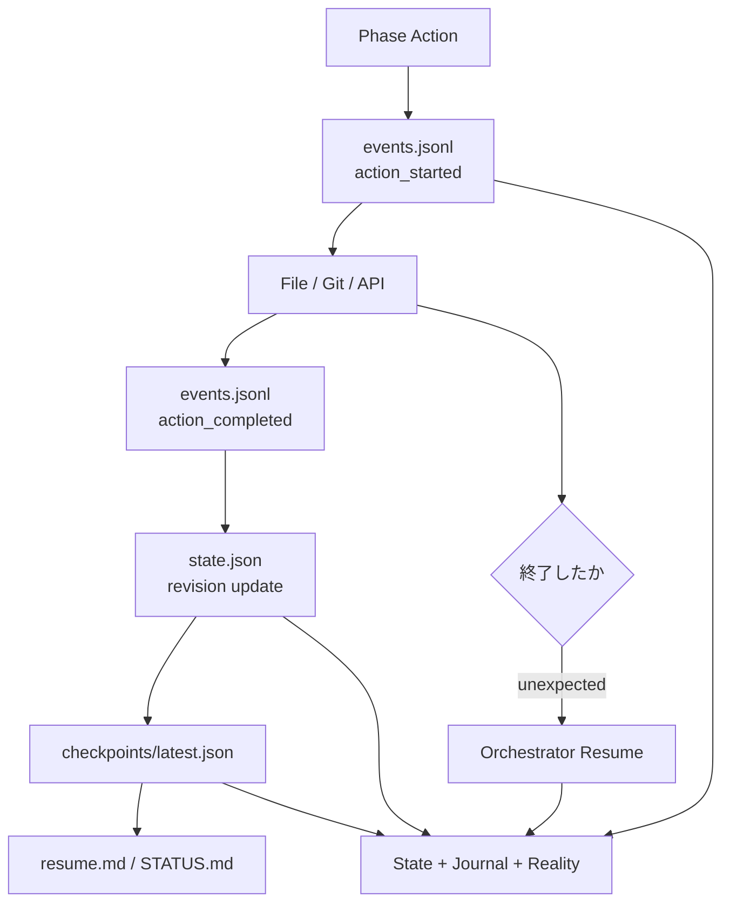

# Task Files Design

## 目的

nousのRoot Task、並列Child Loop、cycle履歴、Knowledge、checkpointを、再開しやすく誤読しにくいfile構造へ配置する。

- 作業対象repositoryをnousの管理fileで汚さない
- Humanが1つの入口から全Taskの状態を確認できる
- machine stateとPhase成果物は厳密に解析できるJSON、Human向け表示はMarkdownに分ける
- 現在有効なPlanと過去Planを混同しない
- 並列Child Loopを同じ規則で保存する
- 必要になるまでfileやdirectoryを増やさない

## 形式の原則

| 情報 | 形式 | 理由 |
| --- | --- | --- |
| Task Definition、Stable Context、State、Checkpoint、Artifact metadata | JSON | 型、version、recoverable update、機械検証を優先する |
| Knowledge Questions / Claims / Sources | JSON | ClaimとSourceのtyped reference、鮮度、provenanceを機械検証する |
| Plan / Implement / Review Result、Review Decision | JSON | Phase完了と遷移を条件付きで機械検証する |
| Parallelization Plan、Child Loop Contract | JSON | DAG、scope、resource、参照整合性を機械検証する |
| Event Journal | JSON Lines (`.jsonl`) | 1 eventずつ追記し、途中終了から復旧しやすくする |
| Phase view、Knowledge view、Summary、Resume | Markdown | canonical dataをHumanが読みやすい形で確認する |
| Lock、Lease、temporary file | runtime用file | 永続成果物やKnowledgeと分離する |

Markdown内へmachine stateを埋め込まず、JSONを正規の状態情報とする。Markdownの見出しや自然文を解析してPhase遷移を決めない。Phase Artifactの型と条件付き必須条件は [Phase Artifact Contract Design](./phase-artifacts.md) を正とする。

## 標準配置

Taskは解決済みRuntime Homeの管理領域へ集約する。

```txt
${NOUS_HOME}/tasks/
```

利用者のlocal projectでは`NOUS_HOME`を任意の実行領域へ設定できるが、
host固有のabsolute pathをSkill packageへ埋め込まない。

作業対象repository内へ`.nous/`やTask管理用Markdownを自動生成しない。対象repositoryには、そのrepository自身が必要とする実装・test・設計変更だけを行う。

## 全体構造

```txt
agent-nous/
└── tasks/
    ├── registry.json
    ├── STATUS.md
    └── 20260718-1430-example-task/
        ├── task-definition.json
        ├── stable-context.json
        ├── task.md
        ├── state.json
        ├── summary.md
        ├── resume.md
        ├── knowledge/
        │   ├── questions.json
        │   ├── claims.json
        │   └── sources.json
        ├── knowledge.md
        ├── sources.md
        ├── current-plan.md
        ├── current-review.md
        ├── approvals.json
        ├── secret-exceptions.json
        ├── policy-overrides.json
        ├── events.jsonl
        ├── human-input/
        │   ├── questions/
        │   │   └── {question_id}.json
        │   └── answers/
        │       └── {answer_id}.json
        ├── evidence/
        │   └── EV-0001.json
        ├── checkpoints/
        │   └── latest.json
        ├── cycles/
        │   ├── 0001/
        │   │   ├── 01-plan-result.json
        │   │   ├── 01-parallelization-plan.json
        │   │   ├── artifact-sets/
        │   │   │   └── {transaction_id}.json
        │   │   ├── 01-plan.md
        │   │   ├── 02-implement-result.json
        │   │   ├── 02-implement.md
        │   │   ├── 03-review-result.json
        │   │   ├── 03-review-decision.json
        │   │   └── 03-review.md
        │   └── 0002/
        │       └── ...
        ├── research/
        │   └── Q-001-topic.md
        ├── loops/
        │   └── L01-api/
        │       ├── contract.json
        │       ├── contracts/
        │       │   └── rev-0001.json
        │       ├── loop.md
        │       ├── state.json
        │       ├── summary.md
        │       ├── resume.md
        │       ├── knowledge/
        │       │   ├── questions.json
        │       │   ├── claims.json
        │       │   └── sources.json
        │       ├── knowledge.md
        │       ├── sources.md
        │       ├── current-plan.md
        │       ├── current-review.md
        │       ├── events.jsonl
        │       ├── evidence/
        │       │   └── EV-L01-0001.json
        │       ├── checkpoints/
        │       │   └── latest.json
        │       ├── cycles/
        │       │   └── 0001/
        │       │       ├── 01-plan-result.json
        │       │       ├── artifact-sets/
        │       │       │   └── {transaction_id}.json
        │       │       ├── 01-plan.md
        │       │       ├── 02-implement-result.json
        │       │       ├── 02-implement.md
        │       │       ├── 03-review-result.json
        │       │       ├── 03-review-decision.json
        │       │       └── 03-review.md
        │       └── research/
        └── artifacts/
            └── index.json
```

この構造は最終状態の上限を示す。Task作成時に全fileを空で作らない。

## Source of Truth

同じ情報が複数のviewへ現れる場合、次の順序で正とする。

```txt
1. `task-definition.json`、`stable-context.json`、`state.json`のrevisionとactive typed artifact reference
2. cycles/{cycle}/ のcanonical Phase JSONとArtifact Set Manifest、immutable Child Contract、`knowledge/*.json`、`approvals.json`、`secret-exceptions.json`、probe evidence JSON
3. checkpoints/latest.json
4. events.jsonl
5. task.md / summary.md / knowledge.md / sources.md / cycles/{cycle}/*.md / current-plan.md / current-review.md / resume.md / STATUS.md
```

ただし、復旧時は`state.json`だけを盲信せず、Checkpoint、Journal末尾、Gitやfileの実状態を照合する。

すべてのMarkdownと`registry.json`、`artifacts/index.json`はHuman viewまたは検索indexとして再構築可能なpost-commit cacheであり、canonical outputではない。各Markdown viewに`do_not_edit`、`generated_from_revision`、`source_ref`、`source_hash`を表示し、State revisionまたはsource hashが一致しなければrendererが再生成する。

## tasks/直下

### registry.json

全Root Taskを検索するためのmachine-readable index。

```json
{
  "schema_version": 1,
  "generated_at": "2026-07-18T14:30:00+09:00",
  "tasks": [
    {
      "task_id": "20260718-1430-example-task",
      "path": "20260718-1430-example-task",
      "lifecycle_status": "active",
      "execution_status": "paused",
      "visibility": "visible",
      "phase": "implement",
      "cycle": 1,
      "sync_status": "push_pending",
      "updated_at": "2026-07-18T14:30:00+09:00"
    }
  ]
}
```

Registryは検索用cacheであり、個別Taskの正規状態ではない。Task更新中にRegistry更新前で終了しても、OrchestratorはTask directoryをscanして再構築できる。

### STATUS.md

Human向けのTask一覧。

最低限、次を短く表示する。

```txt
- task_id / 表示名
- lifecycle status / execution status
- visibility / sync status
- phase / cycle
- 並列Child Loopの集約状態
- Human回答待ちの有無
- 最終更新時点
- 再開時の一行要約
```

全eventや長い進捗を転載しない。`visibility: archived`のTaskは通常表示から除外し、明示的なarchive表示で確認できるようにする。詳細は各Taskの`resume.md`へリンクする。

## Root Task直下

### task-definition.json / task.md

`task-definition.json`がTask作成時のRoot要求を保持するimmutable canonical machine contractであり、`task.md`はTask DefinitionとStable Contextから生成するHuman viewである。

```txt
schema_version
task_id
revision
transaction_id
title
requested_by
created_at
target_repositories[]
initial_request             verbatim_text, captured_at, source
objective                   objective_id, statement
non_goals[]
acceptance_criteria[]       criterion_id, statement, validation_method
constraints[]               constraint_id, statement, source_ref
human_action_boundaries[]   boundary_id, statement, source_ref
```

Humanの`initial_request.verbatim_text`は改変せず、Agentによるtyped interpretationと分離する。作成後のObjectiveやAcceptance Criteria変更は`task-definition.json`を上書きせず、Stable Contextのtyped amendmentとしてHuman回答またはReview Decisionへのprovenance付きで追加する。`task.md`を編集して要求を変更することはできない。

### stable-context.json / summary.md

`stable-context.json`が複数Phaseで再利用する現在有効な解釈、Human質問・回答、判断、risk、Knowledge参照のcanonical machine contractである。

```txt
schema_version
task_id
revision
transaction_id
confirmed_requirement_refs[]
requirement_amendments[]
active_decisions[]
current_outcome
open_question_refs[]
human_question_refs[]
human_answer_refs[]
active_risks[]
relevant_knowledge_claim_refs[]
updated_at
```

Question / Answer本体はimmutableな`human-input/questions/{question_id}.json`と`human-input/answers/{answer_id}.json`に置き、`common.schema.json`が定める唯一のHumanQuestion / HumanAnswer型を使う。Stable Contextはそのrefだけを持つ。`state.json.pending_human_questions`も未回答recordへのcache参照であり、質問本文やresume先の正本ではない。

### state.json

Task State and Recovery Designで定義したCurrent State Snapshotを保存する。

- JSON Schemaで検証可能にする
- `schema_version`と単調増加する`revision`を持つ
- `active_plan_ref`はcanonicalなcycle fileを指す
- Plan / Parallel / Implement / latest Reviewのtyped artifact refを個別に持つ
- `latest_checkpoint_ref`を持つ
- Child Loopの集約状態を持つ
- 一時的なheartbeatを書き込まない

### summary.md

各Phaseが最初に読む短いStable Summary。canonical inputは`task-definition.json`と`stable-context.json`である。

```txt
generated_from_revision:

# Objective
# Confirmed Requirements
# Active Decisions
# Current Outcome
# Open Questions
# Active Risks
# Relevant Knowledge Claims
```

cycleの作業日記や古いPlanを入れない。Human回答と有効な意思決定を優先する。手動編集はcanonical dataへ反映しない。

### resume.md

Humanまたは新しいOrchestratorが、Taskを短時間で再開するためのview。

```txt
generated_from_revision:
generated_at:

# Current State
# Last Safe Checkpoint
# Work Completed
# Interrupted or Pending Action
# Next Safe Action
# Parallel Loops
# Human Questions
# Working Repository State
```

`resume.md`は手書きのlogではない。State、Checkpoint、Journal末尾、repository照合結果から生成する。再開判断は元のJSONと実環境を使う。

### knowledge/*.json / Markdown views

- `knowledge/questions.json`: Knowledge Question lifecycleのcanonical typed store
- `knowledge/claims.json`: Claim、epistemic / lifecycle status、Source relationのcanonical typed store
- `knowledge/sources.json`: Source provenanceとClaimへのsupports / contradicts関係のcanonical typed store
- `knowledge.md`: Questions / Claims JSONから生成するHuman-readable view
- `sources.md`: Sources JSONから生成するHuman-readable view

Research Notesは`research/`へ分離し、Active Knowledgeと混ぜない。Phase Agentや調査Subskillは候補を返し、taskctlだけがtyped Knowledge JSONとviewを確定する。

### events.jsonl

1行に1つのJSON eventを追記する。

```json
{"event_id":"E-0001","revision":1,"event_type":"task_created","occurred_at":"2026-07-18T14:30:00+09:00"}
{"event_id":"E-0002","revision":2,"event_type":"phase_started","phase":"plan","cycle":1,"occurred_at":"2026-07-18T14:31:00+09:00"}
```

- 既存行を更新・並べ替え・削除しない
- secretや長いSource本文を記録しない
- 大きい成果物は保存せず、path、hash、artifact IDを記録する
- 破損した末尾行は復旧時に隔離し、最後の完全なeventまで読む

### approvals.json

Root Taskで現在有効または失効済みのApproval recordを保持するcanonical store。taskctlだけが更新する。

- Approvalを初めてrequestまたはgrantするときに条件付き生成する
- `state.json.active_approval_refs[]`はこのstoreへのcache参照とする
- scope、期限、revoke、consume、exhaustedをEventだけから推定しない
- Child Loopは独自のapproval storeを持たず、Root storeのTask / Loop scopeに束縛されたrecordを参照する
- secret値やcredentialを保存しない

Approval recordのcanonical field、status、scope、matching、consumeは [Action Policy](./action-policy.md) だけをauthorityとし、本書では再定義しない。

### secret-exceptions.json

Secret detectorのfalse positiveに対する、Task単位のcanonical exception store。初回exception確定時だけ生成し、taskctlだけが更新する。

```txt
schema_version
task_id
revision
transaction_id
exceptions[]
  exception_id
  detector_id
  pattern_id
  scope                 task_id, repository_identity, path_or_field_class
  expires_at
  approved_by
  approved_at
  status                active | revoked | expired
  provenance_ref
```

元のsecret-like値、そのhash、可逆表現を保存しない。private key、既知provider tokenなどhigh-confidence hard blockはexception不可とする。Child LoopはRoot storeのLoop / repository scope付きrecordを参照し、独自storeを持たない。

### policy-overrides.json

Taskまたはtarget repository固有の、base Action Policyより厳しいruleを機械適用するcanonical overlay。

- stricter ruleが初めて必要になった時だけ生成する
- source policyまたはHuman指示へのprovenance ref、適用scope、policy versionを持つ
- base policyを緩和するruleを拒否する
- Orchestratorが提案し、taskctlがSchemaとprovenanceを検証して確定する
- Phase Agent、Child Agent、target repositoryのscriptは直接更新しない

### evidence/

Action Policyのpreflight、postcheck、reconcile結果をtyped JSONとして保存する。

```txt
evidence/{evidence_id}.json
loops/{loop_id}/evidence/{evidence_id}.json
```

- Eventにはevidence本文を埋めず、ID、relative ref、hash、resultだけを持たせる
- Root ActionはRootの`evidence/`、Child Actionは自身のLoop `evidence/`へ保存する
- evidenceはSecret Gate通過後に確定し、secretやSource本文を保存しない
- external provider evidenceはimmutable locatorとhashだけを保存できる
- Phase AgentやChild Agentはevidence fileを直接書かず、taskctlへprobe resultを渡す
- reconcile evidenceのfield、条件付き必須、outcome enumは[Action Policy](./action-policy.md)のProbe Evidence Contractだけをauthorityとし、本書では保存pathとwrite boundaryだけを定める

## Cycle Files

各Loopのcycleを4桁zero-paddingで保存する。

```txt
cycles/0001/
cycles/0002/
```

標準のcanonical Phase Artifactとrendered view:

| canonical JSON | rendered Markdown | 役割 |
| --- | --- | --- |
| `01-plan-result.json` | `01-plan.md` | 要件、Acceptance Criteria、Plan、Validation、Knowledge Reference |
| `01-parallelization-plan.json` | `01-plan.md`内の条件付きsection | parallel modeのDAG、Child refs、integration contract |
| `02-implement-result.json` | `02-implement.md` | 実装内容、変更artifact、Planとの差異、Validation結果 |
| `03-review-result.json` | `03-review.md` | Review evidence、accepted criteria、issues |
| `03-review-decision.json` | `03-review.md` | `completed / needs_plan / needs_human_input`のtyped判定 |
| `artifact-sets/{transaction_id}.json` | なし | 同じPhase commitのArtifactLinkをfinal path / hashへ非循環に解決するimmutable manifest |

JSONがcanonicalであり、同名PhaseのMarkdownはJSONからだけ生成する。Knowledge収集はPlanの内部活動なので第4 Phaseを作らない。詳細な調査過程は`research/`を使用し、Phase Artifactには採用したClaim / Sourceへの`knowledge_references[]`だけを持たせる。

### File / Path Naming

```txt
cycle directory: cycles/{cycle:04d}/
Plan Result:      01-plan-result.json
Parallel Plan:    01-parallelization-plan.json
Plan view:        01-plan.md
Implement Result: 02-implement-result.json
Implement view:   02-implement.md
Review Result:    03-review-result.json
Review Decision:  03-review-decision.json
Review view:      03-review.md
Artifact Manifest: artifact-sets/{transaction_id}.json
Child Contract:   loops/{loop_id}/contracts/rev-{revision:04d}.json
Child current view: loops/{loop_id}/contract.json
Child view:       loops/{loop_id}/loop.md
```

- Phase prefixは`01`、`02`、`03`に固定する。
- Cycle pathだけを4桁zero-paddingし、JSON内`cycle`はpositive integerとする。
- `plan-result.json`のようなprefixなしのaliasを作らない。
- `current-*`はconvenience viewにだけ使用し、canonical JSON名に使用しない。
- Root LoopはTask rootをbase directoryとし、Child Loopは`loops/{loop_id}`をbase directoryとする。

### Cycleの不変性

Phaseが正式に完了した後、そのcycleのcanonical JSONとrendered Phase Markdownを次cycle向けに書き換えない。

- 誤記訂正が必要なら訂正eventを残す
- 実質的なPlan変更は新しいcycleで行う
- Phase Agentの作業中payloadはruntime draftまたはworker responseに置き、canonical pathへ保存しない
- Phase完了eventに各JSONとviewのhashを記録し、確定後の意図しない変更を検出する

## current-plan.md / current-review.md

Humanが深いcycle pathを探さずに現在の内容を読めるようにするconvenience view。

### current-plan.md

- `state.json.active_plan_ref`が指す`cycles/{cycle}/01-plan-result.json`から生成する
- source path、cycle、source hash、state revisionを冒頭に記載する
- 手動編集しない
- 新cycleのPlan commit後にcacheとして置き換える

### current-review.md

- `state.json.latest_review_result_ref`と`latest_review_decision_ref`が指す同じ`transaction_id`のartifactから生成する
- ReviewからPlanへ戻った後も、どのcycleのReviewか明示する
- `state.json`が示す現在Phaseより優先しない
- 手動編集しない

過去PlanやReviewは`cycles/`のtyped JSONとrendered viewにだけ残し、`current-*`を複数世代保存しない。

## Checkpoint Files

### checkpoints/latest.json

再開に使う最新の安全なcheckpoint。

- temporary fileへ完全なJSONを書いてからrenameする
- state revision、phase、cycle、最後のAction、次の安全なActionを記録する
- target repositoryのbranch、HEAD、worktree path、dirty summaryを記録する
- active Child Loopの要約を記録する

通常は`latest.json`だけを保持する。次の場合は診断用checkpointを別名で保持できる。

```txt
checkpoints/rev-000042-interrupted.json
checkpoints/rev-000067-before-destructive-action.json
```

全Actionごとのcheckpoint archiveは作らない。詳細な時系列はEvent Journalが担う。

## Runtime Files

Lock、Lease、temporary fileはTask成果物と分離する。

```txt
runtime/
  root.lock
  lease.json
  loops/
    L01-api.lease.json
```

Runtime Filesの規則:

- Git管理対象にしない
- secretを保存しない
- Lease切れ後は新しいOrchestratorが回収できる
- process IDだけで所有者を判断せず、`run_id`と期限を確認する
- temporary fileは原子的rename後に削除する

Runtime directoryの具体的な配置は実行方式に応じて選べるが、Taskのcanonical fileと同じ名前を使わない。

## Child Loop Files

Child Loopは`loops/{loop_id}/`へflatに配置する。filesystem上で再帰的にnestせず、親子関係は`state.json.parent_loop_id`で表す。

```txt
loops/
  L01-api/
  L02-ui/
  L03-integration/
```

flat配置により、深いpathと循環的な親子構造を避ける。

`contracts/rev-{revision:04d}.json`をimmutableなChild Loop Contractのcanonical artifactとし、`contract.json`と`loop.md`はactive revisionから生成するcurrent viewとする。Contractは [Phase Artifact Contract Design](./phase-artifacts.md) のField Dictionaryと条件付き検証に従う。

```txt
contracts/rev-{revision:04d}.json
  task_id
  loop_id
  parent_loop_id
  created_from_plan_ref
  objective
  scope[]
  dependencies[]
  required_inputs[]
  acceptance_criteria[]
  expected_outputs[]
  read_set[] / write_set[] / shared_resources[]
  integration_strategy
  validation_plan[]
  knowledge_references[]
```

Child Agentはcanonical Contract、`contract.json`、`loop.md`を直接更新しない。scope変更が必要な場合はParent Orchestratorへ提案し、`taskctl`が新しいimmutable revisionを確定してStateのactive refを更新する。各Child Loopは独自のState、Cycle、Checkpoint、Journalを持つ。Root TaskのKnowledgeへ統合する前のClaimとSourceにはLoop IDをnamespaceとして付ける。

```txt
L01-K-001
L01-S-001
```

Rootへ統合する際は新しいRoot Claim IDを発行し、`derived_from`でChild Claimを参照する。

## Artifacts

対象repositoryのsource codeやdocumentをTask directoryへ複製しない。

`artifacts/index.json`は確定Phase Artifact、Checkpoint、Eventから再構築する検索cacheとして次を表示する。

```txt
artifact_id:
kind:
locator:
repository:
branch:
commit:
content_hash:
produced_by_loop:
produced_in_cycle:
description:
```

配置方針:

- 対象repositoryに属する成果物: 対象repositoryへ保存し、Task側は参照だけ持つ
- nousの実行報告: Cycle Filesへ保存する
- Task固有で保存先repositoryを持たない成果物: `artifacts/`へ保存できる
- 大容量binary: 原則として外部locatorとhashだけを記録する
- secret、credential、本番dataのcopy: 保存しない

## 最小作成セット

Root Task開始時に必要なfileだけを作る。

```txt
tasks/registry.json
tasks/STATUS.md
tasks/{task_id}/task-definition.json
tasks/{task_id}/stable-context.json
tasks/{task_id}/task.md
tasks/{task_id}/state.json
tasks/{task_id}/summary.md
tasks/{task_id}/resume.md
tasks/{task_id}/events.jsonl
tasks/{task_id}/checkpoints/latest.json
```

Task作成時点ではPlan Resultが存在しないため、空の`01-plan-result.json`や`01-plan.md`を作らない。PlanのDraftが検証され確定するときにCycle directoryとPhase Artifactを同時生成する。

次は必要時に作る。

| 条件 | 作成対象 |
| --- | --- |
| Knowledge Questionがある | `knowledge/questions.json`, `knowledge/claims.json`, `knowledge/sources.json`, 対応するMarkdown view、`research/` |
| Plan確定 | `01-plan-result.json`, `01-plan.md`, `current-plan.md` |
| Parallel Plan確定 | `01-parallelization-plan.json`, `artifact-sets/{transaction_id}.json`, `loops/{loop_id}/contracts/rev-{revision:04d}.json`, current views |
| Implement確定 | `02-implement-result.json`, `02-implement.md` |
| Review確定 | `03-review-result.json`, `03-review-decision.json`, `03-review.md`, `current-review.md` |
| Child Loop生成 | `loops/{loop_id}/`のState最小setとContract |
| Artifact登録 | `artifacts/index.json` |
| Approval初回記録 | `approvals.json` |
| Secret false-positive exception初回記録 | `secret-exceptions.json` |
| Human質問 / 回答確定 | `human-input/questions/{question_id}.json` / `human-input/answers/{answer_id}.json`、Stable Context ref |
| Task / repository固有policy確定 | `policy-overrides.json` |
| Action probe確定 | RootまたはChildの`evidence/{evidence_id}.json` |

空directoryを維持するためのplaceholder fileは作らない。

## Recoverable multi-file transactionと整合性

### Canonical Writer

```txt
Phase Agent -> Draft Envelope -> Orchestrator -> taskctl -> canonical Task Files
```

- Phase AgentはTask directoryのcanonical fileとgenerated viewを直接更新しない。
- Orchestratorは意味判断、policy判断、expected revisionの選択を行うが、canonical fileを自由編集しない。
- `taskctl`はSchema、条件付き必須field、reference、revisionを検証した後だけrecoverable multi-file transactionを開始する。
- すべてのcanonical更新、Event、Checkpointへ同じ`transaction_id`を付ける。
- rendererはcommit済みJSONを入力とする決定的なpost-commit処理としてviewを生成する。
- Child Agentは自身のTask Filesも直接更新せず、同じ経路を使う。target repositoryの許可されたwrite scopeは別契約である。

### Canonical commit

```txt
1. Schema、条件付き必須項目、cross-artifact referenceをmemory上で検証する
2. `transaction_id`を発行し、prepared markerと全canonical targetのprevious / next hashをdurableに保存する
3. 同じfilesystem上へ全canonical temporary fileを書き、flush / fsync / 再検証する
4. deterministic orderでcanonical targetを`os.replace`し、各parent directoryをfsyncする
5. State、Event、Checkpointを同じtransaction IDとrevisionで整合させる
6. committed marker / Eventをdurableにし、prepared dataを回収する
7. Markdown view、Registry、STATUS、artifact indexをpost-commit cacheとして再生成する
```

これは複数fileが同時に不可分更新されるという意味のatomic transactionではない。crash時はprepared marker、next hash、既存canonical hashからroll-forwardまたはrollbackし、部分成功をsuccessとして返さない。

### Event Journal

- 1 eventを1行にserializeして追記する
- 1つのLoopに対するwriterをLeaseで限定する
- eventの書き込み後にState Snapshotを更新する
- State revision、event revision、`transaction_id`の差を復旧時にreconcileする

### Concurrent Child Loops

- 各Child Loopは自身のdirectoryだけを書き込む
- Root Taskの共有fileはChild Loopが直接更新しない
- Child OutputをRootへ統合するのはParent Orchestratorだけにする
- Registry、STATUS、artifact indexはParent Orchestratorがpost-commitに集約更新し、失敗時はcanonical Task directoryから再構築する

## Version Control方針

永続的なTask Filesは、判断経緯と再開情報を保持するためGit管理できる形にする。

Git管理対象:

- Task State Snapshot
- Event Journal
- Checkpoint
- Phase Output
- Knowledge / Sources / Summary
- Registry / STATUS
- Artifact metadata

Git管理対象外:

- Lock / Lease
- temporary file
- process ID
- credential / secret
- cache
- 外部repositoryの複製

Checkpointごとの自動commitを必須にはしない。commitの粒度とremote同期は実行policyで定義し、破壊的操作やHuman確認条件と分離する。

## Resume時の読み順

Orchestratorは次の順に読む。

```txt
1. tasks/registry.json。欠損または不整合ならTask directoryをscanする
2. Root Taskのstate.json
3. checkpoints/latest.json
4. events.jsonlのcheckpoint以降
5. target repositoryとartifactの実状態
6. runnable / waiting / interrupted Child Loopのstate.json
7. task-definition.json、stable-context.json、active Knowledge JSON
8. 現在Phaseに必要なstate.jsonのtyped artifact refが指すcanonical JSON
9. Resume Packetとresume.mdを再生成する
```

新しいPhase Agentへ渡すのはResume Packetと必要なcanonical fileだけであり、Task directory全体を無条件に読ませない。

## Mermaid: 保存と再開



## 不変条件

- machine stateとPhase ArtifactはJSON、eventはJSONL、Human向けviewはMarkdownとする
- Root TaskとChild Loopは同じLoop file契約を使う
- `state.json`から現在有効なPlanを一意に特定できる
- 過去cycleのtyped outputを現在Planとして解釈しない
- MarkdownだけでPhaseを完了または遷移できない
- Phase Agent、Child Agent、Orchestratorはcanonical fileを直接編集せず、`taskctl`を経由する
- `task.md`、`summary.md`、Knowledge Markdown、`current-*`、`resume.md`、`STATUS.md`、Registry / indexは再生成可能なviewまたはcacheとする
- Registryが壊れてもTask directoryから再構築できる
- Child LoopはRoot共有fileを直接更新しない
- 対象repositoryへnous管理fileを置かない
- secretとcredentialをTask Filesへ保存しない
- 実体のTask Filesを生成する前にJSON Schemaとtemplateを定義する

Template Catalog、Markdown base / overlay、JSON Schema、generated viewの生成規則は [Task Template Design](./task-templates.md) で定義する。

Task作成、Git保存、一覧、pause / resume、retention、archive、cleanupの運用は [Task Operations Design](./task-operations.md) で定義する。
