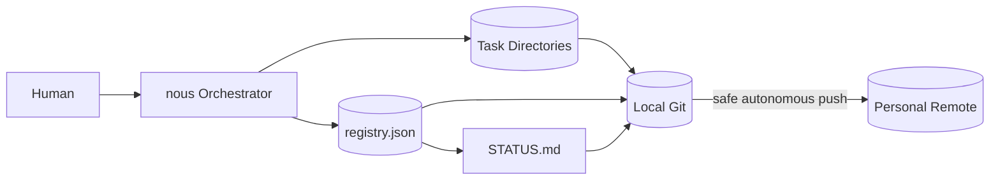

# Task Operations Design

## 目的

Task Filesを長期間安全に運用し、Humanが1つの窓口から作成・確認・停止・再開・完了Taskの参照を行えるようにする。

- durable milestoneでGitへ保存する
- agent-nousの個人repositoryは安全な時点で自律pushできる
- completed Taskを自動削除・自動移動しない
- `STATUS.md`は要対応Taskと直近完了5件を中心にする
- Registryが壊れてもTask directoryから再構築できる
- 別machineではremote上の最後のpushから再開できる
- runtime fileとworktreeだけを安全にcleanupする
- Phase確定・pause・session終了時にtarget成果物のdurabilityを明示する

## 運用の窓口

Humanは個々のChild Loopやfileを直接操作せず、nous Orchestratorへ操作を依頼する。

```txt
new       新しいRoot Taskを作る
status    要対応Taskと最近の完了Taskを見る
show      1つのTaskのresume viewを見る
pause     safe checkpointで一時停止する
resume    Taskをreconcileして再開する
cancel    Taskを中止する
rename    表示名を変更する
duplicate 新しいTaskへ目的・contextを引き継ぐ
reopen    cancelled / blocked Taskを明示的に再開する
archive   一覧上のvisibilityを変更する
cleanup   runtime resourceを安全に解放する
```

これらは論理operationであり、自然言語、Skill、internal script、CLIのどのinterfaceからでも同じ契約を使う。

StateとTask Filesを変更するinternal command contractは [taskctl Internal Utility Design](./taskctl.md) で定義する。
個々の操作のrisk、approval、probe、reconcile、auditは [Action Policy](./action-policy.md) に従う。

Runtime Task pathは文書・command・Eventで次の表記へ統一する。

```txt
${NOUS_HOME}/tasks
${NOUS_HOME}/tasks/{task_id}
```

packageや設計書へhost固有のTask absolute pathを埋め込まず、Task内のartifact refは`${NOUS_HOME}/tasks/{task_id}`基準のrelative pathとcontent hashで表す。



## Task Operation State

Taskの意味上の状態はTask State Designに従う。運用上のvisibilityは別fieldとして扱う。

```txt
visibility: visible | archived
```

- `visible`: 通常の検索・一覧対象
- `archived`: 明示的に指定しない限り通常一覧から除外

`archived`はTask directoryの移動を意味しない。pathを維持したままRegistryとSTATUSの表示を変える。

Taskの完了・中止・blockとvisibilityを混同しない。

## Gitの役割

### Local Files

単一fileのatomic replace、Event Journal、Checkpoint、recoverable multi-file transactionにより、processやterminalが突然終了しても同じmachineで復旧できる。複数fileを一括でfilesystem atomicにできるとは仮定しない。

### Local Git Commit

Task Filesのdurable milestoneを履歴として固定し、誤削除や誤更新から戻れるようにする。

### Remote Push

別machineからの再開とmachine lossへのbackupを提供する。

Git commitやpushをTask Stateそのものとして扱わない。未commitでもlocal Stateは有効であり、remoteでは最後にpushされたmilestoneまでしか復元できない。

## Local Git Adapter Contract

Local Parallelを実装・有効化する前に、managed Executorから呼べるLocal Git Adapterを利用可能にする。これはremote Git operationとは別のprerequisiteである。

```txt
status
diff
worktree_list
worktree_create
worktree_remove
branch_create
branch_delete
commit
patch_export
patch_apply
integration_apply
```

各requestは`repository_identity`、`expected_base_ref`、`normalized_target`、`allowed_resource_refs[]`、`action_id` / digest、`execution_grant_ref`を持つ。各responseはexit statusだけでなく、before / after HEAD、dirty paths、worktree / branch ref、commitまたはpatch hash、changed semantic resources、probe evidence refを返す。

- adapterは許可されたrepository / worktree / semantic resource以外を変更しない
- destructive cleanupはcontainment、dirty state、未統合artifactをprobeしてから別Actionとして実行する
- commitとpatch生成はlocal durabilityであり、push、remote branch作成、外部公開のpermissionを含まない
- operationがunsupported、probe不能、または結果がambiguousならparallel writeを開始せず、sequential fallbackまたはreconcileへ進む
- Schedulerはraw shell commandではなくこのtyped adapter contractを参照する

push / remote durability / cross-machine resumeは後段のRemote Push contractで追加し、Local Parallelのavailabilityをそれらへ依存させない。

## Action Execution Boundary

Task operationがfile、Git、repository script、network、外部resourceへ作用する場合、OrchestratorはAction Proposalを作り、Policy Gatewayを通す。operation名や「運用上必要」という理由でMatrixを迂回しない。

```txt
1. action_type、repository identity、environment、target、expected effectを正規化する
2. persistence / outbound候補へSecret Gateを適用する
3. repository / Task固有policyを重ね、policy decisionを保存する
4. required preflightとbefore evidenceを確定する
5. Redまたはapproval必須Actionはcanonical approvalをscope照合する
6. approval_consumedとaction_startedを同じ`transaction_id`のrecoverable multi-file transactionで記録する
7. Actionを実行する
8. required postcheckとafter evidenceから完了を判定する
9. durability、Checkpoint、Stateを更新する
```

unknown action type、probe不能、scope不明はfail closedにする。`action_started`だけが残る場合は、Action Policyのreconcile contractに従い、外部状態を確認するまで再実行しない。

## Repository Scope

自律pushの事前承認は、次のrepositoryへ限定する。

```txt
${CONTROL_REPOSITORY}
```

対象scope:

```txt
agent-nous/**
README.md内のagent-nous導線
```

この承認から除外するもの:

- 他project directoryの変更
- Taskが作業対象とする別repository
- force push、history rewrite、tag作成、release
- branch protectionの変更
- secretまたはprivate dataの追加
- unrelatedな既存変更

対象repositoryが個人用であるため、通常のpush timingはOrchestratorが安全性とbackup価値から決められる。別repositoryへのpush permissionとして継承しない。

この事前承認も暗黙設定にはせず、各Root Taskのcanonical `approvals.json`へprovenance付き`bounded_standing` approvalとして参照可能にする。`git_push_control_repo`、repository identity、remote、許可branch、environment、normal fast-forward push、禁止option、対象path、expected effect classを固定する。各pushのcommit / action digest、before / after refはAction Eventへ記録するが、将来commitが未確定であることだけを理由にstanding approvalを無効化しない。

このstanding approvalは期限・回数を固定しない明示的な個人repository方針として扱えるが、Humanが撤回できる。force push、history rewrite、別remote、別repository、Target Repository、scope外path、Red Actionへは使用できない。

## Commit Policy

### Commitするdurable milestone

- Root Task作成
- Plan Phase確定
- Implement Phase確定
- Review Phase確定
- Child Loopの重要Output統合
- Human回答によるRequirementまたはApproval Boundary変更
- safe pause完了
- interrupted Taskのrecovery完了
- cancelled / reopened / archived
- Root Task完了
- Schema migrationまたはTask repair

Checkpointごとにはcommitしない。Phase中の細かいActionはlocal fileとEvent Journalで復旧する。

### Commitを遅延できる場合

- 直前のcommitから変更が小さい
- processが継続中でlocal recoveryが可能
- repository lockを長く保持しない方がよい
- 複数Child OutputをParentが同じmilestoneへ統合する

Pause、process終了、別machineへの移行前には遅延分をcommitする。

### Commit Scope

- stage対象をpathで明示する
- unrelatedな変更を`git add -A`で混入させない
- Task記録とnous本体の設計・実装変更は可能な限り別commitにする
- Child Agentは共有RegistryとSTATUSを直接commitしない
- Parent Orchestratorをagent-nous Task記録の単一Git writerとする

commit前に永続化候補とstaged contentへSecret Gateを適用する。高信頼secretを含む場合はcommitをblockし、値を含まないredaction summaryだけを記録する。

### Commit Message

```txt
task(<task-id>): create task
task(<task-id>): complete plan cycle 1
task(<task-id>): checkpoint safe pause
task(<task-id>): integrate child L01-api
task(<task-id>): complete task
task(<task-id>): archive task
```

nous本体の設計・実装変更には通常のrepository規約を使い、Task runtime commitと区別する。

## Push Policy

利用者が明示的に設定したcontrol repositoryでは、承認された安全なcommit後に
Orchestratorがpush候補を作成できる。実際のremote pushは別のhuman gateで扱う。

推奨するpush point:

- Task作成後
- Phase確定後
- Human回答を反映した後
- safe pause後
- 長時間処理やriskのあるActionの前
- session終了前
- Task完了後

各pointで必ずpushする必要はない。短時間に複数commitが続く場合はまとめられる。

### Push前の確認

```txt
1. remoteとcurrent branchを確認する
2. staged / committed scopeを確認する
3. secretや不要なbinaryが含まれないことを確認する
4. remoteをfetchする
5. non-fast-forwardやremote divergenceを確認する
6. safeな通常pushを実行する
7. remote refがexpected commitを指すことをpostcheckする
8. policy decision、approval ref、local / remote ref、before / after evidenceをEventへ記録する
```

禁止:

- `--force`、`--force-with-lease`
- remote変更を確認せずにhistoryを書き換える
- conflictを自動的に片側優先で破棄する
- unrelated branchをpushする
- Task対象repositoryへこのpre-approvalを流用する

remote divergenceがある場合は、fetch後に内容をreconcileする。Humanまたは別processの意図を安全に判定できなければ、選択肢で確認する。

push結果のresponseだけで完了判定しない。再開時にremote refがexpected commitと一致すればcompletion記録を補い、未更新かつfast-forward可能なら有効なapprovalの下で同じcommitだけをretryできる。remote divergence、不明なref、approval失効時は自動retryしない。

## Repository Script Operation

repositoryの`test` / `lint` / `build`は、初回実行前にscript定義と直接・間接commandをinspectionし、manifest、runner config、lockfile、wrapper、参照先のhashへevidenceを束縛する。これらの定義が変わった場合はGreen判定を破棄し、再inspectionする。

- inspection済みで、network、secret access、scope外write、install / deploy / migration、download-execute、不明な動的commandがない`test` / `lint` / `build`だけをGreenにできる
- その他のrepository scriptはYellowをdefaultとする
- 未知、検査不能、不審な副作用、広いdelete、credential accessを含む場合はRedまたはblockとする
- 実行後はexit codeだけでなくchanged paths、network / external effect、test artifactをpostcheckする

script名をapprovalやinspectionの代わりに使わない。

## Branch Policy

agent-nous Task Registryは全Taskを横断するため、Taskごとの永続記録を互いに見えないbranchへ分散しない。

- configured canonical branchへTask milestoneを集約する
- Agent実装中のfeature branchがある場合は、そのbranch policyを優先する
- concurrent Child Agentはagent-nous共有fileを直接commitしない
- Parent OrchestratorがChild fileとRegistry viewをまとめてcommitする
- source codeの並列実装用branch / worktreeは対象repository側で管理する

canonical branchへ直接pushできないrepository設定の場合、dedicated integration branchを使い、Task Registryがそのbranch名を記録する。

## Scheduler / taskctl Operation Contract

Parallel Scheduler、Parent Orchestrator、Child workerはcanonical Stateを直接編集せず、次の論理operationをtaskctlのtyped request / responseとして呼ぶ。詳細なDAG / Resource意味論は [Parallel Loop Design](./parallel-loop.md) を正とする。

```txt
record-parallel-plan
create-child-loop
revise-child-contract
reservation-request
reservation-acquire
reservation-release
record-child-result
record-integration-review
```

共通request:

```txt
operation_id
task_id
loop_id
expected_state_revision
idempotency_key
transaction_id
actor_identity
payload_ref_or_payload
```

共通response:

```txt
operation_id
status: committed | replayed | conflict | rejected | recovery_required
previous_state_revision
committed_state_revision
canonical_artifact_refs[]
event_refs[]
checkpoint_ref
transaction_id
```

共通規則:

- `expected_state_revision`とLease ownerをCAS検証し、stale workerを拒否する
- 同じ`idempotency_key`と同じpayload digestは既存resultを返し、異なるpayloadは衝突として拒否する
- 複数canonical fileはprepared → canonical replace → committedのrecoverable transactionで更新する
- generated Markdown、Registry、STATUSはcommit後に再生成できるcacheであり、canonical commit成功条件へ含めない
- failure時は`transaction_id`からroll-forward / rollback可能性を判定し、意味判断をtaskctl内へ持ち込まない
- Reservationはscheduler排他状態であってExecution Grantではない
- `record-child-result`はChild Review `completed`をintegration-readyへ写像するだけでRootを完了しない
- `record-integration-review`はmaterialized Child LoopがあるRootのcompletion条件を検証できる唯一のparallel operationである

この文書はschedulerが依存するoperation surfaceのauthorityである。taskctlのcommand inventoryと実装はこの契約を参照し、command不足をScheduler側のfile直書きで補わない。

## Create Operation

```txt
1. `${NOUS_HOME}/tasks`とGit scopeを確認する
2. Registry lockを取得する
3. task_idを生成し、collisionを確認する
4. Minimal Template Setをtemporary directoryへ生成する
5. JSON SchemaとMarkdown placeholderを検証する
6. Task directoryをatomic renameする
7. task_created Eventとinitial Checkpointを確認する
8. RegistryとSTATUSを再生成する
9. durable milestoneとしてcommitする
10. safe timingでpushする
11. lockを解放する
```

途中失敗時に半端なTask directoryをactive Taskとして表示しない。temporary directoryはcleanup対象として識別する。

## Status Operation

`STATUS.md`は次の順で表示する。

```txt
1. Human回答待ち
2. interrupted
3. blocked
4. running / active
5. paused
6. 直近に完了した5件
```

各Taskは1〜3行に収める。

```txt
task_id / title
status / phase / cycle / updated_at
next safe actionまたはHuman questionの一行要約
```

表示しないもの:

- 全Event
- 長いPlanやReview本文
- archived Task
- completed Taskの全履歴
- secretやprivate data

全Task一覧はRegistryから別操作で取得できる。`STATUS.md`を完全な台帳にしない。

## Registry Rebuild

RegistryとSTATUSはcache / generated viewであり、Task directoryから再構築できる。

```txt
1. `${NOUS_HOME}/tasks/{task_id}/state.json`をscanする
2. JSON Schemaを検証する
3. duplicate task_idとpath mismatchを検出する
4. valid Taskをstatus・updated_atでindex化する
5. invalid TaskをRegistryへ混ぜずrepair reportへ出す
6. registry.jsonをatomic replaceする
7. STATUS.mdを生成する
```

Registry更新失敗で個別Task Stateをrollbackしない。次回operationで再構築する。

## Pause Operation

```txt
1. execution_statusをpausingへ更新する
2. 新規ActionとChild schedulingを止める
3. 実行中Childへsafe checkpointを要求する
4. target artifactごとにdurabilityをprobeする
5. `dirty_worktree_only`ならresume.mdへmachine-loss警告と復元可能な次Actionを表示する
6. Root Checkpointとresume.mdを更新する
7. execution_statusをpausedへ更新する
8. RegistryとSTATUSを更新する
9. Task fileをcommitする
10. 有効なapprovalがある場合だけremoteへpushする
11. runtime LeaseとLockを解放する
```

push failureだけを理由にlocal pauseを失敗扱いにしない。`resume.md`へremote backup未反映を表示する。

## Resume Operation

### 同じmachine

```txt
1. Registryから候補を取得する
2. Root Leaseを取得する
3. State、Checkpoint、Journal末尾を読む
4. target repositoryとartifactの実状態をreconcileする
5. interrupted Actionを判定する
6. Resume Packetとresume.mdを更新する
7. runnable Childをscheduleする
```

### 別machine

```txt
1. agent-nous repositoryを取得またはfetchする
2. canonical branchのremote差分を確認する
3. local変更がなければfast-forwardする
4. RegistryをTask directoryから再構築する
5. machine-local Leaseを失効済みとしてreconcileする
6. target repository、branch、commit、worktree可用性を確認する
7. target artifact durabilityと保存locatorをprobeする
8. 不足artifactまたはunpublished commitを検出する
9. 安全に復元できる最後のCheckpointから再開する
```

remoteへpushされていないlocal変更は別machineから復元できない。Pauseとsession終了前のpushによって差を小さくする。

## Rename Operation

- `task_id`とTask directory名を変更しない
- Human向け`title`だけを変更する
- title変更Eventを残す
- `task.md`、Registry、STATUS、resume viewを更新する
- SourceやChild referenceはstable IDを使う

## Duplicate Operation

DuplicateはTask directoryのfile copyではなく、新しいRoot Task作成として扱う。

引き継げるもの:

- Objective候補
- Humanが選択したRequirement
- reusableなActive Knowledgeへの参照
- target repository
- Approval Boundaryの候補

引き継がないもの:

- State revision
- Event Journal
- Checkpoint
- Cycle number
- execution status
- active Lease
- completed判定
- Task固有のpre-approval

新Taskへ`derived_from_task_id`を記録し、引き継いだ情報を再検証する。

## Cancel Operation

- 新しいActionとChild schedulingを止める
- 実行中Actionをsafe boundaryへ移す
- 最終Checkpointとcancel reasonを保存する
- 未統合artifactとworktreeを一覧化し、durability stateをprobeする
- lifecycle statusを`cancelled`へ更新する
- Task Filesを保持する
- RegistryとSTATUSを更新し、commit / pushする

cancelは削除ではない。

## Reopen Operation

### paused / interrupted

`resume`を使い、lifecycleを変更しない。

### blocked

blockerが解消したことを確認し、同じTaskを再開できる。

### cancelled

Humanの明示指示があり、ObjectiveとAcceptance Criteriaが同じ場合は同じTaskを再開できる。

- reopen Eventを記録する
- lifecycleを`active`へ戻す
- 新cycleのPlanから開始する
- 過去のcancel reasonが解消したか確認する

Objectiveが変わる場合は新しいTaskを作り、`derived_from_task_id`で関連付ける。

### completed

completed Taskをactiveへ戻さない。追加変更はfollow-up Root Taskとして作り、`derived_from_task_id`を記録する。

これにより、過去の完了判定とAcceptance Criteriaを保持する。

## Retention and Archive

### Retention

原則として、次を期限なしで保持する。

- Task StateとCheckpoint
- Event Journal
- Phase Output
- KnowledgeとSource
- Child Loop履歴
- ReviewとIntegration Review
- Artifact metadata
- Human回答とApproval記録

自動削除しない。

保持しないもの:

- expired Lock / Lease
- temporary file
- cache
- 統合済みで不要なworktree
- secret
- 外部repositoryのcopy

### Archive

Archiveは明示operationだけで行う。

- Task directoryを移動しない
- `visibility: archived`へ変更する
- default STATUSと通常一覧から除外する
- explicit searchとTask ID指定では取得できる
- archive / unarchive Eventを記録する
- commit / pushする

これにより、relative referenceとGit historyを壊さず一覧を整理できる。

## Cleanup

### 自動cleanupできるもの

- expired temporary file
- released Lock / Lease
- validation用cache
- Integration済みでcleanなChild worktree
- canonical commitから再生成できるgenerated viewのtemporary file

### 自動cleanupしないもの

- dirty worktree
- 未統合commitを持つbranch
- provenance不明のArtifact
- canonical Task File
- Humanが追加したfile
- external resource

cleanup前にArtifact Index、Child State、Git branch containmentを確認する。判断できないものは削除せず、`blocked`またはrepair対象として表示する。

## Backup and Disaster Recovery

### Target Artifact Durability Gate

target artifactごとに次のいずれかを保存する。

```txt
none
dirty_worktree_only
patch_exported
local_commit
remote_pushed
external_backup
```

- `dirty_worktree_only`: worktree path、repository identity、base commit、changed path、before / after evidenceを記録する。別machine復旧不可として警告する
- `patch_exported`: base commit、patch hash、保存locator、適用probeを記録する。patch自体のbackup可用性を別に示す
- `local_commit`: exact commit、parent、branch、repository identityを確認する
- `remote_pushed`: exact remote / refがcommitを指すことを確認する
- `external_backup`: provider、immutable locator、artifact hash、base ref、復元方法を確認する

Phase確定、pause、cancel、session終了前にdurabilityをprobeしてCheckpointとRoot集約Stateへ反映する。Phaseは`dirty_worktree_only`でも意味上は確定できるが、STATUS / resume viewに警告を必ず出す。別machine resumeを保証する運用では`remote_pushed`または取得可能な`external_backup`をgateとする。pushや外部backupがRed Actionである場合、durability向上を理由にapprovalを省略しない。

### Backup対象

- agent-nous Git repositoryのpushed commit
- target repositoryのpushed commitまたは外部backup
- Artifact Indexが参照する外部成果物

### 復旧可能性

| 状態 | 同じmachine | 別machine |
| --- | --- | --- |
| local checkpointのみ | 復旧可能 | 復旧不可 |
| local commit済み | 復旧可能 | repository未転送なら不可 |
| remote push済み | 復旧可能 | 復旧可能 |
| target worktreeだけに未commit変更 | reconcile可能 | 復旧不可 |

`patch_exported`はpatch保存先が別machineから取得可能な場合だけ別machine復旧候補になる。local filesystemだけにあるpatchはmachine lossへ耐えない。

別machine resumeを保証したいTaskは、Pause、Phase確定、session終了前にagent-nousと必要なtarget repository成果物をremoteへ保存する。target repository pushにはそのrepository固有のpermissionが必要である。

## Concurrency

- Root Registry更新はglobal lockで直列化する
- 各Root Taskはtask-level Leaseを持つ
- Child Loopは自身のdirectoryだけを更新する
- Parent OrchestratorだけがRegistry、STATUS、Root Summaryを更新する
- Git commit / pushはagent-nous repository単位で直列化する
- push中に新しいlocal eventが追加されても、push対象commitと未commit Stateを混同しない

## Repair

repair対象:

- invalid JSON
- State revisionとEvent revisionの不一致
- missing canonical Phase Output
- stale generated view
- duplicate task_id
- RegistryにないTask directory
- Task directoryのないRegistry entry
- missing Child parent reference
- remoteにはあるがlocalにないmilestone

repair原則:

1. canonical fileを上書きする前にbackupを作る
2. Event JournalとGit historyから根拠を集める
3. 自動修復できるgenerated viewとRegistryを先に直す
4. semanticなState推定はReviewまたはHuman確認へ戻す
5. repair内容、根拠、変更hashをEventへ残す

## Security

- Task request、Human回答、Phase artifact、Event、Checkpoint、probe evidence、generated viewを永続化前にSecret Gateへ通す
- push前にstage pathを明示する
- `.env`、credential、private key、高信頼secretを含むfileをstage、commit、pushしない
- Task Sourceへ機密本文を必要以上に保存しない
- remote URLやtokenの実値をTask Filesへ書かない
- secretの値、可逆表現、値のhashをredaction recordへ残さない
- outbound payloadはsecretをblockし、repository / Task固有のstricter policyを優先する
- external repositoryへagent-nousのpre-approvalを適用しない
- force pushとhistory rewriteを自律実行しない
- Humanのuncommitted変更を自動破棄しない

## 不変条件

- durable milestoneでcommitする
- agent-nous個人repositoryは安全なtimingで自律pushできる
- push前にscope、secret、remote divergenceを確認する
- Task対象の別repositoryへpush permissionを自動継承しない
- completed Taskを自動削除・自動移動しない
- archiveはpath移動ではなくvisibility変更とする
- STATUSは要対応Taskと直近完了5件を表示する
- Task IDとdirectory名は変更しない
- completed Taskの追加作業はfollow-up Taskにする
- Registryとgenerated viewは再構築可能にする
- cleanupで未統合成果物を失わない
- Phase確定・pause・session終了時にtarget artifact durabilityを記録する
- Actionのpolicy decisionとbefore / after evidenceをEventへ残す
