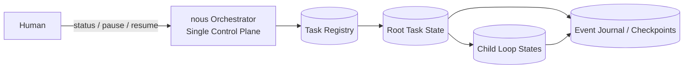
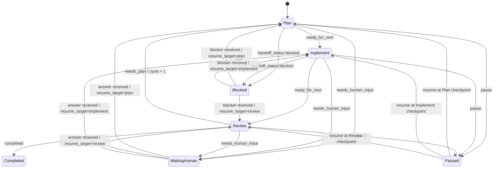
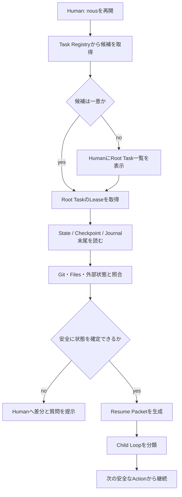
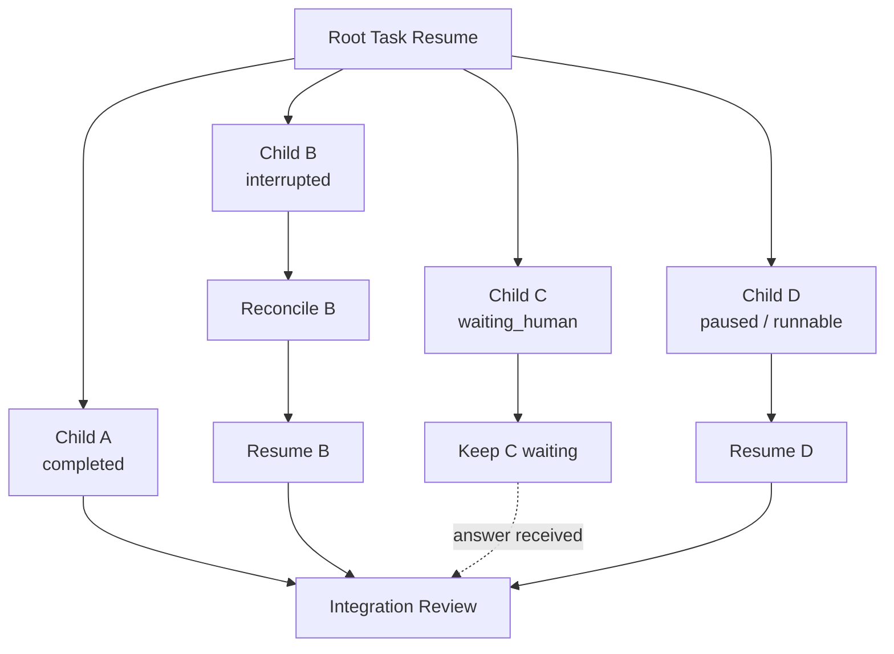

# Task State and Recovery Design

## 目的

nousが単一ループ・並列Child Loopの現在状態を永続化し、次を満たせるようにする。

- Plan / Implement / Reviewのどこにいるかを判定できる
- Reviewから自律的にPlanへ戻れる
- 意図的な中断と予期しない終了のどちらからも再開できる
- Humanは並列Child Loopの詳細を追わず、1つの窓口から状況確認・停止・再開できる
- 再開時に古いPlanや会話履歴を現在の指示として誤認しない

本設計は、**Finite State Machine**、**Checkpointing**、**Append-only Journal**、**Lease**、**Idempotency**を中核概念とする。

Actionの分類、approval、probe、reconcileは[Action Policy](./action-policy.md)を正とする。StateとJournalはそのdecisionとevidenceを復旧可能な形で保持する。

## 単一の操作窓口

Humanが操作する窓口は、個々のPhase AgentやChild Loopではなく、常にnous Orchestratorとする。

Orchestratorは全Root Taskを参照できるTask Registryを持ち、次の操作を提供する。

```txt
status                         # 再開可能なRoot Taskと全体状態を表示する
pause <task_id>                # 安全なcheckpointで停止する
resume <task_id>               # 状態を復元して継続する
resume                         # 再開候補が1件ならそれを継続し、複数なら一覧を示す
cancel <task_id>               # 明示的に終了する
```

これらは論理的な操作契約であり、CLI、Codex Skill、自然言語UIなどの具体的な実現方式には依存しない。



Humanは「どのChild Loopのセッションを開き直すか」を判断しない。OrchestratorがRoot Taskから子状態を集約し、再開対象を決定する。

## TaskとLoopの識別子

### Root Task

`task_id` は作成後に変更しない。

```txt
YYYYMMDD-HHmm-{slug}
```

同一分・同一slugが重なる場合は短い連番を付ける。

```txt
20260718-1430-design-resume
20260718-1430-design-resume-02
```

ディレクトリ名や表示名が変わっても、内部参照では作成時の`task_id`を維持する。

### Child Loop

Child LoopはRoot Taskとは別のトップレベルタスクにせず、Root Task配下の実行単位とする。

```txt
root_task_id: 20260718-1430-example
loop_id: root

root_task_id: 20260718-1430-example
loop_id: L01-api
parent_loop_id: root
```

`loop_id`も作成後に変更しない。表示名は変更できる。

## 状態の分離

「タスクが完了したか」と「実行プロセスが動いているか」を同じstatusで表現しない。

### Lifecycle Status

タスクまたはLoopの意味上の状態を表す。

```txt
active
waiting_human
blocked
completed
cancelled
```

| 状態 | 意味 |
| --- | --- |
| `active` | 自律実行できる作業がある |
| `waiting_human` | Humanの回答または承認がなければ進められない |
| `blocked` | 外部障害や前提未成立により進められない |
| `completed` | completion authorityに従うcanonical Review Decisionをtaskctlが検証し、受け入れ条件を満たしたと確定した |
| `cancelled` | Humanまたは上位Orchestratorが中止した |

### Execution Status

ワーカーやセッションの実行状態を表す。

```txt
idle
running
pausing
paused
interrupted
```

| 状態 | 意味 |
| --- | --- |
| `idle` | 実行可能だがワーカーが割り当てられていない |
| `running` | 有効なLeaseを持つワーカーが処理中 |
| `pausing` | 新規処理を止め、安全なcheckpointへ移行中 |
| `paused` | 意図的に安全な位置で停止済み |
| `interrupted` | Lease切れなどにより、処理中の実行主体が失われた |

たとえば、`lifecycle_status: active`かつ`execution_status: paused`は「未完了だが安全に一時停止している」ことを表す。

### PhaseとCycle

Core Phaseは次の3つに限定する。

```txt
plan
implement
review
```

Knowledge収集はPlan内の活動であり、第4のCore Phaseにはしない。Integration ReviewはReviewの実行種別として扱う。

```txt
phase_kind: standard | integration
```

- 通常のPlan / Implement / Reviewは`standard`を使う
- Root TaskのIntegration Reviewだけ`integration`を使う
- `phase_kind`は`phase`を置き換えず、Reviewの実行種別を補足する

`cycle`は各Loopごとに1から始める。Reviewが`needs_plan`を返してPlanへ戻るときに1増やす。

過去cycleのPlanは変更せず履歴として保持する。現在有効なPlanは、Task Stateが指す最新cycleのPlanだけである。過去Planを再利用する場合は、現行KnowledgeとReview結果に照らして再検証する。

## Reviewの判定

Reviewは次のいずれかを返す。

```txt
completed
needs_plan
needs_human_input
```

これはLifecycle Statusとは別の、Phase終了時の判定である。



Plan / Implementの`handoff_status: blocked`は`blocking_reasons[]`と解除条件を必須とし、phase / cycleを維持して影響Loopを`blocked`へ遷移させる。Gateway `deny`はAction開始前なら`action_started`を作らず、`action_denied`を保存する。代替手順で解消できる`deny`または`replan_required`はReview Decision `needs_plan`へ送るまでcycleを増やさない。`interrupt_for_approval`はApproval RequestとHumanQuestionを保存し、Questionの`resume_target`が示す同じphaseで待機する。

### Root completion authority

- materialized Child Loopが0件のRootは、`phase_kind: standard`のRoot Review `completed`だけをcompletion根拠にできる
- materialized Child Loopが1件以上のRootは、全必須Childがintegration-readyまたは明示的除外であり、`phase_kind: integration`のIntegration Reviewが`completed`の場合だけcompletion根拠にできる
- Child Review `completed`はChild Loopをintegration-readyにするだけでRootを完了しない
- Review AgentはDecisionを返すだけでStateを書かない。Orchestratorが遷移を要求し、taskctlがAcceptance Criteria、blocking issue、required validation、pending approval、topologyを検証して`completed`を確定する
- logical sequential fallbackでもChild Loopをmaterialize済みならIntegration Reviewを必要とする

## 永続化モデル

canonicalな複数file更新は完全なfilesystem atomicityを仮定せず、同じ`transaction_id`を持つrecoverable multi-file transactionとして扱う。

```txt
prepared
  -> canonical fileごとのatomic replace
  -> committed Event / transaction marker
  -> generated view / Registry / STATUSの再生成
```

State、Event、Checkpoint、artifact、approval / secret exception current stateの更新には`transaction_id`を関連付ける。prepared後に中断した場合はtransaction markerとEvent intentからroll-forwardまたは安全なrollbackを選び、generated viewの欠損だけでcanonical commitを失敗扱いにしない。

再開を会話履歴や生存中のサブエージェントに依存させない。各Root TaskとChild Loopは、次の3種類の永続情報を持つ。

### 1. Current State Snapshot

現在状態を短時間で理解するための構造化snapshot。

```txt
schema_version:
revision:
task_id:
root_task_id:
loop_id:
parent_loop_id:
lifecycle_status:
execution_status:
visibility:
phase:
phase_kind:
cycle:
current_action:
active_plan_ref:
active_parallelization_plan_ref:
active_implement_ref:
active_contract_ref:
latest_review_result_ref:
latest_review_decision_ref:
latest_checkpoint_ref:
pending_human_questions:
active_approval_refs:
pending_approval_request_refs:
active_secret_exception_refs:
blocking_reasons:
child_loops:
run_id:
lease_expires_at:
sync_status:
target_artifact_durability:
updated_at:
```

`revision`は更新ごとに増やし、古いワーカーによる上書きを防ぐ。

`visibility`は`visible | archived`を取り、Lifecycle Statusと分離する。`sync_status`は`clean | uncommitted | push_pending | conflicted | unavailable`を取り、Taskの意味上の完了状態へ影響させない。

`visibility`と`sync_status`はRoot Taskの集約fieldとする。Child LoopはRoot Taskのvisibilityを継承し、独立してarchiveしない。Child Loop固有のworktreeやbranch状態はCheckpointとChild集約情報へ記録し、Rootの`sync_status`へ集約する。

`active_approval_refs`はcanonical `approvals.json`内で現在利用可能なapprovalへのcache参照である。`pending_approval_request_refs`は`status: requested`の未回答requestを指す。実行可否は参照だけで決めず、action-start時にapproval recordのstatus、mode、scope、期限、Plan ref/content hash、Action Descriptor identity / digestまたはstanding constraint、remaining countを再検証する。`active_secret_exception_refs`も同様に専用storeの有効recordへのcacheであり、検出回避の根拠をStateだけから推測しない。

Phase artifact refの規則:

- `active_plan_ref`は現在Cycleで確定した`01-plan-result.json`を指す
- `active_parallelization_plan_ref`は現在Planに並列化契約がある場合だけ`01-parallelization-plan.json`を指す
- `active_implement_ref`は現在Cycleで確定した`02-implement-result.json`を指す
- Child Stateの`active_contract_ref`は`${NOUS_HOME}/tasks/{task_id}/loops/{loop_id}/contracts/rev-{revision:04d}.json`にあるimmutable revisionを指し、generated `contract.json`を指さない
- `latest_review_result_ref`と`latest_review_decision_ref`は最後に確定した同じrecoverable transactionのReview artifactを指す
- Review `needs_plan`でCycleを増やすとき、前CycleのPlan / Parallel / Implement refをactive refとして引き継がない
- refはartifact ID、relative path、content hash、確定revisionを持ち、pathだけで解決しない

### Target Artifact Durability

Task記録のdurabilityとtarget repository成果物のdurabilityを分離する。Root Stateは必須成果物のうち最も弱い状態を`target_artifact_durability`へ集約し、Checkpointはartifactごとの状態とevidenceを持つ。

```txt
none
dirty_worktree_only
patch_exported
local_commit
remote_pushed
external_backup
```

| 状態 | 契約 |
| --- | --- |
| `none` | target成果物がない、またはまだ作成されていない |
| `dirty_worktree_only` | 未commit変更が1 machineのworktreeにだけある |
| `patch_exported` | base commit、patch hash、保存locatorが記録され、patchから復元できる |
| `local_commit` | repository identity、branch、commit、parentが記録され、local objectを確認済み |
| `remote_pushed` | exact remote / refが記録commitを指すことをpostcheck済み |
| `external_backup` | provider、immutable locator、artifact hash、base ref、復元手順を確認済み |

`remote_pushed`と`external_backup`だけを別machineから復旧可能なdurable stateとする。`patch_exported`はpatchの保存先自体が別machineから取得できる場合に限り、Checkpointへその可用性を明示する。Phase確定、pause、cancel、session終了時に状態をprobeし、`dirty_worktree_only`ならgenerated status / resume viewへ警告を出す。target repository pushは固有approvalなしにdurabilityを上げるため実行しない。

### Terminalと再開

- `paused`と`interrupted`はExecution Statusであり、同じTaskをresumeする
- `blocked`はblocker解消後に`active`へ戻せる
- `cancelled`はHumanの明示指示、同一Objective、新cycleのPlanを条件に`active`へ戻せる
- `completed`は同じTaskとして再開せず、follow-up Taskを作る

### 2. Append-only Event Journal

状態変更や副作用の開始・完了を追記形式で記録する。

```txt
event_id:
task_id:
loop_id:
run_id:
revision:
transaction_id:
occurred_at:
event_type:
action_id:
summary:
artifact_refs:
actor_identity:
action_type:
action_digest:
policy_outcome:
gateway_outcome:
policy_decision_ref:
execution_grant_ref:
approval_ref:
before_probe_ref:
after_probe_ref:
reconcile_evidence_ref:
secret_exception_ref:
redaction_summary:
```

Action以外のEventではAction専用fieldを省略できる。canonical mutationに属するEventは`transaction_id`を必須とする。`action_started`は`action_type`、`action_digest`、`policy_outcome`、`gateway_outcome`、`policy_decision_ref`、`actor_identity`、`before_probe_ref`を必須とし、承認が必要な場合は`approval_ref`、Grantを使う場合は`execution_grant_ref`も必須とする。`action_completed`は成功を示す`after_probe_ref`、`action_failed`と`reconciliation_required`は失敗・曖昧性を示すevidence refを必須とする。`action_reconciled`はAction Policyに適合するReconcile Evidenceを`reconcile_evidence_ref`で参照する。probe本文、secret、credential付きURLはEventへ直接埋めない。

代表的な`event_type`:

```txt
task_created
phase_started
phase_completed
action_started
action_completed
action_failed
reconciliation_required
action_reconciled
policy_decided
action_denied
execution_grant_issued
execution_grant_revoked
policy_violation
checkpoint_saved
human_input_requested
human_input_received
approval_requested
approval_granted
approval_denied
approval_revoked
approval_expired
approval_consumed
child_loop_created
child_loop_completed
task_blocked
task_unblocked
pause_requested
paused
resumed
execution_interrupted
review_decided
task_completed
task_cancelled
```

Gateway audit Eventの最低条件:

| event_type | 必須参照 |
| --- | --- |
| `policy_decided` | Policy Decision、Action identity / digest、outcome |
| `action_denied` | denyしたPolicy Decision、reason code。`action_started`は存在してはならない |
| `execution_grant_issued` | single-use Grant、Action identity / digest、scope、expiry |
| `execution_grant_revoked` | Grant、revoke reason、影響Action |
| `policy_violation` | Grantまたはdeny decision、violation evidence、影響resource |
| `action_reconciled` | original Action、typed Reconcile Evidence、normalized outcome |
| `task_blocked` / `task_unblocked` | blocking reason refs、解除条件または解除evidence |

Journalは監査と復旧に使う。通常のPhase Agentが全件を読むことはなく、Orchestratorが必要範囲をResume Packetへ要約する。

### 3. Checkpoint

再開に必要な最小情報を、意味のある作業単位ごとに保存する。

```txt
checkpoint_id:
state_revision:
phase:
cycle:
completed_actions:
in_progress_action:
next_safe_action:
artifacts:
decisions:
open_questions:
working_context:
validation_state:
child_loop_summary:
active_contract_ref:
active_approval_refs:
pending_approval_request_refs:
active_secret_exception_refs:
blocking_reasons:
target_artifacts:
target_artifact_durability:
```

`working_context`には、対象リポジトリ、branch、worktree、基準commit、作業ツリーの状態など、再開時に実環境と照合できる情報を含める。

`target_artifacts`はartifact ID、repository identity、base / current ref、changed pathまたはartifact locator、durability state、probe evidence refを持つ。secretを含むpatchやartifactはexport、commit、pushせずblockする。

## Checkpointを保存するタイミング

以下のタイミングではcheckpointを更新する。

- Phaseの開始前と終了後
- 外部副作用を伴う操作の開始前と完了後
- ファイル変更など、意味のある原子的作業が完了した後
- Child Loopの生成、停止、完了時
- Humanへの質問を出す直前
- pause要求を受け、安全な停止位置に到達した時
- Integration Reviewの開始前と判定後

長いPhaseの最後にだけ保存する設計にはしない。

## 副作用とIdempotency

ファイル変更、commit、push、API呼び出しなどは、途中終了すると「実行されたが完了記録がない」状態になり得る。

各副作用には`action_id`を付け、次の順序で扱う。

```txt
1. action_type、target、action digest、expected effectを確定する
2. Secret GateとPolicy Gatewayでpolicy decisionを得る
3. required preflightを実行し、before evidenceを保存する
4. 必要なapprovalのscope、期限、revision、hash、countを照合する
5. approval_consumedとaction_startedを同じ`transaction_id`のrecoverable multi-file transactionで記録する
6. 副作用を実行する
7. action type固有のpostcheckで実環境を確認する
8. action_completed / action_failedとafter evidenceを記録する
9. State SnapshotとCheckpointを更新する
```

approval不要のActionでは手順4と`approval_consumed`だけを省略する。policy decisionとbefore / after evidenceは省略しない。同一`action_id`のreconcile / retryはapprovalを二重consumeしない。

再開時に`action_started`だけが存在する場合、同じ操作を即座に再実行しない。Git、ファイル、外部APIなどの実状態を確認し、次のいずれかを判断する。

- すでに完了しているため、完了記録だけ補う
- 未実行なので、安全に再実行する
- 部分的に実行されているため、修復Planへ戻す
- 判定や再実行が危険なので、Humanへ確認する

各`action_type`は`pre_probe`、`idempotency_key_location`、`success_probe`、`partial_state_patterns`、`safe_retry_condition`、`compensation_strategy`、`human_fallback_condition`を持つ。`not_started_safe_to_retry`かつapprovalが現在も有効な場合だけ同じActionをretryできる。外部message、paid API、push、deployなどでprovider ID、remote ref、receiptを確認できない場合は自動再実行しない。

Reconcile Evidenceのcanonical field、条件付き必須条件、outcome enumは[Action Policy](action-policy.md)のProbe Evidence Contractを唯一のauthorityとする。本書は別payloadを定義せず、同じEvidenceへの参照だけをState / Eventへ保存する。

`action_reconciled` EventはこのEvidenceを参照し、Action Policyが定義したoutcomeを次のState遷移へ写像する。

| reconcile outcome | canonical transition |
| --- | --- |
| `completed_verified` | `action_reconciled`後に不足していた`action_completed`を補い、同じphaseの次のsafe actionへ進む |
| `not_started_safe_to_retry` | phase / cycleを維持し、Actionをretryableとして保存する。Policy、Grant、approval、resource versionを再検証してから同じAction IDでretryする |
| `partial_requires_repair` | repair evidenceをReview入力へ渡す。Review Decision `needs_plan`が確定するまでcycleを増やさず、unsafeな部分状態ならLoopを`blocked`にする |
| `ambiguous_requires_human` | HumanQuestionを保存し、影響Loopを`waiting_human`へ遷移する。Questionの`resume_target`から再開する |

outcomeは`pass | fail | ambiguous`だけのprobe resultから推測せず、専用fieldへ保存する。

## Approval State

Approval RequestとApprovalのcanonical current stateは`${NOUS_HOME}/tasks/{task_id}/approvals.json`へ保存し、taskctlだけが更新する。record field、`requested | active | denied | revoked | expired | exhausted`のstatus、immutable request snapshot、matchingは[Action Policy](action-policy.md)を唯一のauthorityとし、本書では再定義しない。

HumanQuestionは`approval_request_ref`と`resume_target`を必須にし、再開時にEvent履歴から承認待ちActionを推測しない。Stateの`pending_approval_request_refs`は`requested`だけを、`active_approval_refs`は利用可能な`active`だけを指す。

Approval lifecycleは次のEventに固定する。

```txt
approval_requested
approval_granted
approval_denied
approval_revoked
approval_expired
approval_consumed
```

`expires_at`を過ぎたapprovalは`approval_expired` Eventの有無にかかわらず無効である。taskctlは次のmutating operationまたはresume preparationでEventを一度だけ補う。denyはrecordを削除せず`status: denied`として保持し、revoke / expire / exhaustedは新しいActionへの利用を禁止する。開始済みActionは完了扱いにせず、action type固有のprobeでreconcileする。

## Persistence Secret Gate

State、Event、Checkpoint、approval、probe evidence、Human入力、Phase artifact、generated viewの全候補はcanonical storeへ書く前にSecret Gateを通す。

- 高信頼secretを含むwriteは拒否し、値を除いたredaction summaryだけを別Eventへ記録する
- 意味を保てるsecret-like値は`[REDACTED:<kind>]`へ置換してからSchema検証する
- 元の値、可逆表現、値のhashをJournalやdiagnostic backupへ残さない
- false positive exceptionはHuman承認、detector / pattern ID、repository / Task scope、有効期限へ限定し、`${NOUS_HOME}/tasks/{task_id}/secret-exceptions.json`へ保存する
- secret検査前のtemporary fileをcanonical filesystemへ作らない

Secret Exception recordのfield、ID、status、保存形式は[Task Files Design](task-files.md)の`secret-exceptions.json`と`secret-exceptions.schema.json`を唯一のauthorityとし、本書では再定義しない。

- 検出した値、可逆表現、値hash、credential本文は保存しない
- Human承認を経て`status: active`になったexceptionだけを適用する
- private key、既知provider token、credential fileなどhigh-confidence hard blockは例外不可とする
- scope外、期限切れ、detector / pattern不一致では適用せず、適用したAction Eventは`secret_exception_ref`を持つ
- Policy Overlayはbase secret policyを緩和するstoreとして使わない

## Leaseと予期しない終了

各実行主体は`run_id`と期限付きLeaseを持つ。

- 実行中はLeaseを定期更新する
- Leaseが有効な間は、別のOrchestratorやワーカーが同じLoopを実行しない
- `running`のままLeaseが失効したLoopは`interrupted`として扱う
- 再開時は新しい`run_id`を発行し、古い実行主体からの更新を拒否する

これにより、画面やターミナルを急に閉じた場合でも、永久に`running`として残らず、安全に回収できる。

## 意図的なPause

pause要求を受けたOrchestratorは次の順序で停止する。

1. Root Taskを`pausing`にする
2. 新しいPhaseとChild Loopを開始しない
3. 実行中Child Loopへcheckpoint要求を送る
4. 原子的な処理の途中なら、安全な境界まで完了またはrollbackする
5. 各Child Loopの`next_safe_action`を保存する
6. Root Taskの集約checkpointを保存する
7. `paused`へ遷移する

即時終了が必要な場合はプロセスを閉じてもよい。その場合はLease失効後に`interrupted`として、予期しない終了と同じ復旧手順を使う。

## Resume Packet

Orchestratorは再開時に全ログをPhase Agentへ渡さず、Current State、Checkpoint、実環境の照合結果からResume Packetを生成する。

```txt
task_id:
objective:
resume_reason:
state_revision:
phase:
cycle:
lifecycle_status:
last_completed_action:
interrupted_or_pending_action:
next_safe_action:
active_plan_ref:
active_parallelization_plan_ref:
active_implement_ref:
active_contract_ref:
latest_review_result_ref:
latest_review_decision_ref:
active_approval_refs:
pending_approval_request_refs:
active_secret_exception_refs:
stable_context_refs:
changed_artifacts:
target_artifact_durability:
validation_state:
open_questions:
runnable_child_loops:
waiting_child_loops:
blocked_child_loops:
blocking_reasons:
reconciliation_notes:
```

Phase AgentはこのPacketと参照先を主入力にする。過去の会話履歴、古いPlan、Journal全件はデフォルト入力にしない。

## 再開手順



再開処理の原則:

- Phase全体を無条件に最初からやり直さない
- 完了済みActionは再実行しない
- 実行途中だったActionは実環境を照合する
- 安全に確定できなければHumanへ聞く
- 再開後も同じ受け入れ条件と有効なPlanを維持する

## 並列Child Loopの再開

Root Taskのcheckpointは、全Child Loopを次の集合に分類する。

```txt
runnable
running_with_valid_lease
paused
interrupted
waiting_human
blocked
completed
cancelled
```

再開時の扱い:

- `completed`は再実行しない
- `running_with_valid_lease`は重複起動しない
- `interrupted`は個別にreconcileしてから再開する
- `paused`は依存関係を満たすものから再開する
- `waiting_human`に依存しないChild Loopは継続できる
- すべての実行可能Child Loopが停止している場合だけ、Root Taskを`waiting_human`または`blocked`として扱う
- Child Loopの結果は、Integration Reviewを通過するまでRoot Task完了とはみなさない
- pending Approval Requestは`approvals.json`とQuestionの`approval_request_ref` / `resume_target`から復元し、Eventだけから推測しない



## Root Taskの集約状態

Root Taskの状態は、単純に最も悪いChild Loopの状態へ合わせない。

- 実行可能なChild Loopが1つでもあれば`active`
- 実行可能なChild Loopがなく、Human回答待ちだけが残れば`waiting_human`
- 実行可能なChild Loopがなく、外部blockerだけが残れば`blocked`
- materialized Child LoopがあるRootは、全必須Child Loopがintegration-readyまたは明示的除外で、Integration Review Decisionが`completed`の場合だけ`completed`
- materialized Child LoopがないRootはstandard Root Review Decisionが`completed`の場合だけ`completed`
- Root Taskがcancelされた場合、未完了Child Loopも新規実行を停止する

## 再開時のHuman確認

通常の中断・Lease切れだけを理由にHumanへ質問しない。次の場合のみ確認する。

- 外部副作用が完了したか判定できない
- 作業ツリーがcheckpoint以外の変更を含む
- 対象branchやworktreeが削除・置換されている
- Humanが中断中に要件や成果物を変更した可能性がある
- 同一Root Taskを別の実行主体が継続している
- 再実行が破壊的、課金、本番反映、外部公開につながる
- approvalが失効・撤回・消費済み、または`exact_action`のaction digest / target、`bounded_standing`のconstraintと一致しない
- target成果物が`dirty_worktree_only`であり、別machine復旧を必要とする

質問の形式、risk分類、blocking scope、pre-approvalの詳細は [Human Input Policy](./human-input-policy.md) で定義する。

## 不変条件

- OrchestratorをHuman向けの単一窓口とする
- セッションやサブエージェントの生存を進捗保存に使わない
- すべてのRoot TaskとChild Loopは永続的なStateを持つ
- 現在有効なPlanはTask Stateから一意に特定できる
- 過去PlanとJournalは履歴であり、現在の指示ではない
- 副作用は開始と完了を区別して記録する
- Action Eventにpolicy decisionとbefore / after evidenceを記録する
- pendingを含むapprovalの現在状態をcanonical storeで管理し、scope照合とconsumeをaction-startへ束縛する
- Gateway decision、deny、Grant発行 / revoke、policy violation、reconcileをcanonical Event enumで監査する
- 再開時は外部の実状態を照合する
- reconcile outcomeをtyped Evidenceと`action_reconciled` Eventへ保存し、completion / retry / repair / Human waitへ決定論的に写像する
- target成果物のdurabilityをTask記録と分けて明示する
- canonical persistence前にsecretを検出し、redactまたはblockする
- false-positive secret exceptionを専用storeへ保存し、値または値hashを永続化しない
- materialized Child Loopの有無に応じ、standard ReviewまたはIntegration ReviewだけをRoot completion根拠にする
- 安全に判断できない場合はHumanへ聞く

State、Journal、Checkpoint、Resume Packetの物理配置とfile形式は [Task Files Design](./task-files.md) で定義する。
