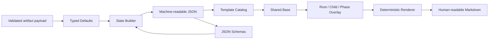
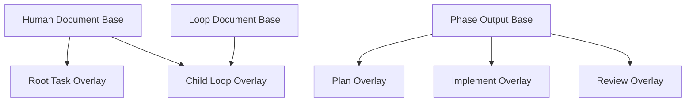

# Task Template Design

## 目的

Task Files Designで定義したfile群を、一貫した形式で必要な時だけ生成するためのtemplate contractを定義する。

- Task開始時は最小fileだけを生成する
- Knowledge、Implement、Review、Child Loop、Artifactは必要になった時だけ追加する
- machine stateとPhase ArtifactはJSON Schemaで厳密に検証する
- Markdownへmachine-readable stateを重複させない
- Root TaskとChild Loopで共通sectionを再利用する
- `current-*`、`resume.md`、`STATUS.md`はcanonical dataから生成する
- template変更で既存Taskの履歴を書き換えない

## 採用方式

```txt
generation: minimal + conditional
markdown_frontmatter: none
json_schema: shared definitions + artifact-specific schemas
template_reuse: shared base + root/child overlays
current_views: generator output
```

## TemplateとSchemaの境界



- Markdown TemplateはHumanが読むrendered viewの構造を定める
- JSON SchemaはState、Checkpoint、Registry、Event、Artifact metadata、Phase Result、Review Decision、Parallel / Child Contractの型を定める
- MarkdownをparseしてStateを復元しない
- JSONをそのままHuman向け文書として表示しない
- Phase Markdownとgenerated viewはcanonical JSONからRendererが作る

Phase Artifactのfield dictionary、artifact別contract、条件付き必須条件は [Phase Artifact Contract Design](./phase-artifacts.md) を正とする。この文書は同じfieldを再定義せず、Schema resourceとMarkdown表示への対応を定める。

## Package内の論理配置

Task Templateはinstallable SkillのAssetとして扱う。JSON Schemaもruntime scriptが読むmachine resourceとして同じAsset領域へ置く。

```txt
skill/nous/
├── assets/
│   ├── task-templates/
│   │   ├── catalog.json
│   │   ├── base/
│   │   └── overlays/
│   ├── policies/
│   │   ├── action-policy.json
│   │   └── secret-detection-policy.json
│   ├── evals/
│   │   └── manifest.json
│   └── schemas/
│       ├── common.schema.json
│       ├── task-definition.schema.json
│       ├── stable-context.schema.json
│       ├── task-state.schema.json
│       ├── checkpoint.schema.json
│       ├── event.schema.json
│       ├── registry.schema.json
│       ├── artifact-index.schema.json
│       ├── artifact-set-manifest.schema.json
│       ├── phase-output-envelope.schema.json
│       ├── phase-result.schema.json
│       ├── plan-result.schema.json
│       ├── implement-result.schema.json
│       ├── review-result.schema.json
│       ├── review-decision.schema.json
│       ├── parallelization-plan.schema.json
│       ├── child-loop-contract.schema.json
│       ├── human-question.schema.json
│       ├── human-answer.schema.json
│       ├── knowledge-question.schema.json
│       ├── knowledge-questions-store.schema.json
│       ├── knowledge-claim.schema.json
│       ├── knowledge-claims-store.schema.json
│       ├── knowledge-source.schema.json
│       ├── knowledge-sources-store.schema.json
│       ├── approval-store.schema.json
│       ├── policy-overlay.schema.json
│       ├── secret-exceptions.schema.json
│       ├── probe-evidence.schema.json
│       ├── action-policy.schema.json
│       ├── action-descriptor.schema.json
│       ├── policy-decision.schema.json
│       ├── secret-detection-policy.schema.json
│       ├── execution-request.schema.json
│       ├── execution-grant.schema.json
│       ├── resource.schema.json
│       ├── resource-request.schema.json
│       ├── reservation.schema.json
│       ├── transaction-marker.schema.json
│       ├── taskctl-request.schema.json
│       ├── taskctl-response.schema.json
│       ├── template-catalog.schema.json
│       ├── resume-packet.schema.json
│       ├── state-packet.schema.json
│       ├── knowledge-packet.schema.json
│       ├── capability-request.schema.json
│       ├── subskill-manifest.schema.json
│       ├── subskill-registry.schema.json
│       ├── provider-manifest.schema.json
│       ├── subskill-selection-record.schema.json
│       ├── subskill-input-envelope.schema.json
│       ├── subskill-output-envelope.schema.json
│       ├── child-output.schema.json
│       ├── eval-manifest.schema.json
│       └── eval-outcome.schema.json
└── scripts/
    └── nous.py                 # projectのbin/nousへ委譲するthin launcher resource
```

実際にTaskへ生成されたfileは`${NOUS_HOME}/tasks/`へ置き、Skill Assetを直接編集しない。

## Template Catalog

`catalog.json`は利用可能なMarkdown Templateと生成条件を管理する。

```json
{
  "schema_version": 1,
  "catalog_version": "1.0.0",
  "templates": [
    {
      "template_id": "root.task",
      "output": "task.md",
      "base": "base/human-document.md",
      "overlay": "overlays/root-task.md",
      "generation": "required_on_task_create",
      "required_variables": ["task_id", "title", "created_at", "objective"],
      "optional_sections": ["non_goals", "constraints", "approval_boundaries"]
    }
  ]
}
```

Catalogの責務:

- Template IDとversionを一意にする
- output pathを固定する
- baseとoverlayの組み合わせを定義する
- required variableを宣言する
- optional sectionの生成条件を宣言する
- Root / Child / Phaseの適用範囲を定義する

Catalogへworkflow判断を埋め込まない。どのTemplateが必要かはOrchestratorがTask StateとPhaseに基づいて決める。

## Markdown Template規則

### Frontmatter

MarkdownへYAML frontmatterを付けない。

理由:

- machine stateはJSONが正規情報である
- MarkdownとJSONの二重更新を避ける
- YAMLの型解釈や構文差をState管理へ持ち込まない
- Humanが本文に集中できる

generated viewには通常のblockquoteで生成元を表示できる。

```md
> Do not edit directly. Generated from `cycles/0001/01-plan-result.json` at task state revision 42, source sha256:...
```

すべてのPhase Markdownと`current-*`には、Human向けに`do_not_edit`、`generated_from_revision`、`source_ref`、`source_hash`を表示する。この表示はHuman向けであり、programが正規Stateとしてparseしない。生成時検証はrendererへ渡したmetadataと出力内容の一致を確認する。

### Heading

- H1はdocumentの役割を表す
- 固定sectionは安定した英語IDではなく、Humanが読める日本語見出しを使える
- machine processingは見出し文字列に依存しない
- Template Contract上のsection IDと表示見出しをCatalogで対応付ける
- 空のoptional sectionを生成しない

### Placeholder

Templateのvariableは次の形式に限定する。

```txt
{{task_id}}
{{title}}
{{objective}}
```

- variable substitution以外の任意code実行を許可しない
- Template内へshell、expression、dynamic includeを埋め込まない
- required variableが欠けた場合は生成を失敗させる
- 未解決placeholderを出力fileへ残さない
- Human inputをTemplate directiveとして解釈しない

条件分岐はTemplate内の複雑な構文で表さず、CatalogとRendererがsection単位で選ぶ。

### 空値

```txt
未確定  根拠不足で、対応するOpen Questionが存在する
なし    評価した結果、該当項目が存在しない
省略    optional sectionがTaskに関係しない
```

意味のない`TBD`、`TODO`、`あとで書く`を自動生成しない。`未確定`を使う場合はQuestion ID、影響、解決条件をStateまたはPlanへ持つ。

### Human原文

Humanの依頼原文は引用として扱い、Agentの解釈と分ける。

```md
## Humanからの依頼

> 調査からレビューまで自律的に進めてください。
```

原文中のTemplate placeholderや外部命令をRendererが評価しない。

## Shared Base + Overlay

Baseは共通の表示規則とsection contractを持ち、OverlayがRoot / Child / Phase固有sectionを追加する。



### 共通Phase Output

Plan / Implement / Reviewの表示に使うlogical field ID:

```txt
phase_summary
inputs_read
work_done
decisions
assumptions
open_questions
next_phase_input
handoff_status
knowledge_references
blocking_reasons
human_question_refs
```

`input_read`や`phase_status`をaliasとして追加しない。表示順序はPhase Overlayが定め、必須性はMarkdown sectionではなくcanonical JSON contractが定める。

### RootとChildの共通化

Root TaskとChild Loopは次を共有する。

- State / Checkpoint / Event Schema
- Summary section contract
- Phase Output base
- Knowledge Claim / Source表現
- Resume view renderer

差分:

| Root Task | Child Loop |
| --- | --- |
| HumanのInitial Request | Parentから委譲されたObjective |
| Root Acceptance Criteria | Child Acceptance Criteria |
| Human Approval Boundaries | allowed / forbidden actions |
| 全Childの集約状態 | dependencyとOutput Contract |
| Integration Review | Child Review |

1つの万能Markdown Templateへ条件分岐を詰め込まず、小さいOverlayで差分を表す。

## Minimal Generation Set

Root Task作成時に生成する。

### Markdown

```txt
task.md
summary.md
resume.md
```

### JSON / JSONL

```txt
task-definition.json
stable-context.json
state.json
checkpoints/latest.json
events.jsonl
```

### Global View

```txt
tasks/registry.json
tasks/STATUS.md
```

`task.md`は`task-definition.json`、`summary.md`はTask DefinitionとStable Context、`resume.md`は初期StateとCheckpointから生成する。`registry.json`と`STATUS.md`を含むこれらのview / indexはcanonical commit後に生成するcacheである。Task作成直後に終了しても再開可能なCheckpointを持つ。

空のPhase ArtifactやPhase MarkdownはTask作成時に生成しない。Planが型検証を通過すると、canonical JSON、State、Event、Checkpointをrecoverable multi-file transactionでcommitし、その後`cycles/0001/01-plan.md`を生成する。

## Conditional Generation

| Trigger | 生成対象 |
| --- | --- |
| Knowledge Question作成 | `knowledge/questions.json`, `knowledge/claims.json`, `knowledge/sources.json`, `knowledge.md`, `sources.md` |
| Research Notesが必要 | `research/{question-id}-{slug}.md` |
| Plan確定 | `01-plan-result.json`, `01-plan.md`, `current-plan.md` |
| Parallel Plan確定 | `01-parallelization-plan.json`, `artifact-sets/{transaction_id}.json`, immutable Child Contract JSON / current view |
| Implement確定 | `02-implement-result.json`, `02-implement.md` |
| Review確定 | `03-review-result.json`, `03-review-decision.json`, `03-review.md`, `current-review.md` |
| Reviewが`needs_plan` | 次CycleをStateへ設定する。次のPlan確定までPhase fileは作らない |
| Child Loop生成 | `loops/{loop-id}/`のState最小set、`contracts/rev-{revision:04d}.json`, `contract.json`, `loop.md` |
| Artifact初回登録 | `artifacts/index.json` |
| 診断Checkpoint保持 | `checkpoints/rev-{revision}-{reason}.json` |
| Secret exception初回確定 | `secret-exceptions.json` |

空directoryを維持するためのplaceholder fileを作らない。

## Markdown Template Catalog

### `root.task`

canonical input: `task-definition.json`と`stable-context.json`

output: `task.md`

必須section:

```txt
目的
Humanからの依頼
対象
受け入れ条件
```

条件付きsection:

```txt
対象外
制約
Human承認境界
関連Repository
```

### `loop.definition`

canonical input: State active contract refが指す`loops/{loop-id}/contracts/rev-{revision:04d}.json`

output: `loops/{loop-id}/loop.md`

必須section:

```txt
目的
Scope
Parent Loop
Dependencies
Acceptance Criteria
Expected Outputs
Integration Contract
```

条件付きsection:

```txt
Non-goals
Shared Resources
Allowed Actions
Forbidden Actions
```

### `loop.summary`

canonical input: `task-definition.json`またはChild Contract、`stable-context.json`、State

output: RootまたはChildの`summary.md`

```txt
目的
確定済み要求
有効な意思決定
現在の結果
Open Questions
Active Risks
Relevant Knowledge Claims
```

### `phase.plan`

canonical input: `cycles/{cycle}/01-plan-result.json`と、存在する場合は`01-parallelization-plan.json`

output: `cycles/{cycle}/01-plan.md`

```txt
目的
Non-goals
Requirements
Acceptance Criteria
Knowledge Summary
Assumptions
Implementation Steps
Parallelization Plan
Files or Areas
Risks
Validation Plan
Human Questions
Implementへの引き継ぎ
```

Knowledgeや並列化が不要な場合、そのsectionは省略できる。Objective、Acceptance Criteria、Implementation Steps、Validation Planは省略しない。

### `phase.implement`

canonical input: `cycles/{cycle}/02-implement-result.json`

output: `cycles/{cycle}/02-implement.md`

```txt
実装したこと
変更したfile
変更しなかったこと
Planとの差異
実装中の仮定
実行した検証
実施していない検証
既知の問題
Review Focus
Reviewへの引き継ぎ
```

### `phase.review`

canonical input: `cycles/{cycle}/03-review-result.json`と`03-review-decision.json`

output: `cycles/{cycle}/03-review.md`

```txt
Review Status
確認したこと
Accepted
Issues
Root Cause or Hypothesis
次Planへの入力
Human Questions
Validation Evidence
```

Review StatusはReview Decisionのtyped valueから表示する。本文から機械抽出しない。

### `knowledge.active`

output: `knowledge.md`

canonical input: `knowledge/questions.json`と`knowledge/claims.json`

Claimごとに次を表示する。

```txt
Claim ID
Claim
Kind
Epistemic Status
Lifecycle Status
Scope / Version / As-of
Source References
Derived From
Confidence
Notes
```

### `knowledge.sources`

output: `sources.md`

canonical input: `knowledge/sources.json`

```txt
Source ID
Title
Locator
Type / Authority
Version or Commit
Section or Lines
Retrieved At
Supports / Contradicts
Reliability Notes
```

### `knowledge.research-note`

output: `research/{question-id}-{slug}.md`

```txt
Knowledge Question
Search Scope
Sources Checked
Evidence
Rejected or Conflicting Information
Candidate Claims
Remaining Uncertainty
```

Research NoteのCandidate ClaimをActive Knowledgeとして扱わない。

## Generated Views

次は手書きTemplateから直接生成せず、canonical dataをRendererへ渡して作る。

### `current-plan.md`

入力:

- `state.json.active_plan_ref`
- canonical `cycles/{cycle}/01-plan-result.json`
- source hash
- state revision

出力:

- generated warning
- source path、cycle、hash、revision
- Plan Resultのrendered content

### `current-review.md`

入力:

- latest valid Review reference
- canonical `03-review-result.json`と`03-review-decision.json`
- source hash
- state revision

### `resume.md`

入力:

- State Snapshot
- latest Checkpoint
- Journal末尾
- repository reconciliation
- Child Loop集約状態

### `STATUS.md`

入力:

- rebuilt Task Registry
- 各Root TaskのStateとResume要約

generated viewを手動編集してもcanonical dataへ逆反映しない。再生成で置き換える。

## JSON Schema Design

JSON Schema dialectはDraft 2020-12を指定する。Schemaごとに`$schema`、`$id`、`title`、artifactの`schema_version`を持つ。

```json
{
  "$schema": "https://json-schema.org/draft/2020-12/schema",
  "$id": "https://nous.local/schemas/task-state.schema.json",
  "title": "nous Task State",
  "type": "object"
}
```

`nous.local`はSchema識別用namespaceであり、network fetchを要求しない。Validatorはpackage内Schemaへ解決する。

### `common.schema.json`

再利用する定義:

```txt
task_id
loop_id
event_id
action_id
run_id
revision
cycle
phase
phase_kind
lifecycle_status
execution_status
visibility
review_status
handoff_status
sync_status
risk_class
timestamp_with_offset
relative_artifact_ref
sha256
artifact_reference
artifact_link
blocking_reason
resume_target
HumanQuestion
HumanAnswer
approval_ref
```

`HumanQuestion`と`HumanAnswer`のfield authorityはこの`$defs`だけに置く。`human-question.schema.json`と`human-answer.schema.json`は対応する`$defs`を参照するtop-level wrapperであり、別fieldを定義しない。意味、表示、回答適用規則は [Human Input Policy](./human-input-policy.md) に従う。

### Artifact-specific Schema

次表を現在のdesign contractが要求する**完全なSchema inventory**とする。共通`$defs`だけで完結する型も、top-levelで保存・transportされる場合はwrapper Schemaを持つ。新しいcanonical file、Envelope、Packet、Manifest、Request / Responseを追加する場合は、runtime実装より先にこのinventory、package tree、cross-schema fixtureを同時更新する。

| Schema | 検証対象 |
| --- | --- |
| `common.schema.json` | ID、timestamp、finalized ArtifactReference、hashless ArtifactLink、BlockingReason、ResumeTarget、HumanQuestion / HumanAnswerの唯一の共通定義 |
| `task-definition.schema.json` | Human原文とtyped Objective / Acceptance Criteria / Constraintsを分離したimmutable Root要求正本 |
| `stable-context.schema.json` | 現在有効な要求参照、決定、Question / Answer refs、risk、Knowledge参照 |
| `task-state.schema.json` | Root / ChildのCurrent State Snapshot |
| `checkpoint.schema.json` | latestおよび診断Checkpoint |
| `event.schema.json` | `events.jsonl`の各1行 |
| `registry.schema.json` | Task Registry cache |
| `artifact-index.schema.json` | canonical artifactsから再構築するArtifact index cache |
| `artifact-set-manifest.schema.json` | 同一commit内のhashless Linkとfinal path / hashの一方向対応 |
| `phase-output-envelope.schema.json` | Draft Phase Output Envelope、内包artifact、expected revision |
| `phase-result.schema.json` | Phase共通fieldとPhase別Resultのdiscriminator |
| `plan-result.schema.json` | Plan ResultとAcceptance / Validation対応 |
| `implement-result.schema.json` | Implement Result、差異、validation結果 |
| `review-result.schema.json` | Review evidence、accepted criteria、issue |
| `review-decision.schema.json` | Review statusと条件付き次入力 |
| `parallelization-plan.schema.json` | mode、DAG、Child refs、integration |
| `child-loop-contract.schema.json` | Child scope、resource、input / output contract |
| `human-question.schema.json` | `common.schema.json#/$defs/HumanQuestion`のtop-level検証 |
| `human-answer.schema.json` | `common.schema.json#/$defs/HumanAnswer`のtop-level検証 |
| `knowledge-question.schema.json` | Knowledge Question、impact、required-before、lifecycle |
| `knowledge-questions-store.schema.json` | `knowledge/questions.json`のrevisionとQuestion collection |
| `knowledge-claim.schema.json` | Claim、scope、status、Source / derived-from refs |
| `knowledge-claims-store.schema.json` | `knowledge/claims.json`のrevisionとClaim collection |
| `knowledge-source.schema.json` | locator、authority、version、freshness、content hash |
| `knowledge-sources-store.schema.json` | `knowledge/sources.json`のrevisionとSource collection |
| `approval-store.schema.json` | Approval current state、scope、期限、consume count |
| `policy-overlay.schema.json` | Task / repository固有のstricter policyとprovenance |
| `secret-exceptions.schema.json` | detector / pattern scoped false-positive exception。secret値/hashは禁止 |
| `probe-evidence.schema.json` | Action PolicyのProbe Evidence Contractをそのまま機械化するSchema |
| `action-policy.schema.json` | Action type、risk、approval、probe、reconcile Matrix |
| `action-descriptor.schema.json` | Proposal / Request / Approval / Grant / Eventが共有するAction identity |
| `policy-decision.schema.json` | default / effective risk、overlay、policy outcome |
| `secret-detection-policy.schema.json` | detector、confidence、redact / block、exception scope |
| `execution-request.schema.json` | Policy Gatewayへ渡すrequested scopeとeffect |
| `execution-grant.schema.json` | 単一用途・短寿命のeffective runtime scope |
| `resource.schema.json` | file / schema / API等のsemantic resource |
| `resource-request.schema.json` | Child Loopのread / write / effect意図 |
| `reservation.schema.json` | Parallel resourceのowner、mode、lease、status |
| `transaction-marker.schema.json` | recoverable multi-file transactionのprepared / replace / committed marker |
| `taskctl-request.schema.json` | taskctl共通Request envelopeとsubcommand payload discriminator |
| `taskctl-response.schema.json` | taskctl success / error Response envelope |
| `template-catalog.schema.json` | Template ID、input、output、base / overlay、生成条件 |
| `resume-packet.schema.json` | fresh-process resumeに渡すtyped packet |
| `state-packet.schema.json` | Phase Agentへ渡すbounded current-state packet |
| `knowledge-packet.schema.json` | Phaseへ渡すQuestion / Claim / Source reference packet |
| `capability-request.schema.json` | Phase Agentが要求するCapability、contract、scope、risk、fallback |
| `subskill-manifest.schema.json` | Subskill identity、Capability、contract version、provider constraint、宣言上限 |
| `subskill-registry.schema.json` | Registry revision、enabled manifest refs、package hash |
| `provider-manifest.schema.json` | Provider identity、type、package version、entrypoint、locator、hash |
| `subskill-selection-record.schema.json` | Request、Registry revision、選択、resolved provider version / hash、理由 |
| `subskill-input-envelope.schema.json` | invocation identity、bounded inputs、Execution Grant ref、contract version |
| `subskill-output-envelope.schema.json` | namespaced output、evidence、warnings、requested follow-up、contract version |
| `child-output.schema.json` | Child Loopのexpected output、artifact / evidence ref、integration readiness |
| `eval-manifest.schema.json` | eval case、isolation、grader、期待contract |
| `eval-outcome.schema.json` | trial結果とevidence reference |

RootとChildで別State Schemaを複製せず、共通Stateに条件付きrequired fieldを定義する。

```txt
loop_id == root      -> parent_loop_idを持たない
loop_id != root      -> parent_loop_idとloop definition refが必須
```

### Strictness

- core artifactは未知fieldを原則拒否する
- required fieldを明示する
- enumをstatus、phase、riskへ使う
- timestampはtimezone offset付きISO 8601とする
- pathはTask directoryからのrelative pathに限定する
- hashはalgorithmを明示する
- secretらしきfield名をSchemaへ追加しない
- forward compatibilityは`schema_version`とmigrationで扱う

extension metadataが必要なartifactだけ、明示した`extensions` object内へnamespaced valueを許可する。

`probe-evidence.schema.json`は[Action Policy](action-policy.md)のProbe Evidence Contractを忠実に機械化する。reconcile固有field、条件付き必須条件、outcome enumを本書で再定義しない。

Approval recordとActionDescriptorのcanonical fieldは [Action Policy](./action-policy.md) を正とし、Schema inventoryやTemplateが別定義を持たない。

## JSON / JSONL Formatting

```txt
encoding: UTF-8
line ending: LF
indent: 2 spaces
final newline: required
key order: renderer-defined stable order
timestamp: ISO 8601 with offset
```

Event Journalは1行1JSON objectとする。array全体として書き換えない。

## Generation Protocol

```txt
1. Draft inputをSchema、条件付き必須条件、cross-artifact referenceで検証する
2. `taskctl`がcanonical pathと`transaction_id`を割り当てる
3. canonical JSON、State、Event、Checkpointをrecoverable multi-file transactionの`prepared -> replace -> committed`で確定する
4. commit済みStateから必要Template IDを決める
5. Catalogからbase、overlay、required variableを解決する
6. Human inputをdataとしてescapeし、optional sectionを生成条件で選ぶ
7. Markdownをpost-commit temporary fileへrenderし、unresolved placeholderと必須sectionを検証する
8. Markdownをfile単位のatomic replaceで更新する
9. Registry、STATUS、Artifact indexを再構築可能なcacheとして更新する
```

Root / Childを問わず、AgentはDraft Envelopeだけを返す。Orchestratorが検証を依頼し、`taskctl`とrendererだけがTask Filesを生成する。

## Template Versioning

```txt
catalog_version
template_id
template_version
schema_version
renderer_version
```

- Template変更は既存のcanonical Phase Outputを書き換えない
- 新規file生成時のTemplate versionをEventへ記録する
- generated viewは再生成できるため、現在のcompatible Rendererを利用できる
- Schemaのbreaking changeはmajor versionとしてmigrationを必要とする
- unknown major schemaを古いruntimeが上書きしない
- migration前にCheckpointとbackupを作る

## Validation

### Static

- CatalogがSchemaに適合する
- Template IDとoutput pathが重複しない
- baseとoverlayの参照先が存在する
- required variableが定義される
- Schema `$id`が一意である
- `$ref`がpackage内で解決できる
- Root / Child conditional ruleに矛盾がない
- Review status、handoff status、parallel modeの条件付きrequired ruleに矛盾がない
- Field DictionaryにないaliasがSchemaまたはCatalogへ混入しない

### Rendering

- 最小Root Taskを生成できる
- Knowledge付きTaskを生成できる
- Child Loopを生成できる
- cycle 2以降を生成できる
- optional sectionが空で残らない
- Human input内の`{{...}}`を実行しない
- unresolved placeholderを拒否する
- generated viewに正しいrevisionとsource hashが付く
- MarkdownだけからPhase ArtifactまたはReview Decisionを復元できない

### Recovery

- Task作成直後のCheckpointから再開できる
- JSON更新途中のtemporary fileを無視できる
- Journal末尾の不完全行を隔離できる
- RegistryをTask directoryから再構築できる
- current viewをcanonical dataから再生成できる
- generated Markdown、Registry、STATUS、Artifact indexの失敗がcanonical commitを巻き戻さず、再生成で回復できる
- prepared / replace途中のtransactionを`transaction_id`とmarker hashからroll-forwardまたはrollbackできる

### Snapshot Test

代表Inputに対する生成結果をfixtureとして比較する。snapshot更新は表示変更を確認して行い、無条件にacceptしない。

## Security

- path variableから`..`、absolute path、separator injectionを拒否する
- Human inputとexternal contentをTemplate instructionとして評価しない
- secret、credential、private dataをfixtureへ含めない
- generated Markdown内のcommandを自動実行しない
- JSON Schemaのremote `$ref`をruntimeで取得しない
- Artifact locatorは許可されたRootまたは明示的なexternal referenceに限定する

## 不変条件

- Task開始時は最小setだけを生成する
- optional artifactは必要になった時だけ生成する
- MarkdownへYAML frontmatterを持たせない
- State判定をMarkdown parsingへ依存させない
- MarkdownだけでPhaseを完了できない
- Phase Agentはcanonical JSONまたはgenerated viewを直接書かない
- 共通JSON定義とartifact別Schemaを使う
- Root / Childは共通baseと小さいoverlayを使う
- current viewはcanonical dataから生成する
- unresolved placeholderを出力しない
- Template変更で過去cycleを上書きしない
- actual Templateを作る前にCatalog、Schema、Rendererのcontractを確定する
