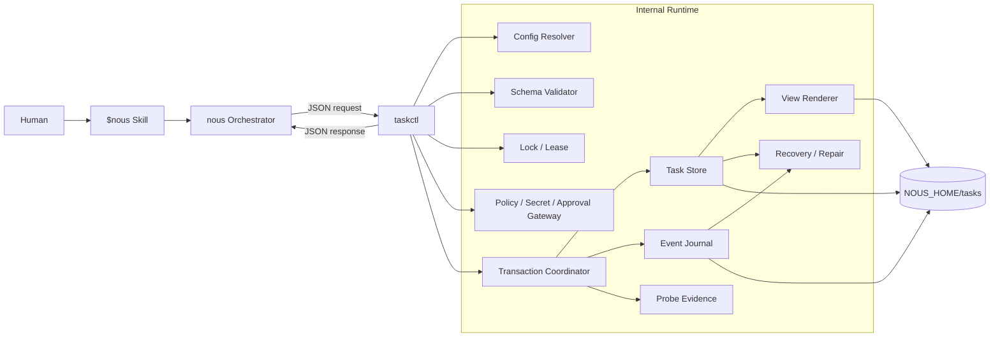
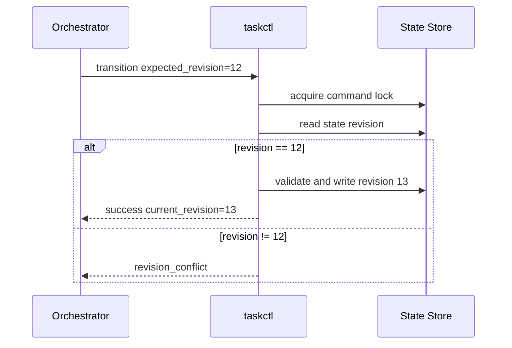

# taskctl Internal Utility Design

## 目的

Task State更新、Event追記、Checkpoint保存、Template生成、Registry再構築を、Agentによる自由なfile編集から分離して決定的に実行する。

- Humanは`$nous`と自然言語で操作する
- nous Orchestratorは1つのinternal command `taskctl`を利用する
- machine stateの変更をSchema、revision、lock、idempotencyで保護する
- commandは対話せず、JSONで結果を返す
- crash途中のtransactionを検出・復旧できる
- Skill packageからportableに呼び出せる
- Action Policy、approval、Secret Gate、probe evidenceをcanonical write境界で強制する

`taskctl`はOrchestratorではない。Plan、Implement、Review、Humanへの質問、Subskill選択を判断せず、渡されたoperation contractを安全に適用する。

## 採用方式

```txt
language: Python 3
schema_validation: jsonschema
command_shape: one entrypoint + subcommands
human_interface: $nous only
taskctl_interface: internal JSON protocol
```

## Architecture



## Package Structure

Humanから見えるcommandは1つにするが、実装を1fileへ詰め込まない。

```txt
agent-nous/
├── pyproject.toml
├── bin/
│   └── nous                         # project venvを解決するlauncher
├── src/
│   └── agent_nous/
│       └── taskctl/
│           ├── __init__.py
│           ├── cli.py
│           ├── config.py
│           ├── contracts.py
│           ├── errors.py
│           ├── ids.py
│           ├── locking.py
│           ├── schemas.py
│           ├── policy.py
│           ├── approvals.py
│           ├── secrets.py
│           ├── evidence.py
│           ├── store.py
│           ├── journal.py
│           ├── transactions.py
│           ├── rendering.py
│           ├── registry.py
│           ├── recovery.py
│           └── commands/
└── skill/nous/
    ├── scripts/                     # bin/nousを呼ぶ薄いSkill resourceだけ
    ├── assets/
    │   ├── schemas/
    │   └── task-templates/
    └── references/
```

taskctl実装の正本は`src/agent_nous/taskctl/`とする。`skill/nous/scripts/`はproject launcherを発見して呼ぶthin resourceに限定し、taskctl packageを複製しない。

## Runtime Requirements

```txt
Python: 3.11以上
Required library: jsonschema 4.x
Encoding: UTF-8
Platform baseline: Linux / POSIX-like filesystem
Filesystem baseline: local filesystem with durable file/directory fsync, atomic same-filesystem replace, atomic directory create
```

Python standard libraryで`argparse`、`json`、`pathlib`、`tempfile`、`os.replace`、`hashlib`、`datetime`、`uuid`を利用する。

Lockはprocess内mutexだけに依存せず、filesystem上のatomic createと期限付きLeaseを組み合わせる。Library versionは実体packageでlockし、system環境に偶然入っているversionだけへ依存しない。

NFS、SMB、FUSE上のcloud sync directory、object-storage mount、atomic replaceまたはdirectory `fsync`を保証しないfilesystemはcanonical Task Storeとしてunsupportedとする。`doctor`が保証を確認できない場合、mutating commandを許可しない。

## Human Interfaceとの境界

Humanは次のように依頼する。

```txt
$nous 新しいタスクを始めて
$nous 状態を見せて
$nous 安全な場所で止めて
$nous 前回のタスクを再開して
```

Skill / OrchestratorがHuman intentを解釈し、`taskctl` requestへ変換する。

`taskctl`は次を行わない。

- Humanへ直接質問する
- 推奨選択肢を決める
- LLMを呼ぶ
- Subskillを選ぶ
- PlanやReview本文を考える
- Git push、外部API、production操作を勝手に実行する

taskctlは外部Actionを実行しないが、[Action Policy](./action-policy.md)のversioned contractに従い、決定的なpolicy評価、approval scope照合、Secret Gate、probe evidence、Action lifecycleの保存を行う。riskやHuman intentを自由推論しない。

Humanが低level commandを直接覚えることを前提にしない。diagnostic時に開発者が手動実行しても同じJSON契約を使う。

## Invocation

```txt
bin/nous taskctl [global-options] <subcommand> [command-options]
```

Global options:

```txt
--nous-home PATH
--config PATH
--input PATH | -
--request-id ID
--expected-revision NUMBER
--dry-run
--pretty
--debug
```

- complex inputはJSON fileまたはstdinから受け取る
- secretをcommand line argumentへ渡さない
- `--pretty`はJSONのindentだけを変え、schemaを変えない
- `--debug`でもsecretやdocument本文全体をstderrへ出さない

## NOUS_HOME Resolution

```txt
1. --nous-home
2. NOUS_HOME environment variable
3. --configで指定したconfig
4. current projectの`.nous/config.json`または`nous.config.json`
5. ~/.config/nous/config.json
```

local project config例:

```json
{
  "schema_version": 1,
  "nous_home": "/path/to/agent-nous",
  "control_repository": "/path/to/control-repository"
}
```

Configへcredential、token、private remote URLを保存しない。解決後にpath scope、Task Schema、Template version、Control Repository identityを検証する。

Skill package、script、reference、fixtureへhost固有のabsolute defaultを埋め込まない。解決候補がない場合はcurrent working directoryやtarget repositoryへ暗黙fallbackせず、設定不足を返す。上記のabsolute pathはlocal configの例であり、配布packageへcopyしない。

## Request Envelope

```json
{
  "contract_version": 1,
  "request_id": "R-...",
  "command": "transition",
  "task_id": "20260719-1030-example",
  "loop_id": "root",
  "expected_revision": 12,
  "payload": {},
  "actor": {
    "type": "orchestrator",
    "run_id": "RUN-...",
    "actor_id": "orchestrator-session-ref"
  }
}
```

- mutating commandは`request_id`必須
- Stateを更新するcommandは`expected_revision`必須
- `actor`は追跡用であり、認証credentialではない。mutating commandでは`type`、`run_id`、`actor_id`を要求する
- unknown contract major versionを拒否する
- CLI flagとinput JSONが競合した場合はerrorにする
- raw Requestはmemory上でSecret Gateへ通し、検出前のpayloadをtemporary file、Event、stderrへ書かない

Public CLIのrequest envelopeは、Task mutationの外側にある`${NOUS_HOME}/requests/{request_id}.json`へ最小のrequest digestとresponseをdurableに記録する。同一`request_id`と同一payloadは保存済みresponseを再利用し、payloadまたはcommandが異なる再利用は`idempotency_conflict`として拒否する。`pending`のまま残ったrequestは完了済みと推測せず、reconcile対象として拒否する。Task内のState/Event/Checkpointのcanonical mutation自体は引き続きTaskStore transactionが正本であり、request ledgerはそれを置き換えない。

## Response Envelope

stdoutへJSON objectを1つだけ出力する。

```json
{
  "contract_version": 1,
  "ok": true,
  "command": "transition",
  "request_id": "R-...",
  "task_id": "20260719-1030-example",
  "loop_id": "root",
  "previous_revision": 12,
  "current_revision": 13,
  "result": {},
  "warnings": []
}
```

失敗時:

```json
{
  "contract_version": 1,
  "ok": false,
  "command": "transition",
  "request_id": "R-...",
  "error": {
    "code": "revision_conflict",
    "message": "Expected revision 12 but found 13",
    "retryable": false,
    "details": {}
  }
}
```

- stdoutへ説明文やprogress barを混ぜない
- diagnosticはstderrへ出す
- errorへsecretやSource本文を含めない
- partial writeの可能性があれば`recovery_required`を明示する

## Exit Codes

```txt
0   success
2   invalid command or arguments
3   contract or schema validation error
4   task / loop / artifact not found
5   revision or idempotency conflict
6   lock / lease conflict
7   unsafe operation or approval required
8   filesystem / I/O failure
9   recovery or repair required
10  incompatible runtime / schema version
11  internal unexpected error
```

Orchestratorはmessage文字列ではなくexit codeと`error.code`で分岐する。

## Command Surface

### Environment

```txt
doctor
init-home
```

`doctor`はPython、dependency、Schema、Template、NOUS_HOME、Control Repository、write permission、same-filesystem atomic replace、directory create atomicity、file / directory fsync、append / lock前提、unsupported network / cloud-sync filesystemでないことをread-only probeで確認する。

`init-home`はNOUS_HOMEの最小runtime directoryを初期化する。existing directoryを上書きせず、`--dry-run`を提供する。

### Discovery

```txt
list
show
status
parallel-ready
diagnose
repair-plan
```

- `list`: filter付きRegistry結果
- `list --include-archived`: archived Taskを明示的に含める。通常の一覧とSTATUSはarchived Taskを除外する
- `show`: 1 TaskのState / Resume summary
- `status`: Registry確認後にSTATUS viewを生成または返す
- `parallel-ready`: persisted child stateからready候補を返す。reservationやleaseは取得しない
- `diagnose`: canonical recovery signalsの安全な要約を返す
- `repair-plan`: diagnosisに基づく非破壊proposalを返す

read-only commandは長期Leaseを取得しないが、snapshot read中のrevision変化を検出する。

### Lifecycle

```txt
create
rename
duplicate
cancel
reopen
archive
unarchive
```

- `create`はtemporary directoryでMinimal Generation Setを完成・検証してからatomic renameする
- `create`は`task-definition.json`と`stable-context.json`をcanonicalに作り、`task.md`、`summary.md`、`resume.md`、Registry、STATUSをcommit後の生成cacheとして作る
- `duplicate`はfile copyではなくnew Task requestを生成する
- `reopen`はcompleted Taskをactiveへ戻さない

### State Machine

```txt
transition
record-phase-output
record-review
record-human-question
record-human-answer
record-task-amendment
record-stable-context
record-knowledge
```

`transition`は許可された遷移、expected revision、reason、triggering artifact refを検証する。Agentが遷移理由を決め、taskctlは契約適合だけを判断する。

`record-phase-output`はPlan / Implement / Review共通のcanonical write commandである。`record-review`はReview Envelopeを同じprimitiveへ渡す互換wrapperであり、独自transactionやMarkdown parsingを持たない。

#### `engine-run`

`engine-run`はTaskのcanonical stateを読み、別のPlan / Implement / Review Agentを順に起動する実行エンジンの入口である。Agentはtyped proposalだけを返し、leaseを持つ親Engineが`ManagedExecutor`と同じAction lifecycleで効果を実行・観測する。Reviewが`needs_plan`またはmanaged validation failureを返した場合は、cycle上限までPlanへ戻る。cycle上限、Agent failure、unsupported effect、Human gateは安全に停止し、taskctlのHumanQuestionまたはtyped errorとして保存する。

`engine-run`自体はTaskの状態遷移を自由に推測する新しいauthorityではない。Phase artifact、lease、Action、Evidence、Review Decisionの永続化は既存のTaskStore primitiveを通り、remote Git、network、credential、paid、destructive effectは引き続きfail-closedである。外部Agentを使う場合は`JsonCommandAgentBackend`がCodex sandboxでrepository read-only / scratch write-onlyとして起動する。

Human向けの設定解決は、明示的な`--engine-config`、project-localの`.nous/config.json`または`nous.config.json`、user configの順に行う。設定がある場合、`taskctl engine-run <task-id>`だけで実行でき、CLIがrequest ID / actorを生成する。`nous_home`を含む同じ設定をEngineとNOUS_HOME解決へ渡し、`--nous-home` / `NOUS_HOME`だけを明示的overrideとする。設定はagent commandとvalidation allowlistを一箇所へ集約するが、TaskStoreのcanonical request / Action policy / lease boundaryを置き換えない。

#### `record-phase-output`

inputは`phase-output-envelope.schema.json`に適合するDraft Phase Output Envelopeであり、処理順を次へ固定する。

```txt
Draft Envelope
  -> envelope schema validation
  -> artifact-specific schema validation
  -> handoff / review-status / parallel-mode conditional validation
  -> current State / expected revision / Loop ownership validation
  -> finalized input ref + Knowledge ref + HumanQuestion validation
  -> hashless forward ArtifactLinkへのcanonical path assignment
  -> non-cyclic hash graph + Artifact Set Manifest validation
  -> recoverable multi-file canonical commit
  -> post-commit view / Registry / index rebuild
```

canonical commitにはPhase JSON、Artifact Set Manifest、必要なHumanQuestion / Stable Context更新、State active ref、Event、Checkpointを含め、すべてへ同じ`transaction_id`を付ける。generated Markdown、Registry、STATUS、Artifact indexはcommit後cacheであり、生成失敗時はcommand responseにwarningとrebuild targetを返すがcanonical commitを失敗扱いにしない。

条件付き遷移:

- Plan / Implement `ready_for_next`: 許可された次Phaseへ遷移する
- Plan / Implement / Review `needs_human_input`: Questionを確定し、影響scopeだけを`waiting_human`にする
- Plan / Implement / Review `blocked`: `blocking_reasons[]`必須、lifecycleを`blocked`、phase / cycleを維持する
- Review `blocked`: Review Decisionを禁止する
- Review Decision `needs_plan`: 同commandだけがcycleを増加し、Planへ戻す
- Review Decision `completed`:必須validationとCriterion acceptanceを満たす場合だけ完了する

Policy Gatewayの`interrupt_for_approval`はAction PolicyのApproval requestとHumanQuestionを保存して影響scopeだけを待機させる。`deny`はAction failure / policy evidenceを記録し、続行不能な場合だけ`blocked`へ移す。`replan_required`はReview Decision `needs_plan`を経由し、GatewayやAgentが独自にcycleを増加させない。

`record-human-question`と`record-human-answer`はraw Human textを永続化前にSecret Gateへ通す。高信頼secretは本文保存を拒否し、approved secret provider refまたはredacted inputを要求する。

両commandは`common.schema.json`の唯一のHumanQuestion / HumanAnswer定義を使う。Question / Answerはimmutableな`human-input/questions/{question_id}.json`と`human-input/answers/{answer_id}.json`へcanonicalに保存し、`stable-context.json`と`state.json.pending_human_questions`はそのrefだけを持つ。AnswerはQuestion ID、回答形式、回答内容またはoption ID、回答者、回答時点、適用scope、`answer_effect`、Questionと同一の`resume_target`を持つ。taskctlはoption / free-text条件とresume target一致を検証し、回答後もblockerが残る場合は再開しない。詳細contractは [Human Input Policy](./human-input-policy.md) を正とする。

`record-task-amendment`はimmutableな`task-definition.json`を変更せず、Human回答またはReview Decisionへのprovenanceを持つtyped Objective / Acceptance Criterion amendmentをStable Contextへ追加する。`record-stable-context`はactive decisions、Question / Answer refs、Knowledge refs等のcurrent contextだけを更新する。`record-knowledge`は`knowledge/questions.json`、`knowledge/claims.json`、`knowledge/sources.json`の候補を各Schemaとcross-referenceで検証し、関係するstoreを1つのrecoverable multi-file transactionで確定する。いずれもMarkdownを入力正本として受理しない。

### Policy / Approval

```txt
policy-evaluate
approval-request
approval-grant
approval-deny
approval-revoke
approval-expire
approval-list
secret-exception-record
secret-exception-revoke
secret-exception-expire
secret-exception-list
```

Public CLIでは`approval-request` / `approval-grant` / `approval-deny` / `approval-revoke` / `approval-expire` / `approval-list`として提供する。ActionDescriptorはrequest envelope内のtyped `action` objectから復元し、TaskStoreがdigest、scope、Plan、質問、回答、期限を再検証する。Actionの実行開始・完了・reconcile自体は外部副作用を持つため、managed adapterのcanonical APIからのみ行う。
`policy-evaluate`はread-onlyで、同じtyped ActionDescriptorをPolicyGatewayへ渡し、risk / outcome / digest / constraintsだけを返す。評価結果自体をApprovalやAction開始の代替にはしない。
`action-start` / `action-complete` / `action-reconcile`はそれぞれTaskStoreのmanaged action boundaryへ接続する。CLIは対象repositoryや外部processを直接操作せず、preflight / postflight / reconcile evidenceをtyped objectとして受け取り、PolicyGatewayとsingle-use grantの検証結果だけをcanonicalに保存する。

- `policy-evaluate`は既知の`action_type`、repository / Task policy overlay、canonical ActionDescriptorの`action_digest`からdefault / effective riskと`policy_outcome`を返す
- unknown action type、unknown overlay、scope不明、required probe欠落は`block`を返す
- canonical approvalはRoot Taskの`approvals.json`へ保存し、`state.json.active_approval_refs[]`と整合させる
- Task / repository固有policyはprovenance付き`policy-overrides.json`へ正規化し、base policyを緩和するoverlayを拒否する
- Approval recordのcanonical field、mode別required、scope matching、consume、status transitionは [Action Policy](./action-policy.md) だけをauthorityとする。taskctlは同Schemaを検証し、独自fieldやaliasを追加しない
- expireは時刻到達時点で効力を失う。mutating commandと`resume-prepare`は未記録expiryを一度だけEvent化する
- denyはactive approvalを作らず、revoke / expire / exhaustedは新しいActionで参照できない
- Event名は`approval_requested`、`approval_granted`、`approval_denied`、`approval_revoked`、`approval_expired`、`approval_consumed`に固定する

初期契約にUsage Ledger、token集計、累積cost追跡commandは含めない。`paid_action: true`は常にRedとし、provider、operation、最大請求影響または1回当たり上限、max countへ束縛したapprovalを要求する。

Secret exception commandはHumanが確認したfalse positiveだけをRoot Taskの`secret-exceptions.json`へ保存する。record fieldとstatusは[Task Files Design](task-files.md)のSchemaをそのまま検証し、本書では再定義しない。元の値、値hash、可逆表現をRequest・store・Eventへ残さず、high-confidence hard blockはrecordを拒否する。Child LoopはRoot storeのscope付きrecordだけを参照する。

### Event / Action

```txt
append-event
action-start
action-complete
action-fail
action-reconcile
```

- Event IDを一意にする
- Actionのstart / complete対応を検証する
- completed Actionの同一requestを再実行しない
- unmatched startをrecovery対象として表示する
- generic `append-event`でActionまたはapproval Eventのrequired field検証を迂回できない

`action-start`は [Action Policy](./action-policy.md) のcanonical `ActionDescriptor`を参照し、`action_id` / `action_digest`の一致、`policy_outcome`、`gateway_outcome`、before probe ref、actor identityを要求する。approval必須Actionではapproval refも要求する。

taskctlはpolicy version、effective risk、overlay、Secret Gate結果、before evidenceの`pass`を検証する。canonical ApprovalとActionDescriptorの照合条件はAction Policyをそのまま適用し、`approval_consumed`、Approval store更新、`action_started`を同じrecoverable multi-file transactionで保存する。同じ`action_id`のreconcile / retryで二重consumeしない。

`action-complete`はsuccessを示すafter probe ref、`action-fail`はfailure evidenceを必須とする。`action-reconcile`は[Action Policy](action-policy.md)のProbe Evidence Contractに適合するreconcile evidenceだけを受理し、fieldとoutcome enumを本書で再定義しない。`action_reconciled` EventとState遷移は[Task State](task-state.md)のoutcome mappingを適用する。

Action type固有のsuccess probeなしに完了を受理せず、Action Policyがsafe retryと判定したoutcome以外をretry可能として返さない。

### Checkpoint / Execution

```txt
checkpoint
pause
resume-prepare
interrupt
```

`resume-prepare`はAgentを起動しない。State、Checkpoint、Journalをreconcileし、Resume Packet候補を返す。外部状態のsemantic判断が必要ならrequired probesをOrchestratorへ返す。

resume時にapprovalを再評価し、expired / revoked / exhausted / scope不一致をactive refから除外する。Target artifactごとに`none | dirty_worktree_only | patch_exported | local_commit | remote_pushed | external_backup`のprobe要求を返し、`dirty_worktree_only`はmachine-loss warningにする。

### Lease / Lock

```txt
lease-acquire
lease-renew
lease-release
lock-status
```

短時間command lockはsubcommand内部で自動取得し、Lease commandは長時間Phase workerのownershipを管理する。

### Parallel / Scheduler

Parallel操作もtaskctlのtyped request envelopeとTaskStore transactionを正本とする。Schedulerはin-memory stateを保持せず、ready childの候補をcanonical stateから読み、実行前にはpersisted reservationとchild leaseを取得する。`ParallelExecutionEngine`はこの操作面を使って最大3つのChild workerを物理起動するが、親revision・Action・Checkpointのcanonical commitは直列化し、workerがTask JSONを直接編集することは許可しない。Child leaseはheartbeatでrenewし、token mismatchをfencingする。Root Planがtyped `parallelization_plan`を返さない場合は、従来のsingle-loop engineを使う。

```txt
child-create
child-revise
parallel-plan
parallel-ready
worktree-bind
reservation-request
reservation-acquire
reservation-renew
reservation-release
reservation-recover
child-start
child-renew
child-release
child-recover
child-result
integration-review
git-durability-observe
git-durability-reconcile
```

`parallel-ready`はread-onlyで、`parallel-plan`はDAG・resource contract・knowledge referenceを検証してimmutable planを保存する。`worktree-bind`はcompleted managed local-Git actionとchild contractへ束縛し、`child-recover` / `reservation-recover`は期限切れをfresh processからcanonical eventとして回収する。remote Git pushや汎用外部修復はこのsurfaceに含めない。

### Rendering / Registry

```txt
render
rebuild-registry
validate
```

`render` target:

```txt
summary
resume
current-plan
current-review
status
```

generated viewからcanonical dataへ逆変換しない。

### Recovery / Migration

```txt
diagnose
repair-plan
repair-apply
migrate-plan
migrate-apply
```

- plan commandはread-only
- applyはplan hash、expected revision、request IDを要求する
- canonical file上書き前にdiagnostic backupを作る
- semantic ambiguityがあればapply planを生成せずHuman確認を要求する

v1のrecovery surfaceは次の境界を持つ。

- `diagnose`: canonical state、latest checkpoint、event要約、child、reservation、Action、Git durabilityを安全な相対refとstatusだけで返す。通常のTaskStore lockでtransaction markerを回収してから読む。
- `repair-plan`: `diagnose`結果から非破壊のtyped proposalと`plan_hash`を返す。`apply_supported`はv1では`false`で、Git conflictはreplan、Human questionはHuman回答、Action状態はexact reconcileへ送る。
- `repair-apply`: command surfaceは存在するが、推測によるcanonical file上書き・unknown file削除・remote repairを実行せず、`unsupported_action`でfail-closedする。将来追加する場合も、対象artifact、plan hash、expected revision、Human/Policy境界を個別に定義する。

## State Transition Validation

taskctlはState Machineをtableとして保持する。

```txt
from lifecycle / execution / phase
event or review decision
to lifecycle / execution / phase
cycle delta
required fields
```

例:

```txt
review + needs_plan
  lifecycle: active -> active
  execution: running -> idle
  phase: review -> plan
  cycle: +1
  required: next_plan_input
```

StateとEventを別々の自由操作にせず、`record-phase-output`のrecoverable multi-file transactionで整合更新する。

## Idempotency

mutating commandは`request_id`とpayload hashを記録する。Public CLIのrequest ledgerはrequest IDとpayload hashを保持し、同一requestのresponse replayと異なるpayloadの拒否を担当する。TaskStoreのcanonical event / transactionにはrequest IDを伝播し、request ledgerと同じmutation boundaryへ束縛する。

```txt
same request_id + same payload
  -> previous successful Responseを返す

same request_id + different payload
  -> idempotency_conflict
```

Action副作用は`action_id`も使う。taskctlがexternal side effectを実行しない場合でも、Orchestratorがstart / completeを記録できるようにする。

## Optimistic Concurrency

State更新は`expected_revision`を必須にする。



revision conflict時にlast writer winsを使わない。Orchestratorが最新Stateを読み、operationを再評価する。

## Lock and Lease

### Command Lock

- TaskまたはRegistry scopeごとにlock directoryをatomic createする
- owner metadataへrequest ID、run ID、created_atを記録する
- command完了時に解放する
- timeout時はexit code 6を返す
- lock fileをGit管理しない

### Worker Lease

長時間Phase実行ownershipとして`run_id`、owner、acquired / renewed / expires time、Task / Loop IDを持つ。

Lease expiryだけで進行中Actionを完了扱いにせず、Checkpointと実状態をreconcileして`interrupted`へ遷移する。

### Stale Lock

- transaction未開始: reclaim可能
- transaction途中: recovery required
- active process / valid Lease: reclaim禁止
- 別machine由来で判断不能: Humanまたはrepair planへ戻す

## Recoverable multi-file transaction protocol

複数fileを完全にatomic updateできないため、`transaction_id`付きmarker、prepared payload、Write-Ahead Eventを使う。用語は**recoverable multi-file transaction**に統一し、file単位のatomic replaceをmulti-file atomicityと呼ばない。

```txt
1. command lockを取得する
2. raw Requestをmemory上でSecret Gateへ通し、Request Contractとexpected revisionを検証する
3. policy decision、approval、preflight evidenceを検証する
4. `transaction_id`を発行し、全canonical target、previous hash、next hash、revisionを持つmarkerを`prepared`でdurableにする
5. intent Eventへ同じ`transaction_id`をappendしfsyncする
6. 全canonical payloadを同一filesystemのprepared temporary fileへ書き、Secret Gate、Schema、conditional、cross-reference、非循環hash graphを再検証する
7. temporary fileをflush / fsyncし、marker記載のdeterministic orderで各canonical targetへ`os.replace`してparent directoryをfsyncする。markerは`replace`へ進める
8. State、Approval / Stable Context等のcurrent store、Checkpoint、Eventを同じrevision / transaction IDへ揃える
9. completion Eventをappendしてfsyncし、markerを`committed`へ更新してparent directoryをfsyncする
10. committed markerを回収してlockを解放する
11. Markdown view、Registry、STATUS、Artifact indexをpost-commit cacheとして再生成する。失敗時はrebuild warningを残す
```

crash locationに応じてdiagnoseする。

```txt
prepared markerなし                         operation未開始
prepared / canonical hashがすべてprevious   safe retryまたはprepared file破棄
replace / canonical hashがmixed             prepared next payloadでroll-forward、不能ならbackupからrollback
全canonical hashがnext / committedなし      completion Eventとcommitted marker補完候補
committed / view・Registry・index旧          post-commit cache再生成
```

recoveryはmarkerの`transaction_id`、target list、previous / next hash、State / Event revisionを照合する。semantic ambiguityまたは外部Actionの副作用がある場合は自動commitせず、Action reconcileまたはrepair planへ送る。

## Atomic File Rules

- temporary fileはtargetと同じfilesystemへ作る
- snapshotは`write all → flush → fsync(temp fd) → os.replace(temp, target) → fsync(parent directory fd)`の順に更新する
- directory entryの新規作成、rename、削除後は、そのentryを持つparent directoryをfsyncする
- canonical fileをin-place truncateしない
- JSONをparse / Schema validationしてからreplaceする
- Event JSONLはTask command lock保持中に`O_APPEND`で開き、UTF-8 JSON 1 objectと終端改行を単一`os.write`でappendし、全byte書込を確認してfileをfsyncする
- Event 1行の上限は256 KiBとし、超えるevidence /本文はSecret Gate済みartifactへ分離してhash refだけをEventへ置く
- JSONL appendのatomicityを複数writer制御に使わず、Task command lockで単一writer化する
- 破損した末尾行は隔離し、黙って中間行を削除しない
- lock directoryは同一parent内のatomic `mkdir`成功をownership獲得条件とし、owner metadataとparent directoryをfsyncしてから利用する
- file / directory fsync、atomic same-filesystem replace、atomic lock directory createを確認できないfilesystemではmutating commandを拒否する

## Dry-run

すべてのmutating commandは`--dry-run`を受け付ける。

```txt
planned_files_created
planned_files_updated
planned_events
from_revision
to_revision
validation_warnings
policy_outcome
gateway_outcome
required_preflight
required_postcheck
required_approval
```

dry-runはState、Event、Checkpoint、Registryを変更しない。repair / migrationはplan commandとapply commandを分離し、applyにはplan hashが必要である。
dry-runはrequest ledgerも作成・更新しない。mutating envelopeのvalidationとrequest ID bindingは行うが、同じrequest IDの再送を成功responseとして保存しない。実際の適用時だけrequest ledgerとTaskStoreのcanonical mutationをcommitする。

## Validation

### Request

- command、Envelope、required payload
- path scope、expected revision、request ID
- Secret Gate、action type、ActionDescriptor、target normalization、action digest

### Existing State

- JSON Schema、Task IDとpath、active refs
- latest Checkpoint、Event sequence、parent / child relation
- Schema / Template compatibility

### Output

- JSON Schema、unresolved placeholder、relative path confinement
- hash、revision increment、EventとStateの整合
- approval current state、policy decision、before / after evidence ref、redaction summary

Remote JSON Schemaをnetwork取得せず、Skill package内Schemaだけを使う。

## Rendering

- YAML frontmatterを生成しない
- optional empty sectionを省略する
- Human inputをTemplate expressionとして評価しない
- generated warning、revision、source hashを付ける
- current viewをcanonical Stateとして扱わない
- unresolved placeholderがあれば失敗する

## Git Boundary

taskctlのinitial scopeではGit commit / pushを直接実行しない。

milestone結果として次をOrchestratorへ返せる。

```txt
validated_paths
excluded_paths
suggested_commit_message
state_revision
secret_scan_required
push_recommended
target_artifact_durability_probe_required
```

OrchestratorがTask Operations PolicyとStanding Pre-approvalに従ってGit操作を行う。Git操作をtaskctlへ追加する場合は別Capabilityとapproval boundaryとして設計する。

## Security

- `NOUS_HOME`外へのpath traversalを拒否する
- symlink解決後のpath scopeを確認する
- Task IDとLoop IDをsanitizeする
- input JSON内のcommand文字列をshell実行しない
- subprocessでshell interpolationを使わない
- Task request、Human回答、Phase artifact、Event、Checkpoint、approval、probe evidence、Response、generated viewを永続化前にSecret Gateへ通す
- high-confidence secretをEvent、Response、stderr、temporary file、diagnostic backupへ出さない
- redaction summaryへsecret値、可逆表現、値のhashを含めない
- outbound payloadのsecretをblockし、repository / Task固有のstricter policyを適用する
- remote Schema、Template、codeを自動取得しない
- repairでunknown fileを自動削除しない
- debug modeでもdocument本文全体をdumpしない
- file permissionを過度に緩めない

## Test Strategy

### Unit

- ID生成、Config resolution、Request / Response validation
- State transition、revision conflict、idempotency
- path confinement / symlink、Template、Schema、Event
- lock / lease expiry

### Integration

- `init-home → create → transition → checkpoint → pause → resume-prepare`
- Review `needs_plan`によるcycle increment
- Review `completed`によるTask完了
- Child Loop作成、Registry rebuild、STATUS render
- duplicate / cancel / reopen / archive
- repair plan / apply

### Fault Injection

```txt
intent Event前
intent Event後
temporary write途中
snapshot replace後
completion Event前
Registry更新前
generated view更新前
```

再実行またはdiagnoseで二重Event、revision飛び、canonical file消失が起きないことを確認する。

### Concurrency

- 同じTaskへの同時transition
- Registry rebuildとTask create
- Lease renewとpause
- stale lock recovery
- 異なるChild Loopの同時write
- ParentによるRoot view更新

### Security

- path traversal、absolute path、symlink escape
- malformed JSONL、oversized input
- Template placeholder injection
- secret-like contentのdiagnostic抑制
- persistence前secret block / redactionとfalse-positive exception scope
- outbound secret blockとstricter repository / Task policy
- unknown schema major version

### Policy / Approval / Reconcile

- unknown action typeのfail closed
- repository script初回inspection、定義変更後の再inspection、未知commandのRed化
- Action Policyが定めるApproval scope / lifecycle / count / action digest mismatch
- `approval_consumed`と`action_started`間のfault injection、同一action retryの非二重consume
- paid actionがUsage Ledgerなしでもapprovalなしに開始できないこと
- action_startedのみ残るGit、delete、external POST、paid APIのtype別reconcile
- policy decisionとbefore / after evidenceのEvent必須性

### Durability

- `fsync(file) → replace → fsync(parent directory)`各境界のfault injection
- JSONL 256 KiB上限、単一write、partial write検出、末尾破損隔離
- directory fsync失敗、cross-filesystem replace、unsupported NFS / cloud-sync filesystemのdoctor failure
- target artifact durability各stateのprobeと`dirty_worktree_only` warning

## Observability

Event Journalへcommand、request ID、actor identity、previous / current revision、duration、result code、changed artifact refsを記録する。Action Eventはpolicy decision、action type / hash、approval ref、before / after evidence ref、redaction summaryを契約に従って追加する。

secret、full Source、full conversation、credential付きURLを記録しない。stderr logはsession diagnosticであり、resume入力には使わない。

Provider / validationの失敗はTask-local `diagnostics.jsonl`へappend-onlyで保存する。各行は`runtime-diagnostic.schema.json`に適合し、category、phase、cycle、provider、action、JSON path、actual type、retryability、redacted stderr summaryを持つ。diagnosticは運用証拠であり、Task State revisionを消費しない。

`diagnose`はdiagnosticの本文を再生せず、直近50件、category別件数、safe message、canonical refだけを返す。validation postflightは別のevidence fileに`returncode`、実行時間、変更path、failure categoryを保持し、pytest cache等の許可副作用と予期しないsource変更を区別する。

## Versioning

```txt
taskctl_version
request_contract_version
response_contract_version
schema_version
template_catalog_version
```

- major version不一致は拒否する
- State migrationは`migrate-plan / migrate-apply`を使う
- active transaction中にruntime versionを切り替えない
- Eventへtaskctl versionとcontract versionを記録する

## Failure Policy

- validation errorでcanonical fileを変更しない
- revision conflictを自動上書きしない
- lock conflictを無限retryしない
- I/O failure後にsuccessを返さない
- partial transactionはexit code 9とrecovery metadataを返す
- unexpected exception後もtransaction markerを残す
- semantic recoveryをUtilityだけで推測しない
- unsupported filesystemではdurabilityを推測せずmutating commandを拒否する

## 不変条件

- Humanは`$nous`を使い、taskctlを覚える必要がない
- taskctlは1 entrypointとsubcommandで提供する
- taskctlはOrchestrator判断を行わない
- stdoutはmachine-readable JSONだけにする
- mutating commandはrequest IDとexpected revisionを持つ
- State updateはSchema、Lock、Idempotency、recoverable multi-file transactionで保護する
- current viewをcanonical Stateとして扱わない
- repairとmigrationをplan / applyへ分ける
- Git pushとexternal side effectをinitial taskctlへ含めない
- crash途中からdiagnose・recoveryできる
- unknown Actionはfail closedにし、Red / paid Actionをapprovalなしで開始記録しない
- approval consumeとAction startを同じrecoverable multi-file transactionで保存する
- canonical persistence前にsecretをredactまたはblockする
- Action Eventにpolicy decisionとbefore / after evidenceを残す
- POSIX durabilityはfile fsync、atomic replace、parent directory fsyncまでを含む
